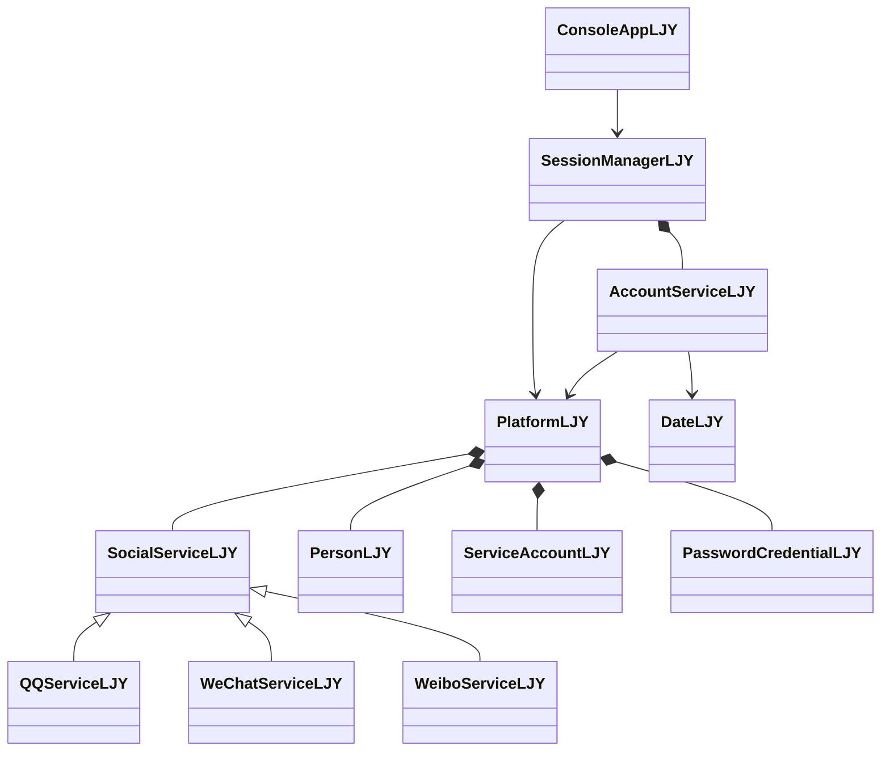

# P1 第 7 步验收报告

现状说明（2026-09-11）：下文保留 P1 当时的验收记录；密码模块随后简化为内存字符串比较，已移除 BCrypt。当前实现及回归结果见 [README 的课设简化说明](../README.md)。

日期：2026-09-10。结论：P1 顺序 1 至 7 的约定范围验收通过。P2 及后续阶段尚未实施，本结论不代表整个课程设计已完成。

验收顺序：先完成 [绑定与 Ctrl+C 两项独立验收](P1插入任务验收_绑定与CtrlC.md)，再复核课程原文、执行全部回归测试、验证实际菜单流程及源码组织，最后更新方案、清单和本报告。

## 1 对照课程原文

依据项目内 [课程要求 doc](2026-面向对象程序课程设计.doc) 只读提取的正文。文档是需求依据，其中提交报告等内容不视为当前提交授权，原始文件未修改。

| 原文条目 | P1 已完成内容 | 范围说明 |
| --- | --- | --- |
| 一、1 用户基本信息及账号关联 | 号码、用户昵称、生日、申请日期、注册年龄、所在地；QQ/微博共享号码，微信独立号码及本人绑定 | 好友和群列表留 P2 |
| 一、4 开通管理 | 可为同一人员开通 QQ、微信、微博，拒绝重复开通 | 现有三个服务是展示范围，新增服务需要扩展类型和派生类 |
| 一、5 登录管理 | 密码登录、其他已开通服务简单确认、取消、统一注销 | 登录不会隐式开通新服务 |
| 一、6 功能展示 | main 创建平台、会话、菜单；可演示账号与登录流程 | 文件初始化、好友和群特色展示留后续 |
| 二、2—4 类划分、封装、继承与多态 | 人员、账号、平台、业务、会话、菜单分层；SocialService 基类及三派生类 | 当前多态体现服务规则，群策略多态留 P2 |
| 二、5 数字菜单、返回、注释和独立类文件 | 数字菜单、返回、局部重输、操作暂停；普通简体中文 // 注释；LJY 后缀 | 12 个类和 4 个枚举已核对 |
| 一、2—3，二、5 的好友、群、动态切换和 I/O | 未实现 | P2 好友与群，P3 持久化 |
| TCP、可视化与数据库 | 未实现 | TCP 为选做，数据库等属于后续增强；P1 不依赖 MySQL |

课程将 T 龄联系到号码申请时间；按用户要求界面命名为“注册年龄”，数据保存申请日期，年龄按完整周年计算。

## 2 测试结果

| 验收项目 | 结果与证据 |
| --- | --- |
| CMake 构建 | 当前源码构建通过，未见编译警告；全部新增 cpp 显式纳入构建 |
| 账号、日期和多态 | p1_steps34，12/12 场景通过 |
| 会话、输入与菜单 | p1_steps56，15/15 场景通过 |
| 登录历史与绑定 | p1_binding_history，5/5 场景通过 |
| 实际可执行文件流程 | 4/4 脚本流程通过，使用真实 jlu_im.exe |
| 控制台与复制 | Ctrl+C 多位置原生测试、VS Code 选中文本复制实测通过 |
| 源码组织 | 12 类、4 枚举，均带 LJY 后缀；类具有独立 h/cpp，头文件包含接口说明 |

CTest 合计 3 个程序、32 组场景全部通过。见 [完整测试日志](P1验收记录/CTest完整日志.txt)。这里的场景组数量不等于其中的断言数量，新增生日边界等包含在原菜单测试组内。

已覆盖的关键边界：非法日期格式、年月日范围、闰年和未来日期；已有账号申请日期限制；8/20 字节密码边界与非法字符；重输时资料保留、取消和输入结束；重复开通、不存在的账号、跨人修改和绑定；首次认证失败、跨服务取消、统一注销、多人会话隔离；微信/QQ 分次登录及反向顺序。

实际菜单流程记录：

1. [QQ 开通三服务，注销后独立登录微信并绑定](P1验收记录/01_qq_wechat_independent_login.txt)：包含生日及密码重输、资料和昵称修改、取消与确认进入微博。
2. [微信先注册，再独立登录 QQ，返回微信绑定](P1验收记录/02_wechat_first_return_and_bind.txt)。
3. [错误密码、未开通、未验证、取消和重复绑定](P1验收记录/03_rejections_and_current_session_binding.txt)：错误均被拒绝，原双服务确认路径仍成功。
4. [新进程为空平台](P1验收记录/04_restart_is_empty.txt)：验证没有伪装为已完成持久化。

实际程序及源码检查的机器可读结果见 [summary.json](P1验收记录/summary.json)。以上测试均使用虚构账号，不涉及真实 QQ 或微信服务。

## 3 当前代码调用关系



入口为 main → ConsoleAppLJY::run → 对应菜单函数 → SessionManagerLJY → AccountServiceLJY。Platform 保存数据；SessionManager 额外登记成功密码登录的账号历史。历史与当前已登录集合分开，因此可在注销后满足绑定条件，但不能绕过重新登录。

## 4 手动演示顺序

先构建并启动：

```powershell
cmake --preset local-debug
cmake --build --preset local-debug
ctest --preset local-debug
.\build\debug\bin\jlu_im.exe
```

1. 主菜单选 2，选 QQ，输入虚构姓名；生日先输入 11wds，确认停在生日步骤，再输入 2000-02-29。输入所在地和用户昵称，密码先输入 short，再两次输入 DemoOnly123!。
2. 记录 QQ 号码 10001，按任意键继续。主菜单选 1，用 QQ、10001 和密码登录。
3. 登录菜单选 3，先开通微信，再开通微博；查看微信号码 wx_20001，微博号码与 QQ 相同。
4. 选 0 注销，再在主菜单选 1，独立登录微信。选 7 绑定，此时无需在当前会话重新确认 QQ；选 2 查看绑定。
5. 选 5 修改个人资料，选 6 修改微信用户昵称，选 1 查看结果；再选 4 切换微博，先取消、再确认，检查状态与昵称分别保留。
6. 选中文字并按 Ctrl+C，确认可复制；取消选择后在菜单和暂停处按 Ctrl+C，程序应保持运行。输入 0 注销，再在主菜单输入 0 退出。

每次操作结束均有“>>>按任意键继续”。密码由星号占位，生日和密码局部重输不会弹出额外暂停。上述号码以每次空平台启动、按此顺序创建为前提。

可复现的额外测试（需要本机 Python，均只用标准库）：

```powershell
python tests/p1_acceptance.py
python tests/p1_console_native_test.py
```

前者验证实际菜单与源码组织，后者在隐藏控制台发送原生输入及 Ctrl+C 事件。结果写入 build/debug/acceptance。交付的固定验收记录位于 docs/P1验收记录。

## 5 当前限制和后续边界

- 当前账号、凭据、绑定和登录历史均在内存中，退出后清空；新启动需要重新注册。
- 微信必须是同一平台人员开通的账号。另行注册成另一人员的微信不自动视作本人，也不允许跨人绑定。
- 本阶段只展示三个服务；群模式枚举只是规则标识，没有实现群管理、好友或群策略切换。
- 参考日期在会话建立时固定；跨日长时间运行不会自动刷新业务参考日期。
- Windows BCrypt 和控制台 API 是当前实现依赖；未承诺跨平台构建。
- Ctrl+C 保护不等于防止关闭窗口或强制结束进程；选中文字的复制行为依赖终端，本机 VS Code 已验证。
- 这是一份 P1 阶段验收记录，不是最终课程报告，也不是用户本人或教师已完成答辩验收的声明。

P1 清单已全部勾选。下一阶段为 P2 好友与群，等待用户明确批准后开始。
