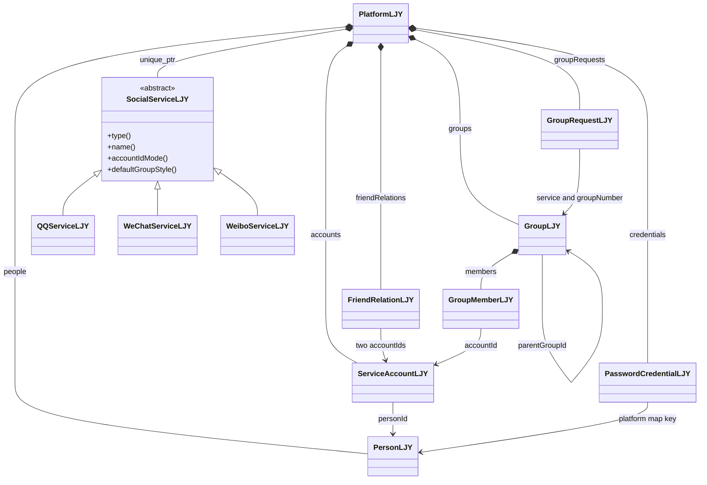
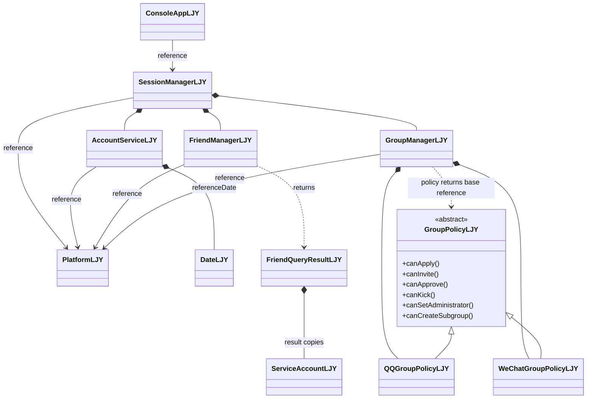
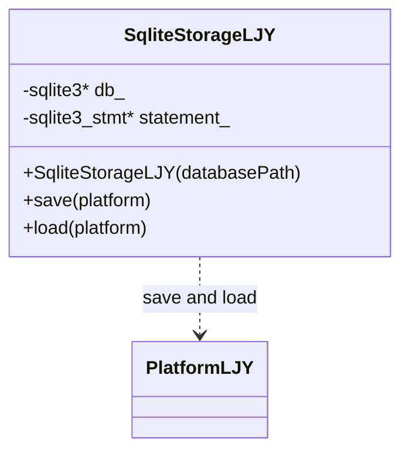
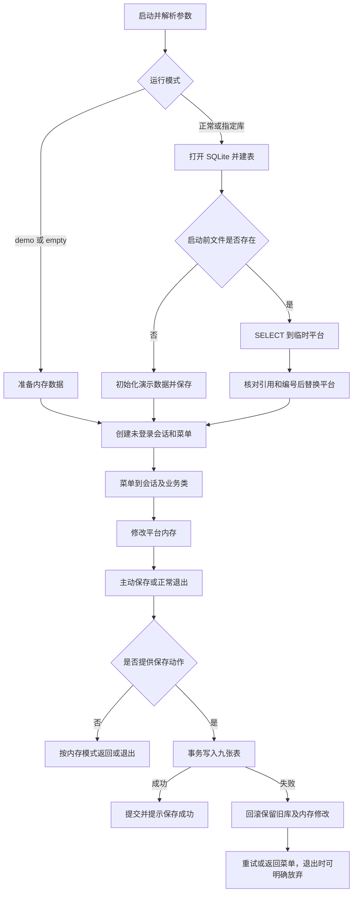

# P3 实际类图与数据流

日期：2026-09-30。依据当前头文件绘制，共 23 个自定义类、7 个枚举。P3 SQLite 已完成；GUI 与 TCP 尚未实现。

图中 `*--` 表示拥有对象并管理其生命周期，`-->` 表示引用或通过编号关联，`..>` 表示调用或结果依赖，`<|--` 表示继承。两幅图中的同名类是同一个类。

## 1 数据与服务

人员和账号均由平台保存，`PersonLJY` 不持有账号容器。每人一份密码凭据，由平台使用人员编号关联。好友关系使用一条记录保存双方编号和各自备注。

父群与子群都在平台的群容器中，通过 `parentGroupId` 关联；父群不拥有另一份子群对象。群成员只保存账号编号与管理员标记，账号资料从平台取得。群主编号保存在群对象中。

## 2 菜单、会话与业务

菜单读取输入，会话确定当前账号，业务类执行规则，平台拥有数据。服务通过基类指针使用三个派生类；群管理器直接持有两种策略，通过基类引用调用虚函数。切换模式保留当前群及其成员；主群转微信时从平台删除直属子群及其请求，切回 QQ 不恢复子群。

`FriendQueryResultLJY` 保存查询结果的账号副本与未入选说明，不拥有平台中的原账号。`DemoDataLJY.h/.cpp` 提供两个演示初始化函数，本身不是类。

## 3 枚举与源码核对

七个枚举分别为 `ServiceTypeLJY`、`AccountIdModeLJY`、`ServiceLoginStateLJY`、`GroupStyleLJY`、`GroupOperationLJY`、`GroupRequestTypeLJY`、`GroupRequestStateLJY`。

类名、枚举名均保留 LJY 后缀；23 个类各自有对应的头文件和实现文件。源码检查动态枚举现有类，不要求只能存在 P1 阶段的类数。完整清单见 [源码检查记录](P3验收记录/source_and_p1/summary.json)，验收结论见 [P3 阶段验收报告](P3第五批与阶段总体验收.md)。

## 4 持久化职责

SqliteStorageLJY 是 P3 唯一新增的类，拥有 SQLite 连接和当前语句，构造时打开并建表，析构时关闭资源。它不拥有业务平台，而通过友元权限读取或还原容器；AccountService、FriendManager、GroupManager 不执行 SQL。没有 Storage 基类、ORM 或多后端切换。

入口 wmain 是函数，不是类。它创建平台、存储、会话和菜单，并将保存动作传给 ConsoleAppLJY；菜单只执行回调。图中的“save and load”表示数据读写依赖，不是平台生命周期由存储类管理。

## 5 实际数据流

主菜单退出调用 finish，再经 saveData 和保存回调进入 storage.save；先提交成功，再结束会话。读取失败发生在创建会话之前，主程序报告启动失败。数据持久化的是账号、关系和编号，不包括当前登录状态、密码登录历史、策略对象或查询结果。

保存使用 BEGIN IMMEDIATE，按依赖顺序清理并重写九表，全部成功后 COMMIT；失败 ROLLBACK。读取使用一次事务取得数据，完整还原成功后才移交给正式平台。load 必须先于会话创建，替换后旧查询指针失效。
