# P4 已完成工作与验收

更新：2026-10-12。按 [新清单](P4临时任务清单.md)六批 18 步已全部完成，P4 阶段验收通过。本文件合并原批次说明与后续界面调整，当前行为以 [方案](P4图形界面方案.md)和 [使用说明](P4使用与代码说明.md)为准。

## 1 已交付范围

| 新批次 | 已完成内容 | 验证依据 |
| --- | --- | --- |
| 第一批 | Qt 与独立 GUI 构建，注册登录、资料昵称、服务绑定和切换、SQLite 读取保存关闭 | 账号控件流程、另进程重载；当时终端与 GUI 工具链业务回归和四种实际启动通过 |
| 第二批 | 好友列表资料、增删、独立备注、共同好友、跨服务映射和推荐 | 好友 GUI 操作、取消、换服务和注销清理、另进程恢复通过 |
| 第三批 | 兼容决策、浅绿卡片、行内编辑、密码修改和解绑、统一固定提示、好友分区 | 当批 4 项 GUI 用例通过，补充好友小窗口与编辑状态检查后 2 项好友用例通过 |
| 第四批 | 群选择、资料、申请邀请、成员任免移除、转让和退群 | 当批 6 项 GUI 用例通过；权限错误红条补验通过 |
| 第五批 | 子群行内创建与查询、模式切换保留、保存关闭联动 | 当批 8 项 GUI 用例通过；真实 SQLite 失败与另进程重载通过 |
| 第六批 | 双入口往返、综合回归、终端保留及便携 Release | GUI 构建 25 项、原终端 13 项 CTest；实际双入口往返；移动后无开发 PATH 启动通过，见第 13 节 |
| 插入修改 | 好友审批、同城推荐、稳定反馈、身份卡、配色、模式报错、图标与内置弹窗 | 相关 16 项 CTest 最终通过，终端及持久化流程通过；详见第 9 节 |

开发程序为 `build/gui-debug/bin/jlu_im_gui.exe`；发布程序位于 `dist/JLU_InstantMessaging`，两个入口均已生成。群导航已启用，GroupsPageLJY 已包含群基础操作、子群与模式切换。现有 closeEvent 的保存失败选择已完成群修改后的联动验证；综合总体验收及 Release 交付也已完成，见第 13 节。

## 2 最新有效结果与限制

| 项目 | 已有结果 |
| --- | --- |
| `p4_gui` / `p4_gui_reload` | 注册确认密码与号码提示、资料昵称行内编辑、绑定、密码和解绑、保存失败取消关闭、保存后新进程恢复通过 |
| `p4_friends_gui` / `p4_friends_reload` | 好友关系、备注独立、查询映射、推荐与取消、切服务清理、保存重启通过 |
| `p4_groups_gui` / `p4_groups_reload` | QQ 申请、微信邀请、成员管理、权限说明、取消、身份隔离与群数据另进程恢复通过 |
| `p4_subgroups_gui` / `p4_subgroups_reload` | 子群创建选择、父子成员同步、模式切换保留及当前选择不变、真实保存失败的三种关闭选择、另进程恢复通过 |
| `p4_social_gui` / `p4_social_reload` | 好友申请拒绝重发与同意、旧库补表及重启继续审批、同城三人轮换、侧栏导航、内置弹窗键盘和提示占位通过 |
| `p4_visual_revision` / `p4_visual_reload` | 六色预览取消和保存、旧库补字段、独立进程恢复、警告震动归位、登录自适应、等大确认按钮通过 |
| 固定反馈与小窗口 | 900×600 提示完整位于窗口内、在数据库路径上方；账号 / 好友 / 群页滚动不移动提示；好友及群页无横向溢出 |
| 好友编辑状态 | 编辑时隐藏删除，取消后恢复；无选择时修改与删除禁用 |
| 实际 exe 启动 | 此前已在移除开发 Qt PATH 后验证 --demo、--empty、新隔离库、已有库；标准账号版补交又验证一次 --demo 启动关闭 |
| 最近完整回归 | 2026-10-12 第六批：GUI 构建 25 项与原终端构建 13 项全部通过，两套工具链的 p1_binding_history 均通过 |
| 此前好友排版保护核对 | 59 个核心、终端及构建保护文件前后哈希一致；没有因好友排版改业务或 SQLite |

历史第二批和样板阶段曾记录 17 项全部通过；账号改造后 p1_binding_history 曾被系统拒绝，原因未确认。第六批重新正常构建并执行完整 CTest，两套工具链此项均通过；未更改系统防护，历史“未运行”不再是当前缺项。

开发构建曾提示缺少 Qt 翻译目录及可选 DirectX 编译器。第六批的部署显式排除可选组件，仍有翻译 catalogs 非致命提示，实际 Release 启动通过。Debug 默认项目库，Release 默认 exe 同目录 data/jlu_im.db。

终端保护需区分阶段：早期增加 GUI 的 CMake 开关和本机预设属于预期修改；账号密码和解绑补了业务接口；此前好友布局及提示调整没有更改终端和 SQLite；第 9 节好友审批按用户要求修改了业务、存储和终端，新表自动补建。原终端基线用于追溯，不能对当前所有文件直接要求哈希与最初一致。正式数据库未用于 GUI 自动验收；账号开发初期被用户程序占用，缺少起始哈希，不能声称全过程都做过数据库哈希核验。

## 3 较早界面截图（最新材质见第 14 节）

来自实际 Qt 控件的离屏渲染，不含系统标题栏，不作为人工逐项点击记录。账号默认图展示资料分区；固定提示位置以小窗口图为准。

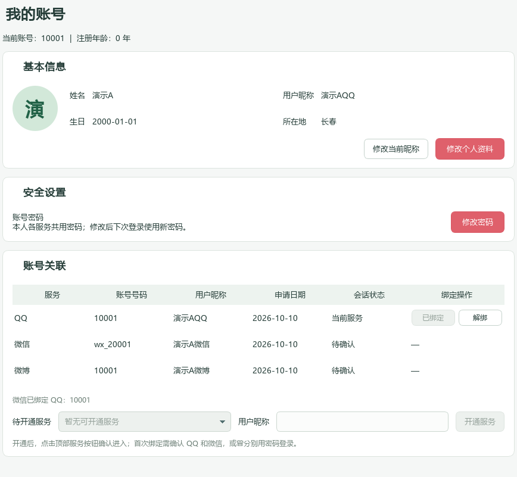

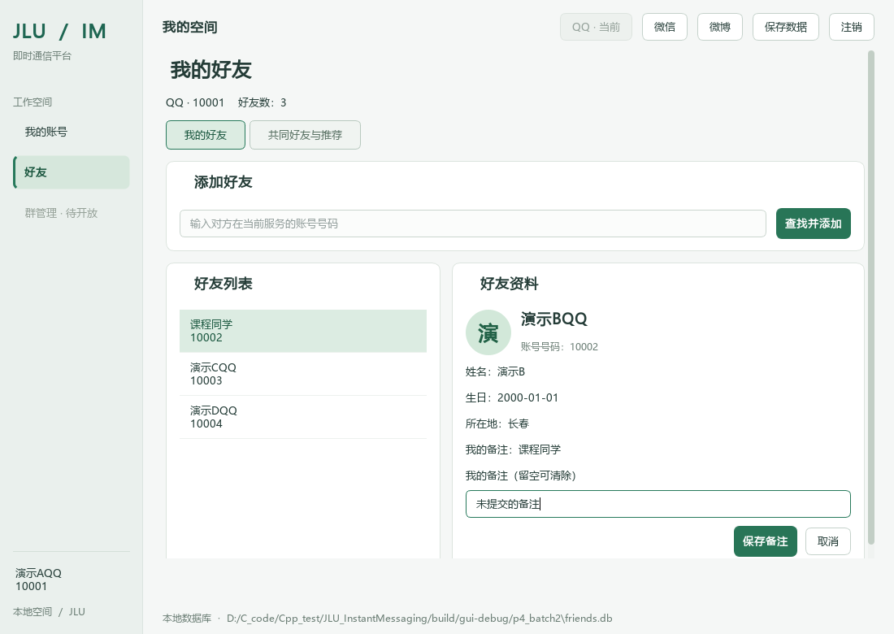

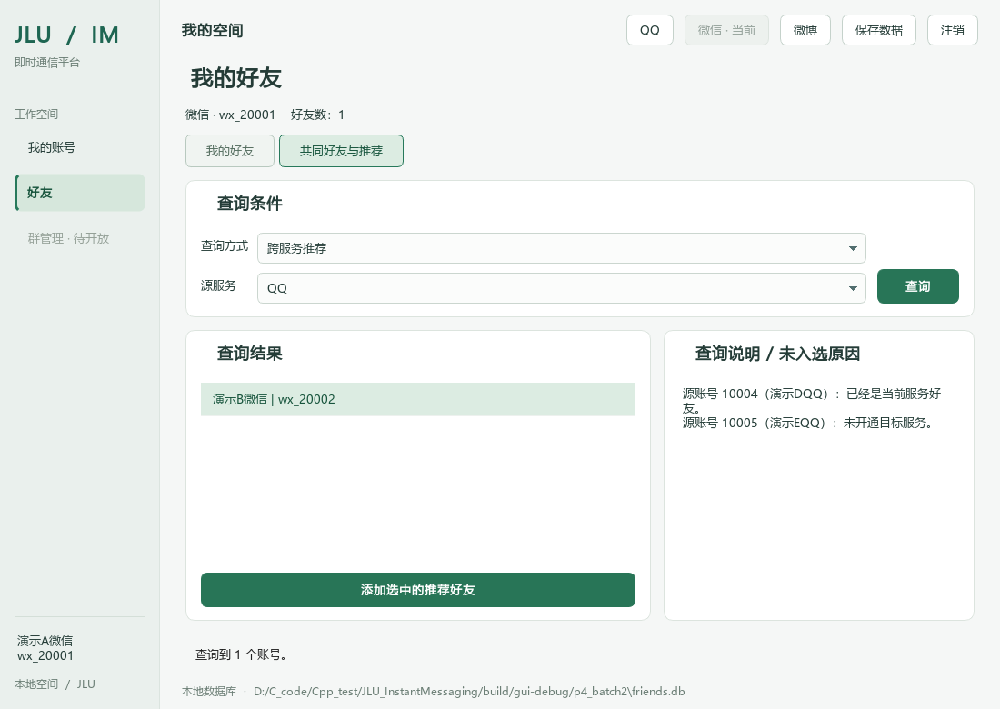

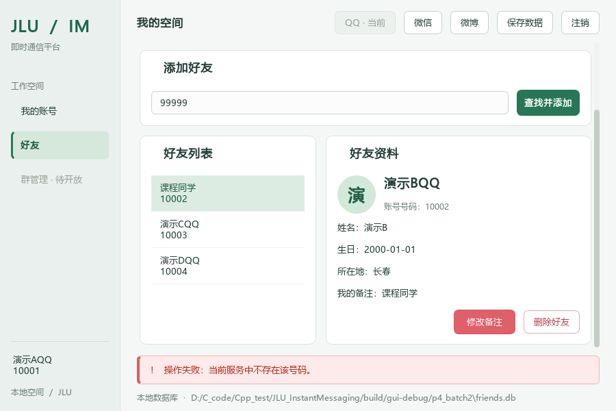

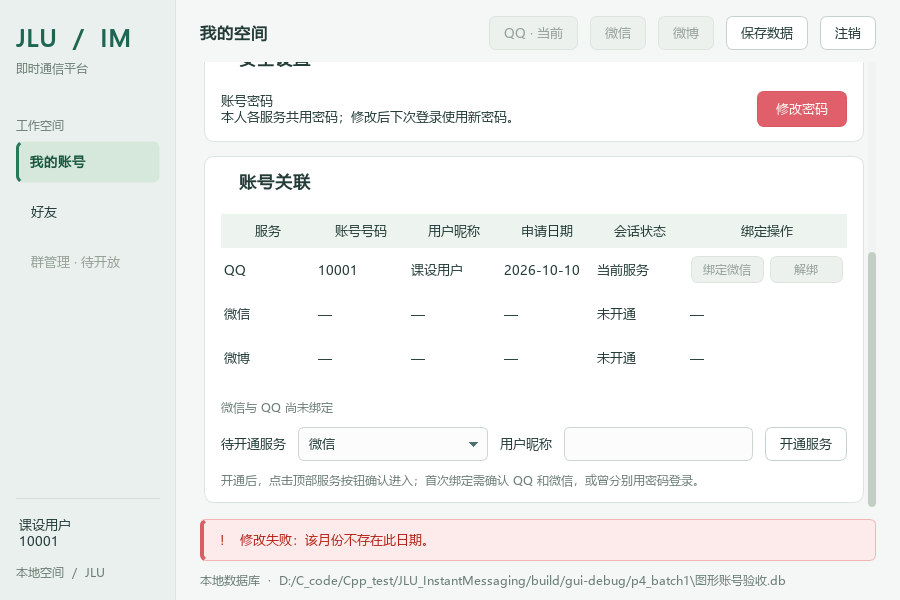

## 4 原始证据

JSON 原样保留，名称中的“原”表示旧批次记录。里面的旧 exe 哈希、临时预览程序和原阶段范围仅用于追溯，不是当前启动指引；当前只使用标准 exe。

| 证据 | 用途 |
| --- | --- |
| [原第一批验收](P4验收记录/原第一批_2026-10-05.json) | 工具链、账号、启动及当时保护核对 |
| [原第二批验收](P4验收记录/原第二批_2026-10-05.json) | 好友功能、当时 17 项结果及启动 |
| [界面样板启动验收](P4验收记录/界面样板_2026-10-10.json) | 外观样板时期的实际启动记录 |
| [账号与固定提示验收](P4验收记录/账号与提示_2026-10-10.json) | 账号改造、补交、提示调整及系统执行限制 |
| [原终端保留基线](P4验收记录/终端保留基线_2026-09-30.json) | GUI 开始前快照，按允许变更解释差异 |
| [第四批群界面验收](P4验收记录/第四批_群界面_2026-10-10.json) | GUI 流程、群重载、保护文件与标准 exe 哈希 |
| [第四批最终群测试日志](P4验收记录/第四批_群界面_CTest.txt) | 最终两项群 GUI 用例的原始日志 |
| [第五批子群与保存验收](P4验收记录/第五批_子群与保存_2026-10-10.json) | 当批 8 项 GUI 结果、隔离库、保护文件及标准 exe 哈希 |
| [第五批 GUI 测试日志](P4验收记录/第五批_GUI_CTest.txt) | 当批 8 项 GUI 用例的原始日志 |
| [好友申请与界面增强](P4验收记录/好友申请与界面增强_2026-10-12.json) | 本次八项功能、16 项受影响测试、终端持久化及程序哈希 |
| [Ela 兼容日志](P4验收记录/Ela兼容检查.log) | 固定版本配置因 Qt 版本检查失败 |

好友最新测试源码为 `tests/p4_friends_gui_tests.cpp`，生成的隔离库与截图在 `build/gui-debug/p4_batch2`；账号测试为 `tests/p4_gui_tests.cpp`，启动检查为 `tests/p4_startup_smoke.py`。build 内生成记录可因清理构建而消失，因此选定截图与原始汇总单独保存在本目录。

## 5 文档整理记录（第四批实施前）

原 P4 计划、第一批、第二批、界面样板、账号改造、好友改造及未带 P4 前缀的 GUI 样式记录，共 7 份，合并为 4 份主题文档：方案、临时任务清单、使用与代码说明、已完成工作与验收。

删除已替代的草图、旧页面截图及草图检查 JSON；保留 6 张有用截图，统一放在 `P4验收记录/截图`。5 份原始 JSON 按日期和用途归入 `P4验收记录`。更新 README、总方案和 P3 清单的入口链接，旧 UI 编号只保留在新清单的对应表里。

清理前副本集中保存于 `build/p4_docs_before_2026-10-10.zip`，仅用于恢复，不作为另一套有效文档。该次清理仅涉及文档与配图；其后的第四批实现见下一节。

## 6 第四批实现与验收（2026-10-10）

对应新清单顺序 10—12。新增 `src/gui/GroupsPageLJY.h/.cpp`，主窗口接入群导航、当前身份刷新和统一反馈；GUI 子目录 CMake 增加页面与测试目标，主题增加群卡片样式。只复用已有 SessionManager / GroupManager 接口，未增加群业务分支、SQL 或额外架构层。

窗口先选择有效群，再操作成员或请求。左侧包含已加入群和本人待加入记录；未入群不展示成员。成员表的号码、昵称与身份便于选取目标；最初在操作下方说明禁用原因，第 7 节曾改为选中目标显示固定红条，现按第 8 节改为点击后才报错，邀请入口保留。群号不存在或格式错误时清空成员、请求和邀请入口；注销、换服务清除旧群，即使服务间群号相同也不串用。

申请、邀请、成员操作和处理请求均确认后提交。群主不能直接移除管理员，需先取消管理员身份；管理员不能移除群主或管理员；自己不能移除自己。权限文字直接来自原业务检查。处理后重载成员、请求状态及操作权限，取消不修改数据。普通失败继续显示底部浅红横条。

验收执行：首次 `ctest --preset gui-debug -R '^p4'` 共 6 项通过；收紧表格留白、补充直接选群和小窗口请求检查后，只重跑 `^p4_groups` 两项，均通过。用例实际操作生产 Qt 窗口，另一个进程读取隔离 SQLite 库核对群主、角色、移除、退群和请求状态。没有用正式数据库做验收，也没有重复全量核心回归。子群与模式切换以及保存关闭失败场景在随后第五批完成，见第 7 节。

本批修改前后的核心、存储、终端、原预设和 VS Code 配置哈希一致，具体清单及数量见 JSON。标准 `build/gui-debug/bin/jlu_im_gui.exe` 已重新生成。Qt 翻译与可选组件提示仍沿用之前限制，不代表新引入依赖。此批没有额外新建一套“批次说明”文档，继续维护四份统一文档。

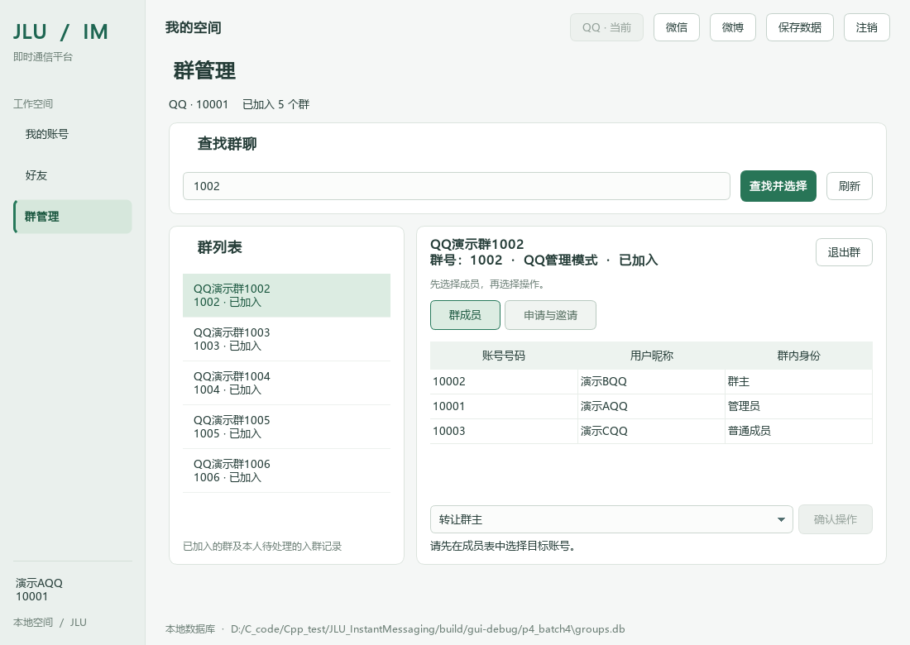

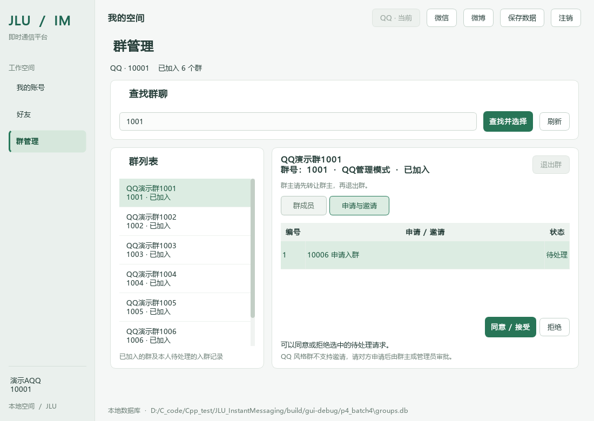

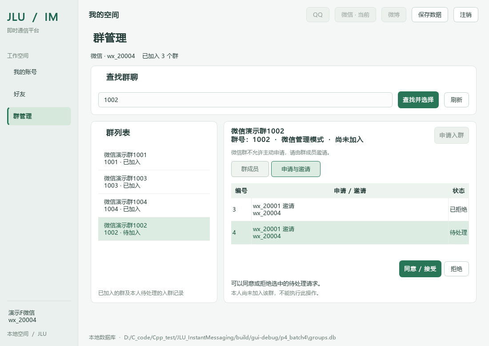

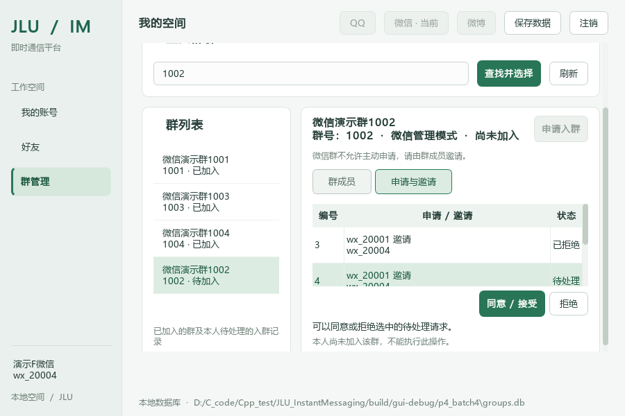

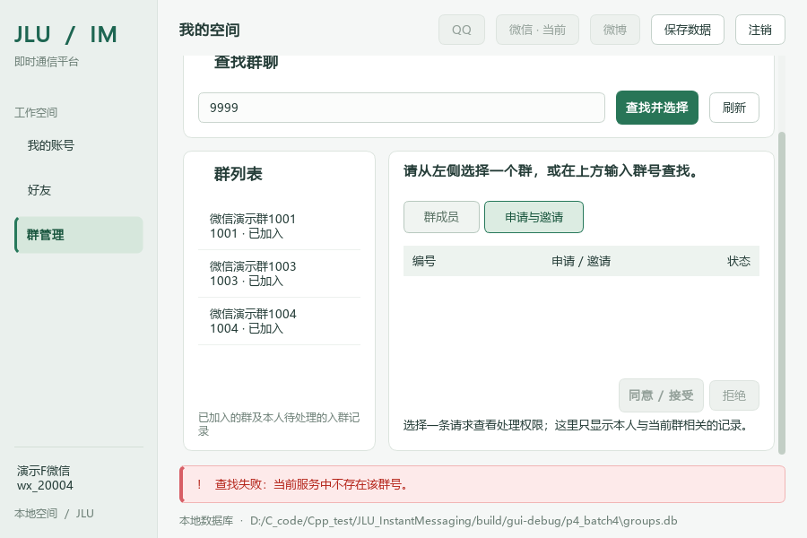

## 7 第五批及权限提示修正（2026-10-10 历史记录）

> 以下为当日实现与验收事实。其中释放子群、禁用按钮和选中即报错的规则均已于 2026-10-12 被第 8 节替代；旧截图和 JSON 只作追溯。

先完成独立修正：用户选择移除自己、直接移除管理员、管理员移除群主或其他管理员等不可行操作时，固定提示区使用浅红底、红字和左侧红边显示原业务原因。请求审批无权限时同样处理；操作按钮禁用，改选合法目标清理旧错误。程序内部刷新不覆盖提交成功和保存成功消息。原两项群用例先单独通过，再进入第五批。

对应顺序 13—15，在现有 GroupsPageLJY 增加“子群与模式”页签，新增行内创建表单和群主 / 成员选择。群主从父群成员中选取并自动加入；查看子群后可以返回父群。模式切换先确认释放对象，切回 QQ 不恢复。所选子群已被释放时，刷新回到缓存的有效父群号。复用现有会话、群策略和存储，不增加业务层或数据库表。

| 验收场景 | 实际结果 |
| --- | --- |
| 创建子群及取消 | 只列父群成员；选择的群主自动加入；格式错误保留草稿并显示红条；取消不创建；确认后更新列表 |
| 父子群关系 | 父群移除成员会同步移除其子群资格；禁止嵌套创建；子群可返回父群 |
| 模式切换 | 取消保留子群和申请；确认微信模式释放子群及请求，父群成员保留；切回 QQ 不恢复 |
| 当前子群释放 | 模拟另一入口切换父群模式，再刷新窗口，自动回到有效父群 |
| 真实保存失败 | 仅在隔离库安装失败触发器；SQLite 写入报错并回滚，旧库可完整读取，内存修改保留，底部红条显示原因 |
| 取消关闭 / 重试 | 取消保留窗口与内存；解除测试故障后点击重试，成功保存并关闭 |
| 明确放弃 | 用户选择放弃后关闭；重新读取仍为最近成功保存的版本，未保存子群不存在 |
| 独立进程读取 | 保存的子群父子关系、群主和成员一致；被释放及放弃保存的子群不再出现 |
| 小窗口 | 900×600 创建表单可滚动、无横向溢出，红色错误条完整位于数据库路径上方 |

新增 tests/p4_subgroups_gui_tests.cpp 和 GUI CMake 测试目标，测试数据仅位于 build/gui-debug/p4_batch5/subgroups.db。触发器只在测试中使用，不改生产保存逻辑。最新一次运行 `ctest --preset gui-debug -R '^p4'`，8 项全部通过；这是 GUI 回归结果，不是全量核心或第六批部署验收。Qt 离屏截图已人工查看，未将其称为原生桌面逐项点击。

本批受保护的核心、存储、终端、根构建、预设与 VS Code 配置哈希均未变化，数量和路径见 JSON；正式数据库没有用于本批验收。当时标准 exe 已完成构建，第六批尚未开始；当前结果见第 13 节。

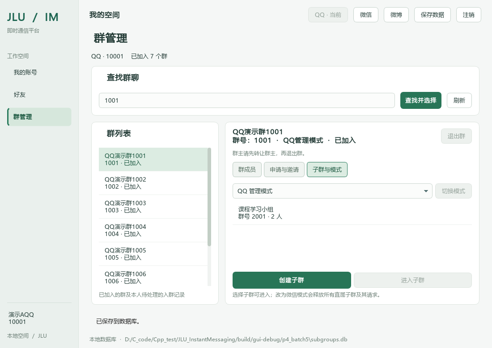

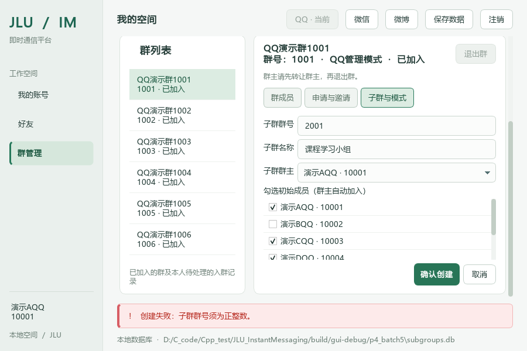

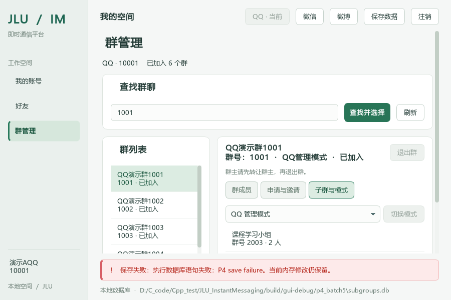

## 8 交互与子群保留调整（2026-10-12）

本节记录本日较早的四项调整，不推进第六批。好友推荐直接添加与当时截图已被第 9 节的申请制和内置弹窗替代；头像可选色现以第 10 节为准。

1. 头像使用绿、蓝、珊瑚、紫、金、青六组浅色配深色文字。人员编号随注册递增，以 `(personId - 1) % 6` 选择颜色，因此按注册顺序循环，同一人跨服务、重启和改昵称颜色一致。账号页和好友页共用 AvatarLJY.h；以后手动改色集中在此扩展，本次没有开放控件或新增数据库字段。
2. 共同好友与推荐结果旁始终保留操作位置。共同好友已是好友，显示不可重复添加的“已是好友”；跨服务推荐结果选中后显示可点击的“添加选中的好友”，确认后添加双向关系。
3. 主群切换只改变自己的模式，已有子群、成员、请求和子群自身模式保留。子群仍可操作，父群成员移除仍同步处理子群资格；微信模式不允许新建子群，切回 QQ 恢复创建权限。终端、UI、业务注释和 SQLite 读取校验同步修改，无需改表。此前版本已经删除并保存的子群不会凭空恢复。
4. 选中群成员、请求或换操作不报权限错误。按钮不会因权限禁用；点击后先由原业务检查，失败使用底部浅红错误条，合法操作再确认提交。改选清理旧错误，内部刷新保留成功提示。未选有效群仍不能进入操作区；没有成员或请求选择时，点击会提示先选择对象。

受影响的 11 项 CTest 已通过：8 项 GUI、p2_subgroup_mode、p3_storage_save、p3_storage_load。首次运行 10 项通过，读取测试的一项断言误用普通成员查询他人请求；改为直接核对隔离库记录后，仅重跑该读取测试并通过，未反复运行全部测试。

另运行实际终端子群流程，验证切换保留、父子成员移除、子群群主转让后退出；P3 实际程序四次重启、子群保留与新编号、两项保存失败场景通过，脚本确认正式库哈希未改变。原生键盘交互脚本已同步新流程并通过语法检查，本次没有重复运行。既有 p1_binding_history 系统执行缺项仍保留，本次未重试。

标准 GUI 与终端 exe 已构建。实际 Qt 离屏截图已查看，头像圆形和原主题保持，推荐添加入口可见，权限错误仅在按钮点击后显示。记录与日志保存在 [本次证据](P4验收记录/交互与保留_2026-10-12.json)。

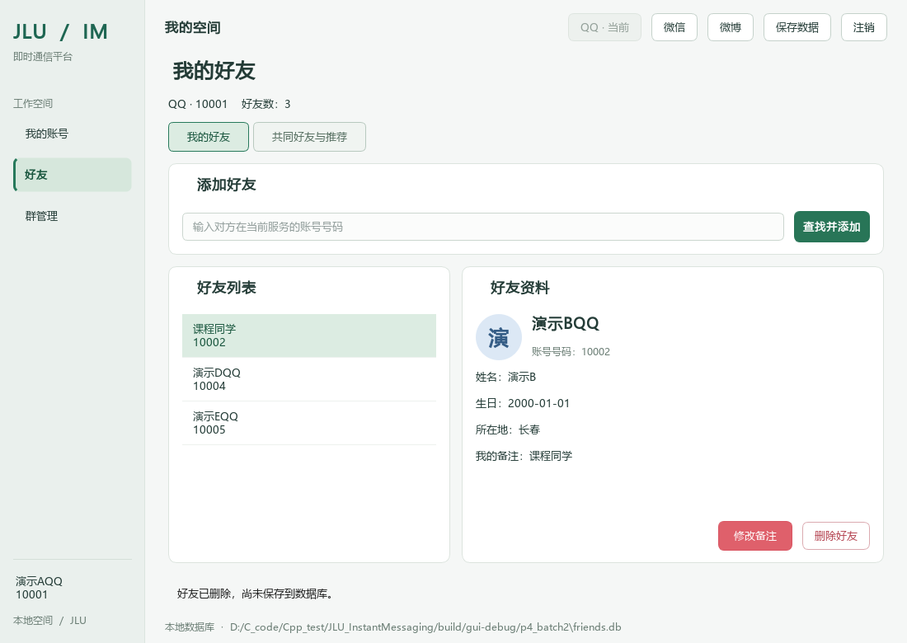

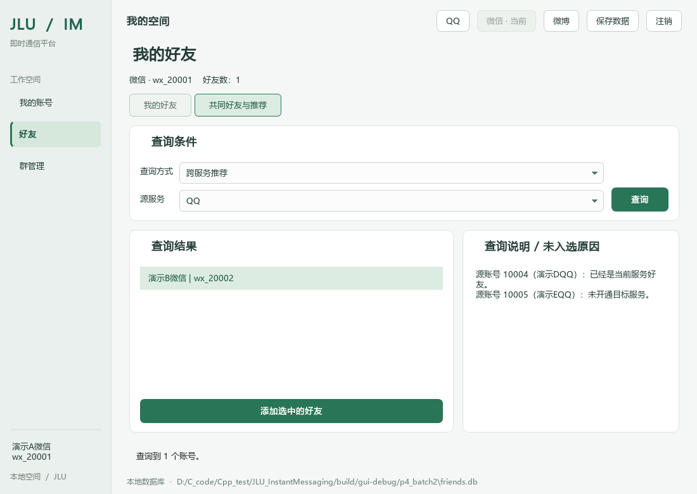

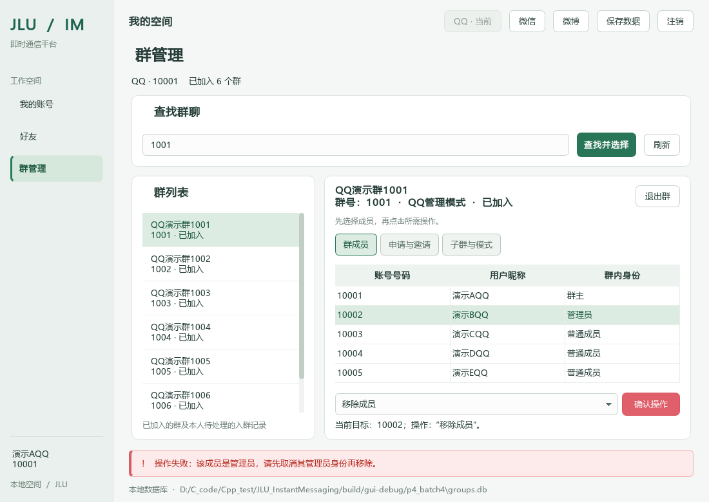

## 9 好友审批与界面增强（2026-10-12）

本节保留上一轮八项实现与验收事实。用户澄清“震动”意图后，62 像素提示区已撤回，头像选择、白色身份卡、卡片尺寸及登录适配以第 10 节为准。该轮未推进第六批，标准 GUI 与终端 exe 已生成。

| 要求 | 当前实现 |
| --- | --- |
| 红条出现抖动 | 固定提示区预留 62 像素，正常和错误使用相同边框厚度、内边距；切换消息不改变提示区和上方页面的位置。长消息支持悬停全文 |
| 添加好友需同意 | 搜索、跨服务和同城推荐先发送申请；好友页面新增“好友申请”，接收方可同意或拒绝，同意后才建立双向关系。终端搜索和推荐也改为申请制，菜单 9 处理申请 |
| 同城查询 | 查询方式增加“寻找同城好友”；所在地文字完全一致，当前服务内排除本人、好友及待处理申请。每批最多三人，尾批不足三个照常显示，取尽后循环；换条件或刷新后重置 |
| 左下角身份 | 三行展示头像、居中加粗昵称、小号浅色账号；整块点击进入我的账号。长昵称单行省略并提供全文提示 |
| 绿色层次 | 主背景 #f0f6f2、侧栏 #dae8df、选中导航 #c8dfd1，保留原浅绿主题 |
| 已是当前群模式 | 点击重复模式时使用固定红色错误条，群和子群行为一致 |
| 软件图标 | 绿色对话气泡，PNG 编入 Qt 资源，多尺寸 ico 与 rc 编入 Windows exe |
| 内置弹窗 | 发送申请、删除好友、群确认、服务切换、保存失败选择改为窗口内遮罩卡片；启动帮助和错误使用同款自绘宿主。Esc 取消、Tab 在按钮间移动、Enter 执行当前按钮 |

代码新增 FriendRequestLJY，Platform 保存按账号对索引的最近一次申请，FriendManager 负责发送和接收方审批；会话提供入口，GUI 与终端共用。SQLite 增加 friend_requests，保存发送方、接收方和 0 待处理 / 1 同意 / 2 拒绝状态；旧九表库打开自动补表，已有好友保留，原编号计数器不变。拒绝后可重新申请。申请与其他业务数据仍需手动保存或正常关闭时保存，不增加后台网络推送或跨进程实时同步。

新增 tests/p4_social_gui_tests.cpp，现有 GUI 测试共 10 项；旧好友、推荐、交互与存储用例同步申请流程和十表结构。相关 16 项 CTest 最终均通过：3 项存储、3 项好友相关业务及 10 项 GUI。首次运行 15 项通过，推荐用例因旧提示文案断言失败；修正后补跑推荐和两项 social 用例，3 项通过。内置弹窗补充键盘处理后再运行子群与 social 共 4 项，全部通过，没有重复全量测试。

新增用例验证发送时不是好友、重复申请、发送者不能批准、接收方拒绝后重发与同意、待处理申请保存后在独立进程继续审批；模拟旧库缺少申请表后自动补建并保留账号。同城使用四名候选验证 3 → 1 → 3 循环，并核对已申请和已是好友的过滤。900×600 下对比普通与错误消息时提示区及页面几何位置一致，身份卡子控件完整可见；内置卡片随窗口缩放，Tab 焦点受限、Esc 取消，图标非空。

另外通过真实终端好友与推荐流程、四次重启和两项存储失败场景，十表往返一致，脚本核对正式数据库哈希未变。测试库位于 build，未用正式库做功能验收。Qt 截图来自实际生产控件的离屏渲染并已查看；不声称原生桌面逐项点击或 Release 部署完成。历史 p1_binding_history 系统拒绝执行的缺项仍保留，本次未重试。

证据：[结果与程序哈希](P4验收记录/好友申请与界面增强_2026-10-12.json)、[首次 16 项原始日志](P4验收记录/好友申请增强_首次16项_CTest.txt)、[最终 4 项补验日志](P4验收记录/好友申请增强_最终4项_CTest.txt)、[终端持久化结果](P4验收记录/好友申请增强_终端持久化_2026-10-12.json)。修改前副本为 build/p4_enhancements_before_2026-10-12.zip。

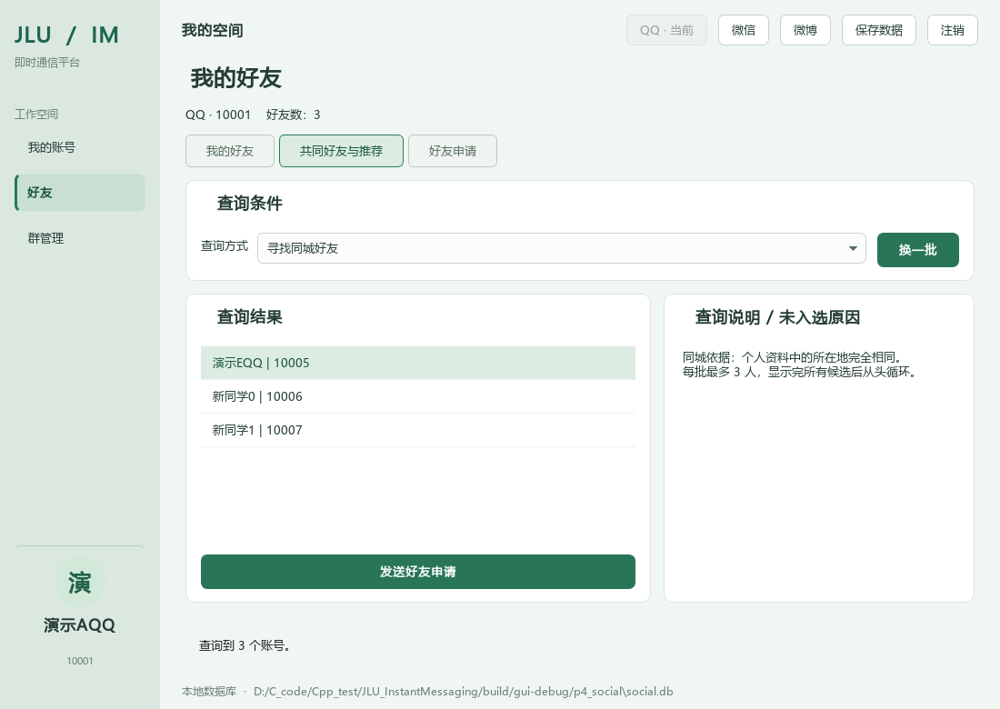

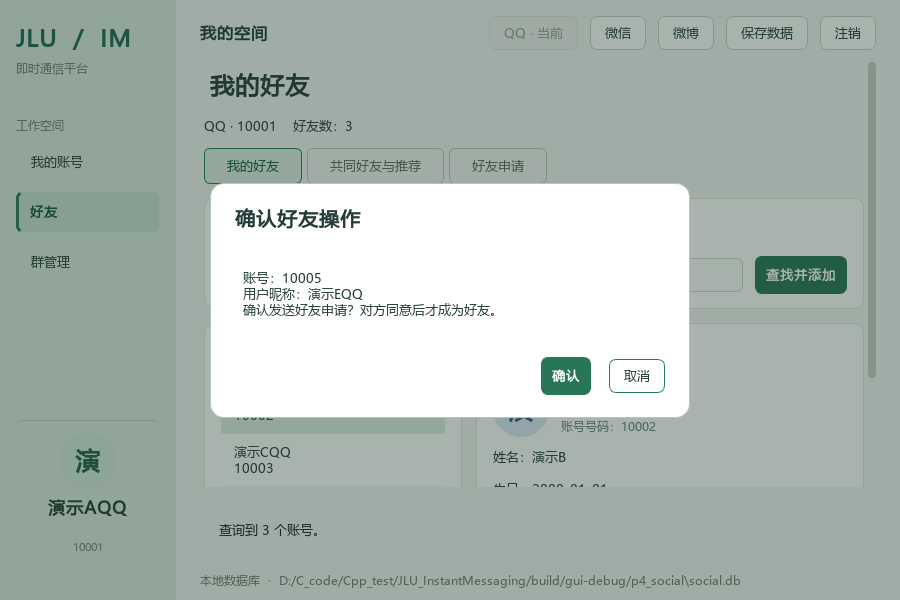

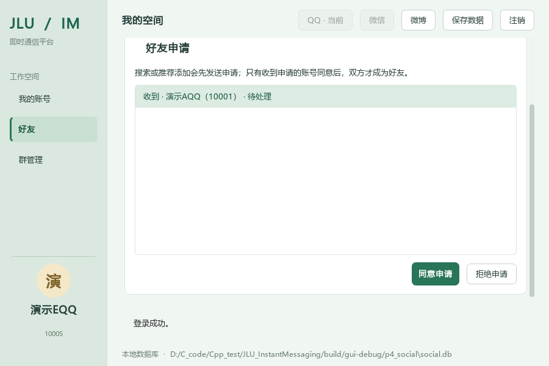

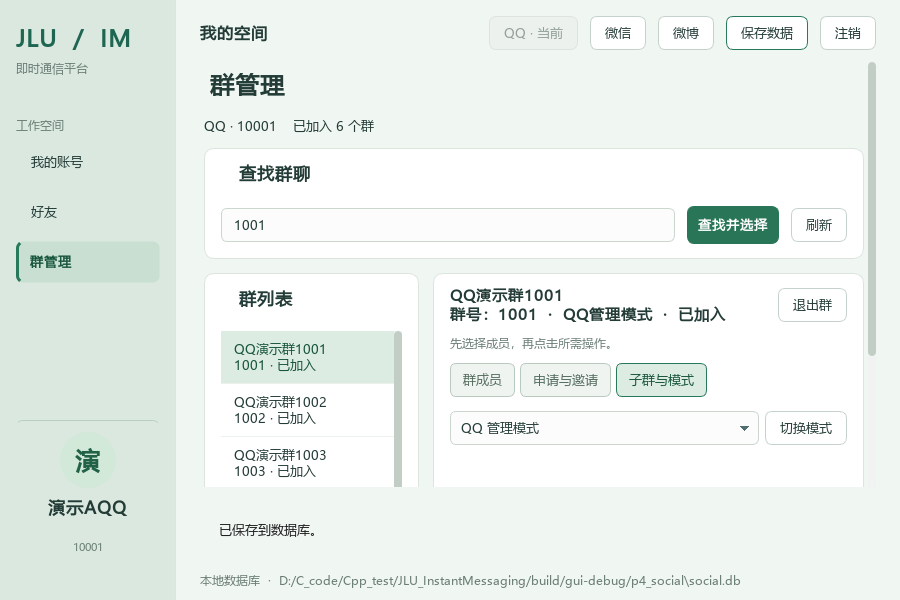

## 10 验收修订、头像选择与自适应登录（2026-10-12）

本节记录完成三项验收问题和三项新需求时的状态，当时第六批仍未开始。

- 确认卡片：统一按钮宽度和 40 像素高度，移除短正文的大块滚动空白。群成员操作标题直接显示“设置管理员？”等动作，正文为昵称、账号和群号；转让补充失去群主身份的影响。模式切换仅保留对象、子群与请求保留和权限变化。长错误正文仍可滚动，取消、重试和放弃语义保留。
- 警告：明确修正上一轮理解错误，撤回固定 62 像素，恢复原最小 42 像素及原红条样式。FeedbackShakeEffectLJY 只偏移警告条绘制，QVariantAnimation 在 320 毫秒内左右移动最多 5 像素后归位；连续报错重新播放，正常消息停止并归位，窗口本身不移动。
- 身份与侧栏：左下角卡片改白底，头像、昵称与号码保持居中；侧栏由 176 加宽到 208 像素，导航由 13 增至 16 像素。
- 头像色：修改资料时出现六个浅弧排列的色点，描边和线条勾号表示选择；仅预览草稿，保存资料一起提交，取消或离开还原。资料失败不部分提交颜色。Person 保存 0—5 的 avatarColor，persons 增加 avatar_color；旧库自动补字段，默认 -1 恢复原编号循环色。账号页、侧栏、好友资料与不同服务一致；终端原资料入口省略颜色参数时保留原色。
- 登录页：按可用宽度将文案、间距和卡片适度放大，最大约 1.5 倍；表单字体最多约 1.3 倍。卡片限宽、限高并居中，既适配小窗口，也避免最大化后整组内容仍维持小尺寸。

新增 tests/p4_visual_revision_tests.cpp，包含实际生产控件操作与独立进程重载。完整运行本轮相关 15 项 CTest（12 项 GUI、3 项 SQLite 存储）全部通过。验证了旧库没有头像字段时自动补建并保留账号和原配色，选色预览 / 取消 / 失败 / 成功、非法色号不部分修改资料、重启恢复及跨服务一致；核对动画偏移数值和最终归位、成功不震动（当时未检查像素位移，实际晃动未生效，已在第 15 节修复）、确认按钮等大且对象明确、900×600 群页面无横向溢出、960×640 与 1920×1080 登录页面缩放。实际截图已查看，修正了选色勾号缺字和登录标题比例。

GUI 与终端标准 exe 均已重新编译。另用独立数据库执行真实终端正常退出保存，前后人员资料及所选紫色一致。正式库未用于本轮验收；旧库实际打开时自动补字段。截图为真实 Qt 控件离屏渲染，不含系统标题栏，不当作原生桌面逐项人工点击。当时历史绑定测试和 Release 部署留给第六批，现已完成，见第 13 节。

证据：[结果与程序哈希](P4验收记录/界面验收修订_2026-10-12.json)、[15 项原始测试日志](P4验收记录/界面验收修订_15项_CTest.txt)。修改前副本：build/p4_visual_revision_before_2026-10-12.zip。

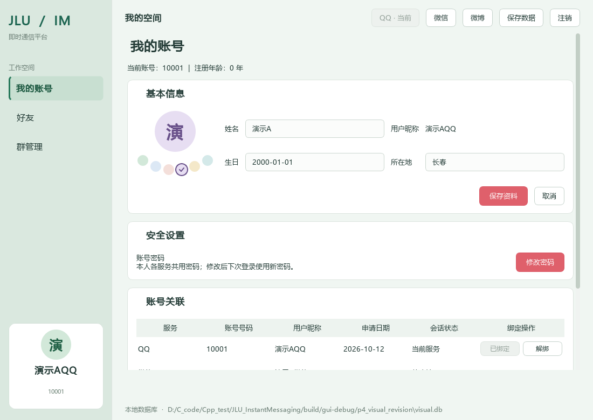

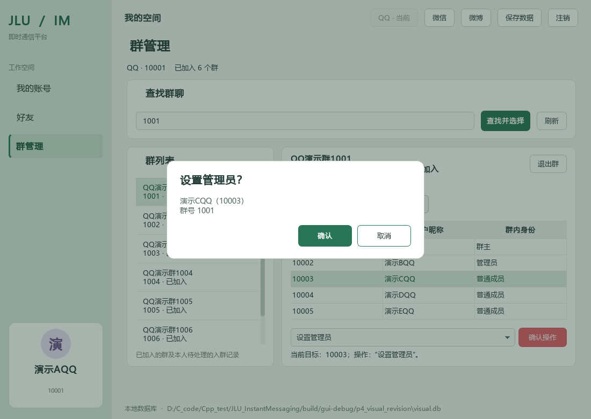

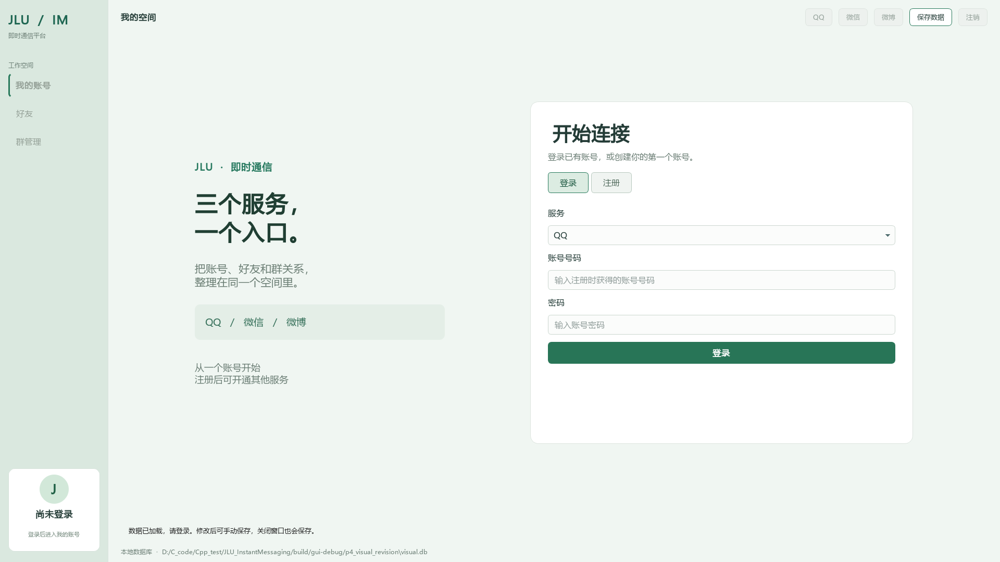

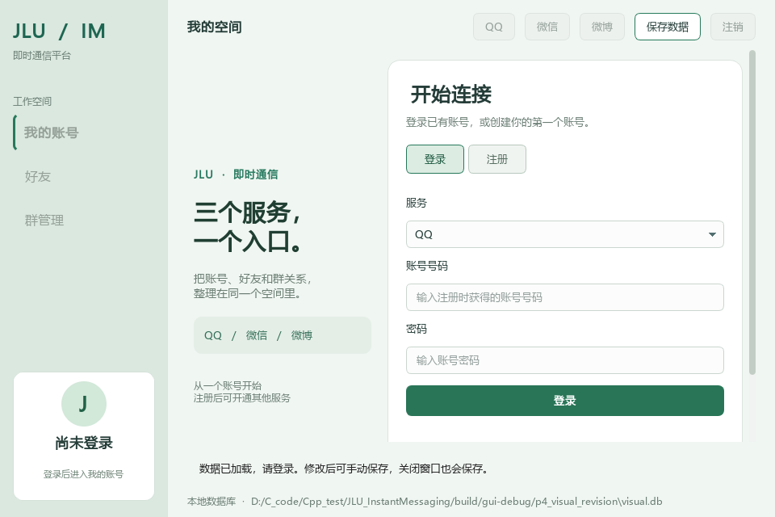

## 11 四项侧栏与微软雅黑（2026-10-12）

侧栏改为四项：消息、群聊、我的账号、好友列表，按用户最后一张参考图采用左图标、右文字的位置关系。SidebarIconLJY.h 使用 Qt 路径绘制气泡、群组、个人和列表造型，参考用户提供的四张图片，生成透明多尺寸图标；避免原图片白底与侧栏混在一起，也不依赖图标字体或额外图像插件。

原导航设置使用 Microsoft YaHei UI，并在选中时加粗。本次导航明确使用 Microsoft YaHei（微软雅黑）16 像素常规字重，选中与未选中不切换字重，选中状态由浅绿底与左侧标记表现。已通过 QFontInfo 核对实际字体 family 为 Microsoft YaHei、非粗体。

消息在登录后可进入准备中页面；真实收发与聊天记录仍待 P5，未增加 SQL 或网络实现。群聊仍进入原群管理页面，账号与好友页面保留，底部白色身份卡仍跳到账号页。未登录四项禁用，登录后启用；登录与注销行为未改。

复用原界面验收，4 项通过：p4_gui、p4_gui_reload、p4_visual_revision、p4_visual_reload。核对四项顺序、图标非空、实际字体、消息占位及原页面路由；实际 Qt 离屏截图已查看。用户关闭程序后，标准 jlu_im_gui.exe 已重新生成。没有重复业务与数据库全量测试，不推进第六批或 P5。

证据：[四项侧栏记录](P4验收记录/四项侧栏_2026-10-12.json)、[4 项测试日志](P4验收记录/四项侧栏_4项_CTest.txt)。修改前副本为 build/p4_sidebar_before_2026-10-12.zip。

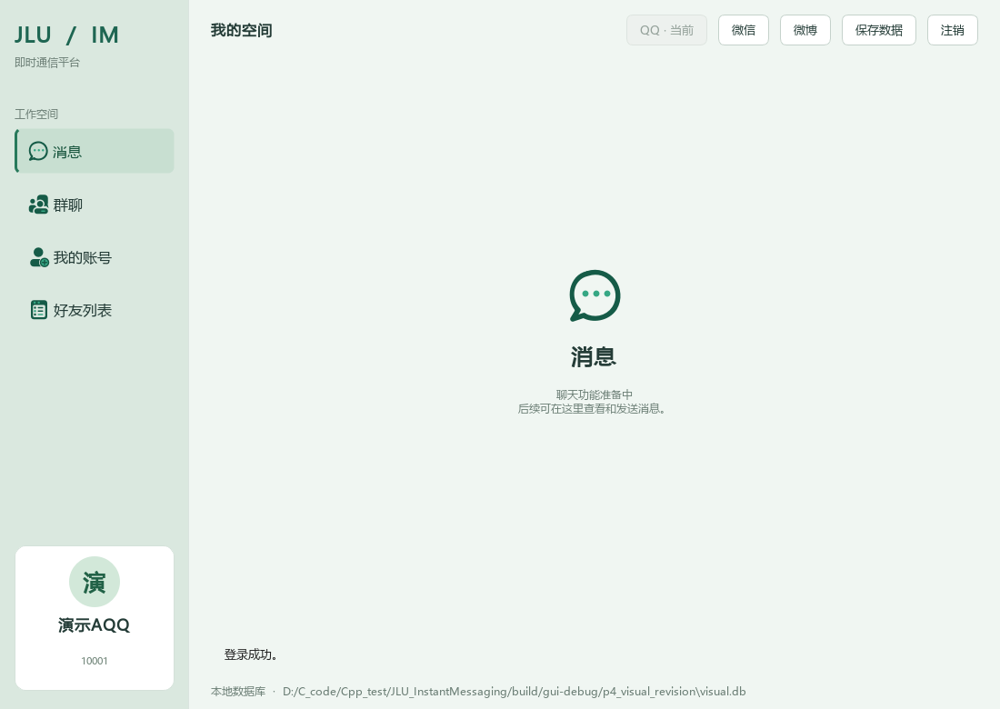

## 12 主界面与全局字体补正（2026-10-12）

用户指出登录主界面仍存在字形和字重不协调。上一轮只修改导航，theme.qss 的全局字体仍为 Microsoft YaHei UI，登录表单还叠加局部缩放样式。本轮将应用默认字体、主窗口基础字体、全局样式和登录卡片动态样式统一为 Microsoft YaHei（微软雅黑）；普通文本、表单和按钮使用常规字重，标题、头像等强调信息保留加粗。

通过 QFontInfo 核对大小窗口、账号页面及内置确认层可见控件实际字体为 Microsoft YaHei，并核对普通按钮不加粗。p4_gui、p4_gui_reload、p4_visual_revision、p4_visual_reload 共 4 项通过；实际 Qt 离屏截图已查看，标准 exe 已重新生成。本轮未改业务、数据库与后续阶段范围。

证据：[字体修正记录](P4验收记录/全局字体_2026-10-12.json)、[测试日志](P4验收记录/全局字体_4项_CTest.txt)。

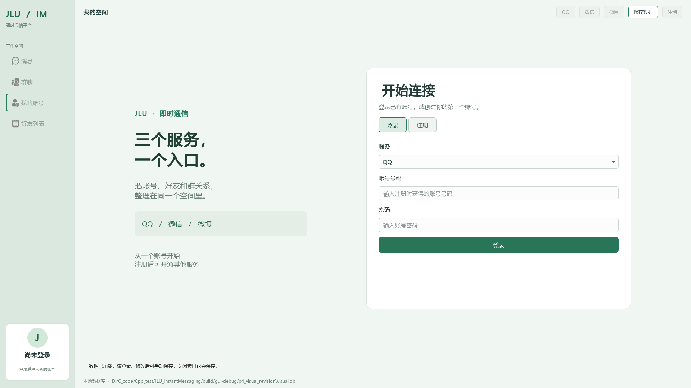

## 13 第六批：总体验收与部署（2026-10-12）

P4 六批顺序 1—18 全部完成。本批只补交付路径和验收打包，没有推进 P5 消息收发，没有增加业务层设计。

| 验收项 | 实际结果 |
| --- | --- |
| 原终端 Debug 构建 / CTest | 构建成功，13/13 通过 |
| Qt Debug 构建 / CTest | 构建成功，25/25 通过，包含 12 项 GUI 操作与独立进程重载 |
| 历史绑定启动缺项 | 两套工具链的 p1_binding_history 均执行并通过，无剩余缺项 |
| GUI → 终端 → GUI | GUI 修改资料、颜色、密码、好友备注、发送申请、切群模式并保存；真实终端读到后同意申请、改资料昵称备注和群模式；全新 GUI 进程用新密码登录并读到修改，绑定保留，重存后的十表逐行一致 |
| 小窗口与错误关闭 | 上述 GUI 回归包含 900×600 固定提示、滚动不移位、无横向溢出，以及实际 SQLite 失败后的回滚、重试、取消关闭和明确放弃 |
| 真实终端输入 | 两项原生脚本通过：中文输入、密码星号与确认、Ctrl+C 不退出或跳过暂停、无效群/自己/管理员拒绝、取消操作、子群保留与模式恢复 |
| Release 构建 | Qt 6.8.3 / MinGW 13.1，两个入口均使用 Release；安装到 dist/JLU_InstantMessaging |
| 部署依赖 | windeployqt 放入 Qt DLL、qwindows 等插件；MinGW DLL 与工具链一致，附 qt.conf、说明及第三方许可 |
| 移动后实际启动 | 复制到包含中文和空格的目录，PATH 仅保留 Windows System32、移除 QT_*，7 次 GUI 正常启动关闭、2 次终端运行全部通过 |
| 默认和指定库 | --demo / --empty 不建库；无参数读写 exe 旁 data；新库/旧库/指定中文路径均通过；Release 终端修改后 GUI 正常重载并保存保留 |
| 原代码与用户数据 | 本批起始基线 60 项哈希一致，包括 src/domain、src/services、src/ui、VS Code 配置和正式数据库；原有 configure/build/test 预设保持不变，只新增 gui-release |

新增的小路径函数位于 src/storage/DefaultDatabasePathLJY.h。Debug 保持原项目库；仅启用 JLU_PORTABLE_DATA 的 Release 按实际 exe 位置拼出默认库。两个 main 使用它，ConsoleApp 和业务实现保持本批前状态。

新增复现文件：tests/p4_roundtrip_gui_tests.cpp、tests/p4_roundtrip_acceptance.py、tests/p4_release_acceptance.py、scripts/package_p4.ps1。图形往返驱动仅在 BUILD_TESTING 下构建，未向生产程序加入测试开关；脚本操作的库在 build 内。图形控件回归采用 Qt 离屏事件，Release 启动使用真实 Windows 窗口并通过正常 closeEvent 退出。

一次部署复查中，复制后的 Release 终端启动报 WinError 5（拒绝访问）。检查权限和近期系统日志未确认原因；原发布文件随后正常执行，完整部署脚本重新验收通过。没有关闭防护、加白名单或修改二进制规避限制，不把这次瞬时失败隐去，也不将未经证实的原因归咎于杀毒软件。

本机清除开发 PATH 的测试通过，但尚未在另一台全新电脑实测；Windows 宿主终端的选中文本复制没有在本批重新人工操作，自动检查仅证明 Ctrl+C 不退出。以上限制不影响已完成的 P4 本机交付范围。

最终发布目录 dist/JLU_InstantMessaging；不含用户数据库的压缩包 dist/JLU_InstantMessaging_P4_Windows_x64.zip。Debug 与 Release 默认库不同，迁移方式见使用说明。P5 消息页仍为占位，P6 最终课程报告尚未开展。

证据：

- [总体验收与保护哈希](P4验收记录/第六批/总体验收.json)
- [GUI 构建 25 项 CTest](P4验收记录/第六批/GUI构建_25项CTest.log)、[终端 13 项 CTest](P4验收记录/第六批/终端构建_13项CTest.log)
- [双入口往返](P4验收记录/第六批/双入口往返.json)、[实际终端输入](P4验收记录/第六批/02_终端输入.txt)、[实际终端输出](P4验收记录/第六批/02_终端读写.log)
- [Release 运行与文件哈希](P4验收记录/第六批/Release部署.json)
- [原生 Ctrl+C](P4验收记录/第六批/终端_CtrlC与密码.log)、[原生群流程](P4验收记录/第六批/终端_群与子群.log)
- [发布压缩包校验](P4验收记录/第六批/发布包.json)：40 个文件，压缩包约 16.6 MiB，内容与已验收目录逐项哈希一致，不含用户数据库。

## 14 卡片柔影与磨砂观感（2026-10-12）

按照确认方案，账号的基本信息、安全设置、账号关联，以及好友、群管理、登录卡片已统一材质。新增 CardSurfaceLJY.h 的简短辅助函数，阴影模糊半径 20、向下偏移 3、灰绿色低透明度；QSS 使用乳白至浅绿微渐变、12 像素圆角、细边框和白色上缘，形成轻微悬浮感。该效果是材质模拟，不是实时模糊卡片背后的内容。

卡片外侧预留阴影空间；列表和表格底色与卡片融合。字体、输入框、选中行、侧栏白色身份卡、底部红色提示与震动保留。所有修改限定于 GUI 外观、构建文件中的头文件列表和说明，未改变终端、业务或数据库代码。

复用现有用例：p4_gui / reload、p4_friends_gui / reload、p4_groups_gui / reload、p4_visual_revision / reload，共 8 项全部通过。包含行内编辑、登录缩放、字体、反馈震动、滚动固定提示与 900×600 无横向溢出。实际 Qt 控件截图已查看，未新增重复业务测试；截图为离屏渲染，不是人工桌面逐项操作或帧率测试。Debug、Release 与发布包同步更新。

本节后的发布程序为最新外观；第 13 节的部署文件哈希保留作当时的验收快照，最新程序与压缩包哈希见 [本次记录](P4验收记录/卡片材质/结果.json)。相关输出见 [8 项 CTest 日志](P4验收记录/卡片材质/相关8项CTest.log)。

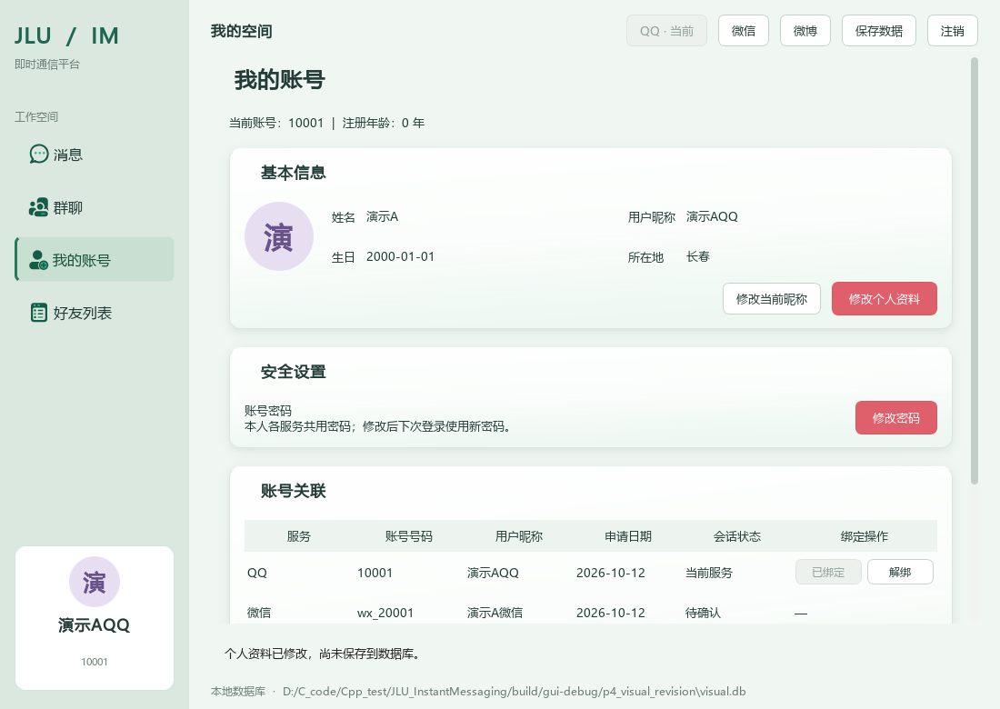

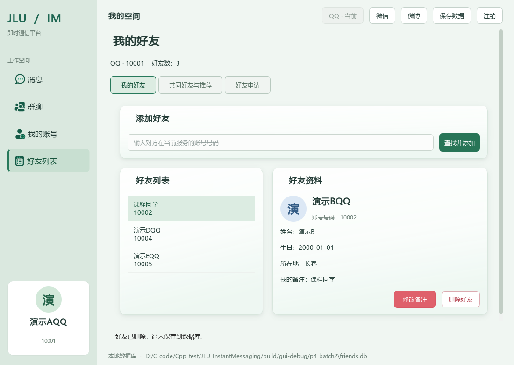

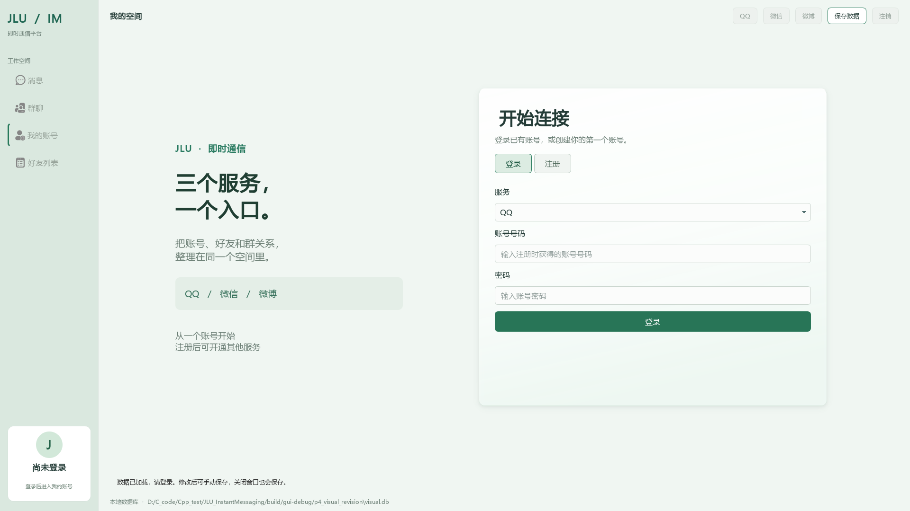

## 15 警告条实际位移修复（2026-10-13）

用户反馈警告条没有晃动。修复前使用现有 MainWindow 的“个人资料生日格式错误”场景，在离屏和原生 Windows 窗口分别逐帧采样，发现偏移数值虽为 −5 / +5，红条和文字的图像完全不变。此前第 10、14 节的相关测试只检查动画数值和归位，不能证明视觉位移，原“震动已验收”结论在此更正。

修复仅改动 UiFeedbackLJY.h 中的绘制函数：取得整条提示的 sourcePixmap 后，按偏移坐标 drawPixmap；不再通过平移 painter 后直接 drawSource。原浅红背景、文字、边框、42 像素最小高度、320 毫秒时长和左右 5 像素幅度保持不变，普通成功提示不晃动。接口依据为 [Qt 6.8 QGraphicsEffect 文档](https://doc.qt.io/qt-6.8/qgraphicseffect.html#sourcePixmap)。

原生 Windows 测试使用当前生产窗口和实际错误输入，系统显示缩放为 150%，截图统一为逻辑坐标后测得：

| 动画时刻 | 实际红条左边缘 | 相对原位 |
| --- | --- | --- |
| 0 毫秒 | 236 | 0 |
| 48 毫秒 | 231 | −5 |
| 96 毫秒 | 241 | +5 |
| 320 毫秒 | 236 | 0 |

自然播放时的连续帧也有实际左右位移，最终归位；固定关键帧用于精确核对两端幅度。控件布局位置保持原样，本次测试尺寸始终为 844×42，窗口没有被带动。

在原 p4_visual_revision 测试中补上红条实际像素位置检查，防止只改动画数值仍被判为通过；与 p4_visual_reload 共两项通过。gui-debug、gui-release 构建完成，正式数据库未改。新版程序位于 build/gui-release/bin/jlu_im_gui.exe，Debug 同步更新；dist 仍是 P4 阶段的历史包，不用于验证此次修复。P5 第四批未启动。

- [修复前 Windows 逐帧数据](P4验收记录/警告条位移修复/修复前_Windows逐帧.csv)
- [修复后 Windows 逐帧数据](P4验收记录/警告条位移修复/修复后_Windows逐帧.csv)
- [结果摘要](P4验收记录/警告条位移修复/结果.json)、[回归日志](P4验收记录/警告条位移修复/CTest.log)
