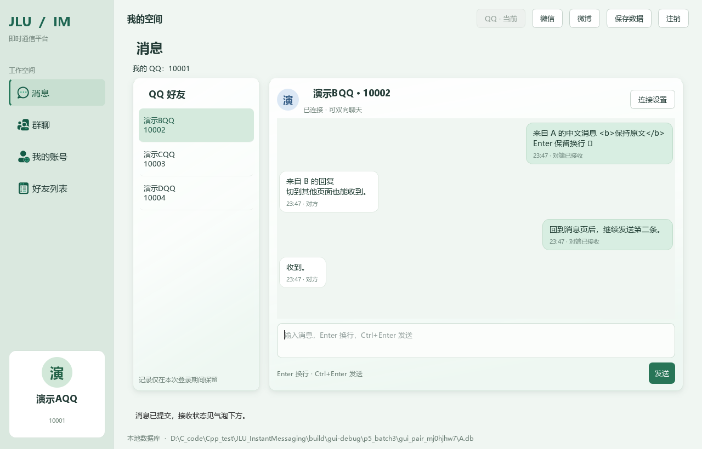
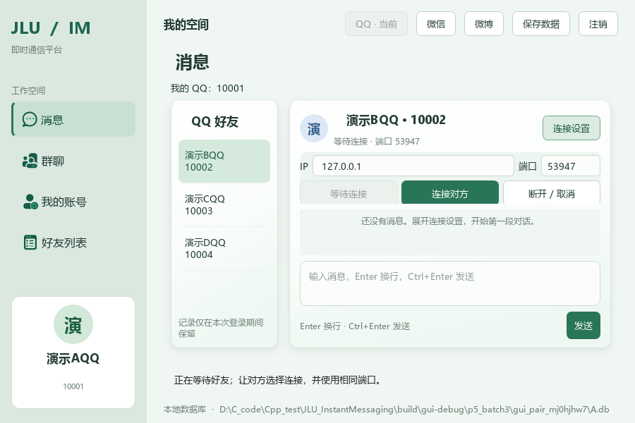
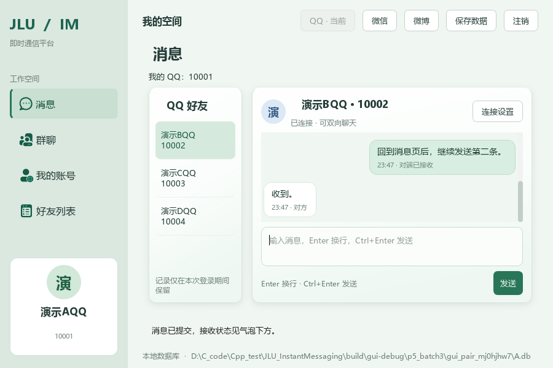
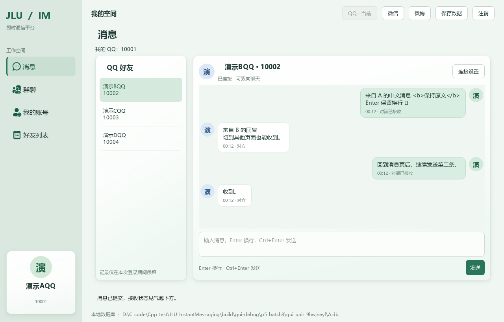
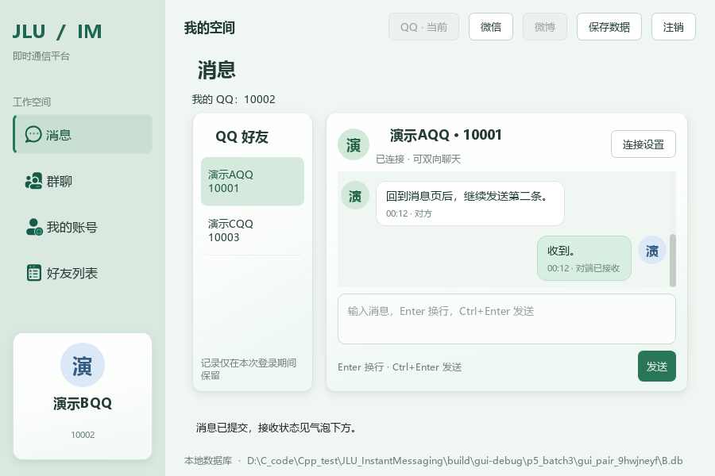

# P5 第三批：图形端实际聊天说明与验收

> 历史批次说明：当前 P5 已完成三服务聊天、协议 2、服务隔离历史及便携包；以 [P5 使用与代码说明](P5使用与代码说明.md) 和 [阶段总验收](P5第六批与阶段总体验收.md) 为准。本文保留当批测试与设计，旧 QQ 专属字段、协议 1、未实施批次及 P4 发布说明不代表当前状态。

> 本文保留第三批交付时的说明。2026-10-13 第四批已补充 SQLite 自动保存、分页与重启恢复；文中“暂不保存历史”为当时边界，当前行为见 [第四批说明与验收](P5第四批说明与验收.md)。

完成日期：2026-10-12。对应 [P5 临时任务清单](P5临时任务清单.md)顺序 **7—9，已完成**。本批接通现有 Qt 页面与第二批 Socket 网络模块，两个窗口现在可以进行 QQ 好友文字私聊。

## 1 本批完成了什么

- “消息”占位页替换为左侧 QQ 好友列表、右侧对端信息、消息气泡、多行输入框和发送按钮。保留浅绿主题、微软雅黑、柔影卡片及四项侧栏。
- 好友资料增加“发消息”，点击后跳转并选中该好友。
- “连接设置”可展开 IP、端口及等待/连接/断开操作；身份握手成功后自动收起。默认本机 IP 为 127.0.0.1，端口 27015，可修改。
- Enter 换行，Ctrl+Enter 或“发送”按钮提交。本人消息靠右，对方消息靠左；时间和接收状态显示在气泡下方。
- 空白消息拒绝发送，输入保留；所有反馈使用底部固定区，错误沿用红色警告条。正常反馈保持黑字无背景。
- 在“我的账号”等其他页面操作时，当前连接仍能收发；回到消息页可看见本次缓存。窗口缩放时气泡随可用宽度调整，停留在末尾时跟随新消息，向上翻阅时保留位置。
- 仅支持当前已登录 QQ 的已有好友，一次连接一个对端。当时版本切换好友会停止旧连接（2026-10-20 已改为浏览保留连接，详见文末）；同一 QQ 登录期间按好友分别保留消息和输入草稿。

第三批暂存消息于内存，**注销、切离 QQ 或关闭程序会清空本次聊天**。顶部“保存数据”仍只保存原账号、好友和群资料，不保存聊天内容。SQLite 消息表、逐条写入和重启恢复属于第四批；完整断线重连、关闭失败与待保存联动的集中验收属于第五批。

## 2 现在怎样直接试用

### 2.1 可执行文件与演示库

新版 GUI 已构建到：

```text
D:\C_code\Cpp_test\JLU_InstantMessaging\build\gui-release\bin\jlu_im_gui.exe
```

Debug 版本同样更新，位置为 `build/gui-debug/bin/jlu_im_gui.exe`。`dist` 目录及 P4 压缩包仍为 P4 交付版本；本次实际聊天请使用上述新版。P5 完整便携发布验收安排在第六批。

已从同一份干净演示数据准备两个独立库：

```text
D:\C_code\Cpp_test\JLU_InstantMessaging\build\p5_demo\A.db
D:\C_code\Cpp_test\JLU_InstantMessaging\build\p5_demo\B.db
```

它们都认识 QQ 10001 和 10002，并已建立好友关系；账号密码均为 `DemoOnly123!`。两库与项目正式 `data/jlu_im.db` 分开，不会覆盖正式资料。后续在其中一端更改好友资料，不会自动同步到另一端。

### 2.2 打开 A、B 两个窗口

在任意路径的 PowerShell 中依次执行以下两行。使用绝对路径，因此即使提示符仍是 `PS C:\Users\27918>` 也能运行，不需要先修改 PATH：

```powershell
& 'D:\C_code\Cpp_test\JLU_InstantMessaging\build\gui-release\bin\jlu_im_gui.exe' --database 'D:\C_code\Cpp_test\JLU_InstantMessaging\build\p5_demo\A.db'
& 'D:\C_code\Cpp_test\JLU_InstantMessaging\build\gui-release\bin\jlu_im_gui.exe' --database 'D:\C_code\Cpp_test\JLU_InstantMessaging\build\p5_demo\B.db'
```

每行打开一个图形窗口。也可以分别在两个 PowerShell 窗口执行；不要让两个程序同时编辑同一个数据库。

1. A 窗口选择 QQ，登录 **10001**；B 窗口选择 QQ，登录 **10002**。密码均为 `DemoOnly123!`。
2. A 点“消息”，选 **演示BQQ / 10002**；B 选 **演示AQQ / 10001**。也可从“好友列表”选人后点“发消息”。
3. A 展开“连接设置”，保持 IP **127.0.0.1**、端口 **27015**，点“等待连接”。
4. B 展开“连接设置”，填相同 IP 和端口，点“连接对方”。不要两端都点等待或都点连接。
5. 两端显示“已连接 · 可双向聊天”后发送中文；Enter 换行，Ctrl+Enter 发送。气泡出现“对端已接收”表示收到 ACK。
6. A 切到“我的账号”，让 B 再发一条，A 回到消息页可看到内容。
7. 想结束连接时展开设置点“断开 / 取消”；关闭窗口也会结束网络线程。

127.0.0.1 仅适用于同一台电脑。真实两台电脑的局域网演示本批未实测，不把本机两个进程等同于两机验收。

如果只想临时体验、不使用任何数据库，也可以运行两次上述 exe 并各自带 `--demo`。两端会载入相同演示好友数据，登录和连接步骤一致。

## 3 实现原理：网络怎样进入页面

### 3.1 原来已有的部分

第二批的 `TcpPeerLJY` 已经负责 Socket 后台线程、HELLO 身份核对、TEXT 消息帧、ACK 和可取消的等待。第三批复用这些接口，不再写第二套网络收发。

`MessagesPageLJY` 持有一个 `TcpPeerLJY`。用户点击连接时，先通过 `makeChatIdentityLJY(session, selectedQQ)` 核对当前登录的是 QQ、所选号码属于好友，再把必要的号码快照交给网络线程。线程不访问账号对象或界面控件。

### 3.2 点击发送后的路径

```text
发送按钮 / Ctrl+Enter
    → MessagesPageLJY::sendText()
    → TcpPeerLJY::sendMessage(UTF-8 正文)
    → 后台线程编码 TEXT 并通过 Socket 发送
    → 对端完整拆包，生成 Incoming 事件并回复 ACK
    → 本端收到 ACK，生成 Delivery 事件
```

`sendMessage()` 成功提交后才清空输入框，失败时保留内容。正文作为普通文字显示，即使输入 `<b>...</b>` 也不会变成 HTML。TCP 负责传输，第二批协议负责从字节流中恢复一条完整消息。

气泡状态含义沿用第二批：发送中、对端已接收、发送失败、结果未知。**对端已接收表示对方程序收到了完整消息，不代表对方已经阅读，也不代表已经写入数据库。**

### 3.3 为什么等待网络时界面不会卡住

网络工作线程把结果放进事件队列；页面使用间隔 **50 毫秒的 QTimer**，在 GUI 主线程调用 `pollEvents()` 取走事件：

```text
网络线程：Socket → 完整消息 / 连接状态 → 事件队列
GUI 主线程：QTimer → pollEvents() → 新建气泡 / 更新状态 / 固定反馈
```

QTimer 的间隔用于定期检查结果，不是要求网络每 50 毫秒必定到达。页面隐藏时定时器仍工作，所以切到账号页后仍会收到消息。Qt 控件只在主线程修改，不需要让网络线程直接操作 QLabel。

每次连接有独立标识，页面只接收当前标识的事件。切换好友时先停止并处理旧连接剩余事件，再变更所选好友；注销或切离 QQ 时清空旧账号的内存记录。正常关闭窗口确认完成后，主窗口停止连接，页面析构也会回收线程。

### 3.4 与 SQLite 的关系

本批数据库仍只为两个程序提供各自的账号和好友数据。**消息从 Socket 到达另一端，SQLite 不承担网络传输。**

当前收到的消息放在页面的 `conversations_` 容器中，按好友号码分类；`drafts_` 保存尚未发送的输入。第四批才在收到消息、提交发送以及状态变化时调用独立的聊天记录存储接口，逐条写库；不把消息塞入 Platform 的整库保存流程。

## 4 推荐代码阅读顺序

| 顺序 | 文件与重点 | 读完需要理解什么 |
| --- | --- | --- |
| 1 | `src/gui/MessagesPageLJY.h` | 页面持有什么对象：会话引用、一个网络端、控件、定时器和按好友分类的内存记录 |
| 2 | `MessagesPageLJY.cpp` 构造函数 | 布局由 Qt 控件组成；connect 把按钮点击、好友选择、定时器超时连接到处理函数 |
| 3 | `refresh()`、`openConversation()`、`selectFriend()` | 当前 QQ、好友列表和选中对象如何对应，什么时候清理旧连接 |
| 4 | `startConnection()`、`sendText()` | 用户点击怎样变成已有网络接口调用，输入失败为何不会丢失 |
| 5 | `pollEvents()`、`updateDeliveryLabel()` | Listening / Ready / Incoming / Delivery 等事件怎样变成可见状态 |
| 6 | `appendBubble()`、`fitBubbles()`、`eventFilter()` | 左右气泡、按正文长度和窗口宽度换行、Enter 与 Ctrl+Enter 的区别 |
| 7 | `MainWindowLJY.cpp`、`FriendsPageLJY.cpp` | 消息页如何嵌入原窗口，“发消息”怎样发出信号并跳转，反馈怎样交给固定底栏 |
| 8 | `tests/p5_chat_gui_tests.cpp` 与 `tests/p5_chat_gui_acceptance.py` | 两个真实进程如何各自登录、点击生产控件并通过网络交换消息 |

网络底层仍按 [第二批阅读顺序](P5第二批说明与验收.md)阅读。新增关键说明采用简体中文 `//` 注释，优先放在头文件，不逐行堆叠注释。

## 5 实际验收结果

本批使用 **两个独立 Qt 测试进程**，加载生产 `MainWindowLJY` 和页面控件，通过 QTest 点击按钮、输入文本。两端各用由同一基线复制的独立 SQLite 库，通过真实本机 Socket 收发。Qt 使用 offscreen 平台，截图来自真实控件渲染；这是自动化控件验收，不声称人工操作了两个桌面窗口。

| 验收项 | 本次结果 |
| --- | --- |
| A / B 分别登录不同 QQ，选择对方，A 等待、B 连接 | 通过；进程号不同，握手完成后才可发送 |
| 从好友详情点击“发消息” | 通过；跳转并选中正确好友 |
| 两端各发两条文字，中文、换行、短消息、普通文本中的 HTML 字符 | 通过；接收正文逐字核对一致 |
| Enter 换行、Ctrl+Enter 与按钮发送 | 通过；提交后清空输入，空白拒绝时保留输入 |
| 每端两条发出的气泡按 ACK 更新 | 通过；只有接收确认后显示“对端已接收” |
| A 切到账号页时 B 发送，A 回到消息页 | 通过；收到消息且已有消息保留 |
| 1280×820 与 900×600 缩放 | 通过；发送及固定反馈区可见，无横向溢出；连接按钮完整，气泡重排且保持最新消息 |
| 注销换人、切到微信、正常关闭 | 基础检查通过；无旧账号消息残留，非 QQ 说明明确，窗口正常结束 |
| 原账号、好友及外观相关回归 | 6 项 CTest 通过：p4_gui、p4_gui_reload、p4_friends_gui、p4_friends_reload、p4_visual_revision、p4_visual_reload |
| 构建 | gui-debug、gui-release 的 GUI 构建通过；local-debug 原终端构建通过 |
| 原项目数据与非 UI 模块 | 正式数据库 SHA-256 未变；原 network、domain、services、storage、ui 及 schema 未改 |

表情字符在协议中按 UTF-8 原样传输，自动验收也核对了内容；具体图形取决于字体回退，offscreen 截图中的部分表情显示为缺字框。本批不将全部 Emoji 字形显示计为已验证。

构建时 windeployqt 报告本机 Qt 缺少 translations/catalogs.json、可选 dxcompiler/dxil 等提示，构建与上述控件测试仍成功；本项目中文界面使用自有文字。这不替代第六批的独立部署验收。

本批未重复全部 P1—P4 测试，只回归受影响的账号、好友、界面；布局修正后重新跑第三批聊天测试。未执行两台电脑局域网测试，未创建聊天表，未提前完成第四至第六批。

### 5.1 日志和截图

- [双进程实际结果与 PID](P5验收记录/第三批/gui_results.json)
- [最终聊天 CTest 日志](P5验收记录/第三批/CTest_GUI.log)
- [构建、相关回归与正式库校验摘要](P5验收记录/第三批/verification.json)
- [A 端输出](P5验收记录/第三批/A.log)、[B 端输出](P5验收记录/第三批/B.log)







### 5.2 需要重新验证时

从项目目录构建第三批测试，再运行对应一项 CTest：

```powershell
Set-Location 'D:\C_code\Cpp_test\JLU_InstantMessaging'
$env:Path = 'D:\Qt\Tools\mingw1310_64\bin;D:\Qt\6.8.3\mingw_64\bin;C:\mingw64\bin;' + $env:Path
cmake --build --preset gui-debug --target p5_chat_gui_tests jlu_im_gui
ctest --test-dir build/gui-debug -R '^p5_chat_gui$' --output-on-failure
```

验收新建 build/gui-debug/p5_batch3 下的独立目录，使用自动选择的临时端口，结果写入 gui_results.json；不会接触正式数据库。当前清单下一批是第四批顺序 10—12：SQLite 聊天记录，等待用户安排继续。


## 6 追加外观调整（2026-10-13）

侧栏左下角身份卡现已复用 CardSurfaceLJY 柔影，配合偏白的半透明渐变、顶部高光和细边框模拟玻璃观感；保持白色基调和点击进入“我的账号”的行为。不是系统级背景模糊，文字与头像保持清晰。

每条聊天消息增加 36 像素圆形发送人头像：收到的消息为“头像—气泡”，自己发送为“气泡—头像”，头像顶端与气泡对齐。使用发送人在本地账号资料中的昵称首字与已保存预设颜色，悬停显示昵称和 QQ 号码；消息气泡预留头像与间距，小窗口保持可读和无横向溢出。

头像资料来自各端自己的本地数据库，本次不增加跨电脑资料同步或网络字段。修改本人颜色后，本机重新刷新聊天显示会采用新颜色；对方电脑仍按其本地资料显示。P5 第四批未启动。

实现位置：`CardSurfaceLJY.h` 的阴影助手支持 QWidget，因此 QFrame 卡片和 QPushButton 身份卡共用；`MainWindowLJY.cpp` 给身份卡应用效果；`MessagesPageLJY.cpp::appendBubble()` 添加头像并排列左右位置，`fitBubbles()` 为头像留出宽度；外观仍集中在 `theme.qss`。

验证：gui-debug、gui-release 构建成功；p4_visual_revision、p4_visual_reload、p5_chat_gui 三项通过。复用已有双 Qt 进程实际收发验收，并检查 1280×820、900×600 的真实控件截图。正式数据库哈希未变，业务、Socket 协议及存储代码未修改。新版仍位于 build/gui-release/bin/jlu_im_gui.exe（Debug 同步更新），dist 仍为 P4 历史交付包。

- [本次 CTest 日志](P5验收记录/第三批/2026-10-13_侧栏与头像/CTest.log)
- [校验摘要](P5验收记录/第三批/2026-10-13_侧栏与头像/verification.json)






> 2026-10-20 现行规则：以上第三批记录中的“换好友停止旧连接”已被替代。现在 `selected_` 只控制浏览，`connectedPeer_` 控制网络收发；点击新好友的开始聊天才切换连接。三服务均支持，当前行为见 [交互改进说明](交互改进_1-11_说明与验收.md)末节。
