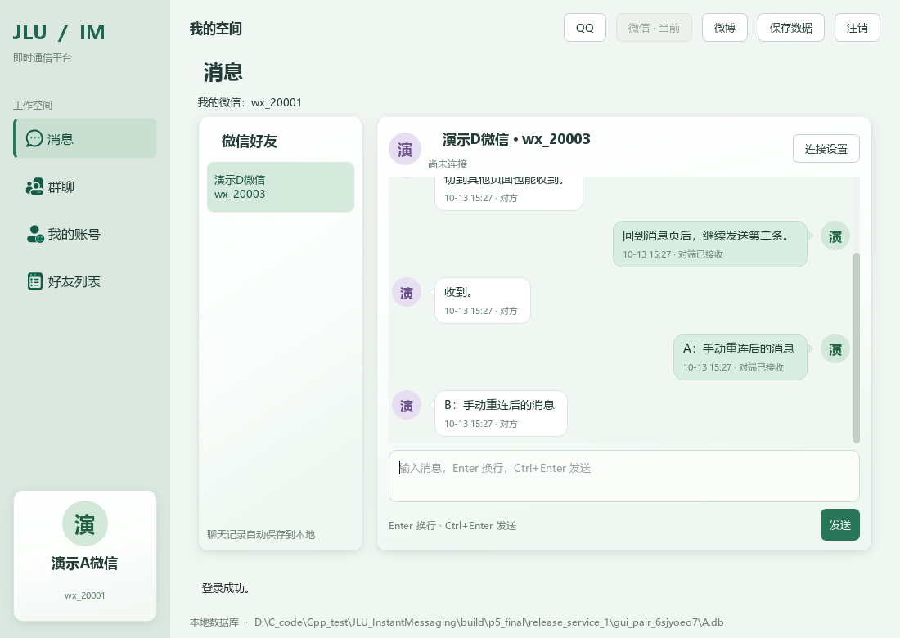
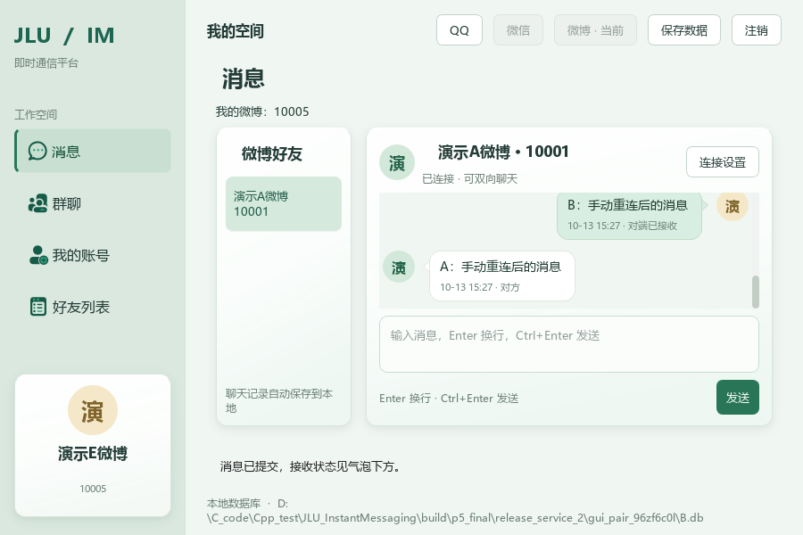

# P5 第六批与阶段总体验收

> 版本说明（P6 9A，2026-10-21）：本文保留当时的设计和测试记录。当前版本仅支持本机窗口通信，双机/IP、局域网发现和 --lan 入口已移除；运行请以 [现行使用说明](P5使用与代码说明.md) 为准。持久群服务、本机多群及离线补齐保留。

完成日期：2026-10-13。P5 六批、顺序 1—18 已完成本机范围的实现、验收与发布；QQ、微信、微博同服务好友私聊均已接入。P6 报告未开始。**实体两机局域网互通未实测，保留环境补验项。**

## 1 交付位置

- 当前目录：`dist/JLU_InstantMessaging/`，双击其中 `jlu_im_gui.exe`。
- 便携包：`dist/JLU_InstantMessaging_P5_Windows_x64.zip`，包含程序、Qt/MinGW 运行库、插件、许可与使用说明，不含用户数据库。
- 开发 Release：`build/gui-release/bin/jlu_im_gui.exe`；Debug：`build/gui-debug/bin/jlu_im_gui.exe`。
- 原终端：发布目录 `jlu_im.exe`；原 C:/mingw64 工具链构建为 `build/debug/bin/jlu_im.exe`。
- 重新打包：`scripts/package_p5.ps1`。更新发布目录保留已有 data，zip 排除数据库。P4 zip 保留为历史版本。

操作方法、演示账号和阅读顺序见 [P5 使用与代码说明](P5使用与代码说明.md)；三服务改动原理见 [第五批说明](P5第五批说明与验收.md)。

## 2 实际测试结果

| 范围 | 实测结果 | 证据 |
| --- | --- | --- |
| Qt/MinGW 13.1 构建 | 34 项不同 CTest 最终通过；含原业务、存储、Qt 页面与 P5 | [全量初次日志](P5验收记录/第五六批/gui_full_initial.log)、[网络单项复验](P5验收记录/第五六批/gui_network_recheck.log) |
| 原 MinGW 工具链 | 17/17 CTest 通过，终端仍能独立编译运行 | [终端完整日志](P5验收记录/第五六批/console_full.log) |
| 实际网络场景 | 13 个进程场景通过：连续中文、分段合并、服务/账号/版本拒绝、旧连接、ACK/握手超时、各阶段取消、RST 突然断线 | [网络明细](P5验收记录/第五六批/network_cases.json) |
| Debug 三服务双端 | 三个服务分别由两个独立 Qt 进程使用不同库，真实控件完成收发与重连；再用新进程重开各恢复 6 条记录 | [QQ](P5验收记录/第五六批/debug_qq.json)、[微信](P5验收记录/第五六批/debug_wechat.json)、[微博](P5验收记录/第五六批/debug_weibo.json) |
| 原生发布程序部署 | 中文移动目录、PATH 只留 System32，7 次真实 GUI 启动/正常关闭、2 次终端运行通过；默认/指定库和内存模式正确 | [发布启动与文件摘要](P5验收记录/第五六批/release.json) |
| Release 三服务双端 | 使用同一 Release 生产界面代码构建的测试入口，运行于发布副本，仅使用副本 DLL/插件，清除开发 PATH；三服务分别完成收发、重连和重启恢复 | [QQ](P5验收记录/第五六批/release_qq.json)、[微信](P5验收记录/第五六批/release_wechat.json)、[微博](P5验收记录/第五六批/release_weibo.json) |
| 数据保护与改动范围 | 正式 data/jlu_im.db 哈希未变；原领域业务与控制台实现保留，仅聊天身份等相关模块调整 | [改动范围](P5验收记录/第五六批/change_scope.json) |

初次 GUI 全量验收中 33 项通过，新增的“用已取消连接后的同一 Windows 满队列强制制造连接超时”测试失败：队列状态变化不能稳定保证这个前提。移除这一不稳定构造，保留真实待连接取消，并增加实际 RST 突然断线场景；网络单项重新通过，原终端全套也使用最终脚本通过。没有修改生产超时来迎合测试，也未重复运行已通过且未受改动影响的其余 33 项。

网络脚本早期另有进程启动超出 5 秒的情况，已把测试启动等待改为 10 秒并保留输出诊断。这只是测试工具的等待时间，生产连接/握手/ACK 仍分别是 10/5/10 秒。当前未声称在所有网络下都复现了主动连接 10 秒超时；此上限由现有代码执行。

Release 双端验证与原生程序启动验证分开记录：收发测试通过 Qt offscreen 操作同一生产控件，测试入口仅放在 build 下的发布副本，并临时加入 Qt6Test/offscreen 插件，未放入交付 zip；普通 jlu_im_gui.exe 的实际 Windows 启动与正常关闭由部署脚本验证。没有把测试辅助入口冒充最终 exe，也没有把同进程方法调用冒充独立网络进程。

## 3 局域网范围

只读核对到 WLAN IPv4 后，用该地址补试本机监听，系统返回 Winsock 10049（请求的地址在当前环境不可绑定）。首轮直接运行补测还缺少测试所需 offscreen 插件路径；补齐后启动正常，继而在绑定地址处明确失败。[记录](P5验收记录/第五六批/wlan_same_host.json)如实保留。

未修改网卡、路由或防火墙，也没有第二台可控设备。**当前通过的是 127.0.0.1 本机两个独立进程，不是实体局域网两机。** 两机操作步骤已写入使用说明，待双方处于可互通网络时补验；网络地址以当时 ipconfig 为准。

按原 P5 清单，实体两机属于环境相关补验项，无设备时标明未实测，不影响本机版本交付。局域网连接在实现上使用可配置 IPv4 和端口，没有写死回环地址。

## 4 界面核对

已查看微信重启历史及微博小窗口截图，确认服务名称、账号、好友入口、头像、气泡尖角、重连消息和历史恢复符合实际。保留原浅绿、柔影和微软雅黑样式，没有重写账号、好友、群页面。

## 5 当前边界与答辩顺序

每端为独立数据库中的模拟账号，不同步账号、好友及群资料。一次一位同服务好友直连，群导航仍是群管理；没有真实腾讯/新浪接口、云端服务器、离线消息、文件语音视频或自动重连。ACK 是应用收到，不是已读或写库承诺。旧 QQ 历史保留，协议 1 客户端需要双方一起更新。

推荐演示：用两个新库启动 → QQ 10001/10002 登录 → 等待/连接 → 中文换行互发 → 断开重连 → 关闭重开查看历史 → 换微信 wx_20001/wx_20003 → 换微博 10001/10005 → 说明服务隔离 → 展示保存失败的重试/取消机制 → 查看核心类调用。密码均为 DemoOnly123!（仅演示初始数据）。

P5 到此完成当前范围。下一阶段是 P6 最终报告和课程交付，不在本次自动启动；两机补验单独保留。
