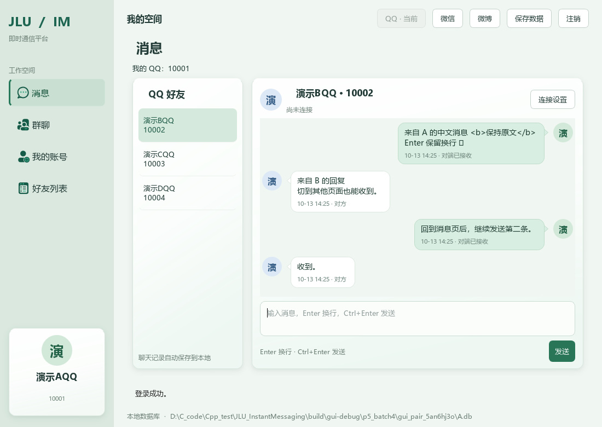
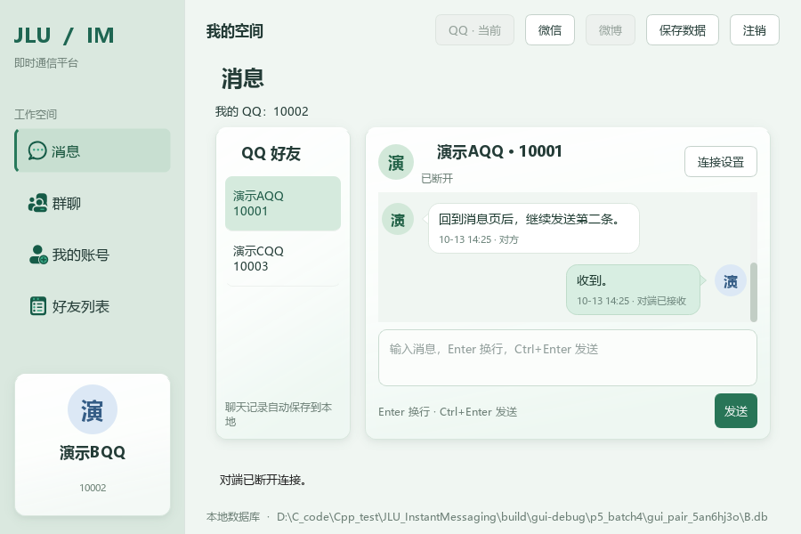

# P5 第四批：SQLite 聊天记录说明与验收

> 历史批次说明：当前 P5 已完成三服务聊天、协议 2、服务隔离历史及便携包；以 [P5 使用与代码说明](P5使用与代码说明.md) 和 [阶段总验收](P5第六批与阶段总体验收.md) 为准。本文保留当批测试与设计，旧 QQ 专属字段、协议 1、未实施批次及 P4 发布说明不代表当前状态。

完成日期：2026-10-13。对应 [P5 清单](P5临时任务清单.md)顺序 **10—12，已完成**。第五、六批未开始。本批沿用现有 Socket、业务及控制台，增加独立历史存储，并为聊天气泡加入朝向头像的小尖角。

## 1 使用变化

- 正常数据库模式：消息发送或收到后自动逐条写入 SQLite；收到 ACK 后更新原记录。无需每发一句都点“保存数据”。
- 选择 QQ 好友先显示最近 100 条，左侧“加载更早消息”每次再取最多 100 条。加载到最早一条后隐藏按钮。初次读取失败可点“读取聊天记录”重试。
- 关闭后重新打开**同一个数据库**，登录原 QQ 并选择好友，即可离线查看历史。连接状态不恢复，需要聊天时再手动连接。
- 上次异常退出留下的“发送中”，重读时显示“结果未知”；不冒充已接收，不自动重发。
- 写入失败时消息仍显示，左侧保留待保存数量和“重试保存记录”。底部用原红色错误条解释失败。数据库恢复可写后点击重试，按原顺序补存。
- 点击“保存数据”先尝试补存待保存消息，再保存账号、好友和群。关闭时先停止网络并处理最后事件，再尝试保存；仍失败时显示内置重试、取消、放弃卡片。
- 取消关闭保留窗口和待保存记录；连接已停止，之后需手动重连。明确放弃只舍弃尚未写入的记录，不删除已有历史。
- `--demo` 和 `--empty` 是内存模式，不创建聊天表，关闭后不保留记录。升级前已经关闭程序而丢失的内存聊天无法补回。

“对端已接收”依然只表示对端程序收到完整消息，并不表示用户已读或对端数据库保存成功。每个窗口使用各自的数据库，不共享一个库运行两个完整平台。

## 2 数据库怎样接入

项目已在 P3 编译接入 SQLite，因此无需安装新软件或数据库服务。新类 ChatHistoryLJY 使用同一份 SQLite 库，在 GUI 主线程持有独立连接；第一次查询或保存聊天时，使用 `CREATE TABLE IF NOT EXISTS` 创建缺失的表。原有账号、好友、群数据不清空。

| 字段 | 含义 |
| --- | --- |
| id | SQLite 自动分配的本地行号，用于排序、向前分页 |
| owner_qq | 这份记录属于哪个登录 QQ |
| peer_qq | 对端 QQ |
| message_key | 网络消息编号，ACK 也使用这个编号 |
| direction | 1 为本人发送，0 为本人接收 |
| body | UTF-8 正文，保留引号、换行等内容 |
| message_time | 发送方消息时间，Unix 毫秒；用于显示 |
| local_time | 首次保存时的本机时间，Unix 毫秒 |
| delivery_state | 发送中、对端已接收、发送失败、结果未知，对应枚举值 0—3 |

`UNIQUE(owner_qq, message_key)` 防止同一账号把一条消息保存两遍。首次使用 INSERT；同编号再次保存采用 `ON CONFLICT ... DO UPDATE`，只更新状态。因此收到 ACK 后不会新增一个重复气泡或改变原消息顺序。

正文通过 `sqlite3_bind_text` 绑定到问号占位符，不把正文拼进 SQL。中文以 UTF-8 字节保存，单引号和换行不会变成 SQL 语句。SQLite 每条 INSERT/UPDATE 自动提交，适合当前课设规模，不增加 ORM、连接池或额外后台数据库线程。

查询条件为 `owner_qq + peer_qq`，首次按 id 倒序取 100 条，再反转成时间线显示顺序；下次使用 `id < 当前最早行号` 继续查询。采用本地行号而非两台电脑的时间排序，避免时钟不一致造成分页漏项。索引为 `(owner_qq, peer_qq, id)`。

原 SqliteStorageLJY::save 会整体替换平台业务表。新聊天表独立于 Platform，既不参加原批量删除，也不建立指向这些会被替换的表的外键，所以“保存数据”不会清空聊天。聊天记录也不参与账号、好友、群的加载重建。

## 3 函数调用如何变化

```text
发送按钮 / Ctrl+Enter
  → MessagesPageLJY::sendText
  → TcpPeerLJY 提交消息并生成 Delivery 事件
  → MessagesPageLJY::pollEvents 追加本人气泡
  → MessagesPageLJY::storeMessage
  → ChatHistoryLJY::save → SQLite 插入记录

网络后台收到 TEXT / ACK
  → 事件队列
  → GUI 定时器调用 pollEvents
  → 追加收到的气泡 / 更新发送状态
  → storeMessage → save → 插入记录 / 更新原记录状态

登录后选择 QQ 好友
  → refresh → loadHistory
  → ChatHistoryLJY::load(owner, peer)
  → renderConversation → 带头像与尖角的气泡

数据库暂时不能写入
  → pending_ 保留消息及所属账号
  → 重试保存记录 / 保存数据 / 关闭窗口
  → retryHistory → 按顺序补存
```

网络线程仍只负责 Socket，不直接操作数据库或 Qt 控件。页面从事件队列取出结果后，在 GUI 主线程更新控件和数据库。SQLite 繁忙等待限制为 100 毫秒；失败之后暂存并等待明确重试，不在定时器中反复写失败的记录。

待保存项单独保存所属 QQ。注销或切换账号会清空当前显示，但不会把未保存记录误归到新账号；重试时仍按原账号写入。此处只是本机历史隔离，不代表同步两端的账号资料。

## 4 推荐代码阅读顺序

| 顺序 | 文件与入口 | 重点 |
| --- | --- | --- |
| 1 | src/storage/ChatHistoryLJY.h | StoredChatMessageLJY 的本地行号；save 与 load 的职责 |
| 2 | src/storage/ChatHistoryLJY.cpp 构造函数 | 打开已存在的平台库、按需建表和索引 |
| 3 | 同文件 save | 参数绑定、首次插入、ACK 更新状态 |
| 4 | 同文件 load | 本人/对端筛选、行号分页、发送中转未知 |
| 5 | src/gui/MessagesPageLJY.cpp 的 sendText、pollEvents、storeMessage | 在已有收发链路中加入保存；失败保留内存 |
| 6 | 同文件 loadHistory、retryHistory、prepareToClose | 历史显示、补存、关闭确认 |
| 7 | src/gui/MainWindowLJY.cpp 的 save、closeEvent | 与原保存及退出流程衔接 |
| 8 | src/gui/ChatBubbleLJY.h | QPainter 绘制圆角气泡和朝向头像的小三角 |

ChatBubbleLJY 仍是简单 QFrame 子类。圆角矩形与三角形合成同一条绘制路径，避免两者之间出现边线；本人浅绿气泡的尖角朝右，对方白色气泡的尖角朝左。文字区预留尖角宽度，不覆盖正文。头像继续使用本地昵称首字和预设配色。

## 5 手动体验

已有演示库 `build/p5_demo/A.db` 与 `B.db` 沿用第三批；本次未覆盖它们。分别在两个 PowerShell 窗口运行：

```powershell
# 窗口 A
& 'D:\C_code\Cpp_test\JLU_InstantMessaging\build\gui-release\bin\jlu_im_gui.exe' --database 'D:\C_code\Cpp_test\JLU_InstantMessaging\build\p5_demo\A.db'
```

```powershell
# 窗口 B
& 'D:\C_code\Cpp_test\JLU_InstantMessaging\build\gui-release\bin\jlu_im_gui.exe' --database 'D:\C_code\Cpp_test\JLU_InstantMessaging\build\p5_demo\B.db'
```

两份库仍为原演示数据时，A 登录 QQ 10001，B 登录 QQ 10002，密码均为 `DemoOnly123!`；若你已修改过账号或密码，使用自己修改后的值。两端选中对方好友，A 等待连接，B 用 `127.0.0.1` 和同一端口（默认 27015）连接。

互发几句后关闭两个窗口，再用原命令启动。重新登录并选择好友，不连接也应看见刚才的消息及状态。可点击“保存数据”后再重开，聊天仍存在。清空或换成另一个数据库自然不会出现原库的聊天。

本批不要求手动锁库；失败与恢复已由隔离测试验证。手动检查主要看历史恢复、尖角朝向和小窗口文字是否完整。

## 6 实际验收结果

| 验收入口 | 结果与覆盖 |
| --- | --- |
| p5_history | 通过。205 条分页、中文引号换行、时间逆序下的本地行号排序、ACK 去重、本人/对端隔离、原平台保存加载兼容、锁库失败与重试、重启发送中显示未知 |
| p5_chat_gui | 通过。两个独立 Qt 进程加载不同库，以实际生产控件完成 TCP 收发；A 收到消息时写库被锁，气泡仍显示并有错误反馈；取消关闭保留待保存记录，解锁后重试成功；两个新进程重开各恢复 4 条消息 |
| p5_history_gui | 通过。GUI 初次读取失败后重试；205 条按 100、100、5 加载，末尾按钮隐藏；分页回到较早记录；保存不丢失历史；换账号隔离；内存模式不显示持久化历史 |
| p3_storage_save / p3_storage_load | 2 项通过，原平台数据库读写不受影响 |
| p4_gui / p4_gui_reload | 2 项通过，原页面和恢复流程回归 |
| p4_visual_revision / p4_visual_reload | 2 项通过，原视觉交互与恢复回归 |

合计 **9 个不同的相关 CTest 项通过**。不重复执行与本批无关的全部业务排列组合。GUI 自动化使用 Qt offscreen 的真实 MainWindow 控件和真实 TCP，未把内存函数互调当成网络；本批未做两台实体电脑的局域网测试。

已人工查看双端宽/窄窗口及重新打开后的截图。发现并修复了历史气泡首次出现时字体样式尚未生效造成的多行裁切，并加入正文高度检查。最后对移除好友时同步清理分页游标做了小修正，避免重新添加同一好友后跳过历史读取。

Debug GUI、Release GUI 与原 local-debug 终端构建完成。Qt 部署仍提示本机缺少可选翻译目录及部分图形组件，不影响本次构建成功；已有 Qt 与 MinGW 运行库按构建脚本部署。`dist` 仍为 P4 历史包，P5 完整打包留待第六批。

验收只操作 build 下隔离数据库。与本轮开始前的哈希基线比对，正式 data 数据库、原领域/业务/网络/控制台源文件未变。

证据：[GUI 测试日志](P5验收记录/第四批/gui_ctest.log)、[存储测试日志](P5验收记录/第四批/storage_ctest.log)、[最终 GUI 复验日志](P5验收记录/第四批/gui_final_ctest.log)、[双端和重开结果](P5验收记录/第四批/gui_results.json)。





第五批继续完善并集中验收断线、手动重连、注销和切换服务等完整联动；本批的基本关闭确认不代表第五批已验收。今后不执行此前的邮件及关机要求。
