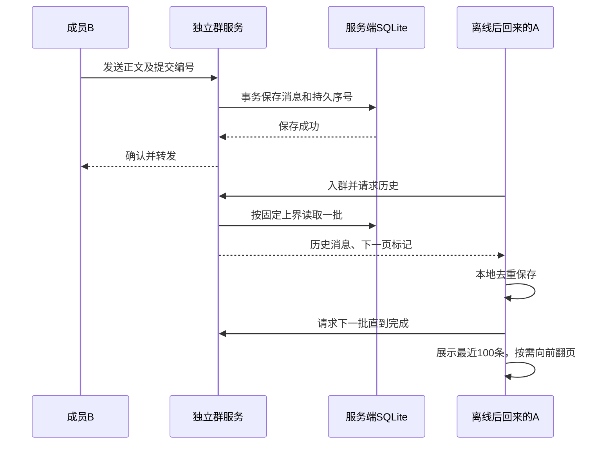

# P5 群离线同步方案与验收

> 版本说明（P6 9A，2026-10-21）：本文保留当时的设计和测试记录。当前版本仅支持本机窗口通信，双机/IP、局域网发现和 --lan 入口已移除；运行请以 [现行使用说明](P5使用与代码说明.md) 为准。持久群服务、本机多群及离线补齐保留。

日期：2026-10-15。此项修复群聊扩展中“只读本地历史、漏掉离线消息”的缺口，不启动 P6。保留已完成的 UI、私聊、终端及账号业务。

## 1 本次实现

- 本机正常数据库模式选择群后，自动启动独立 `jlu_group_server.exe`，不再由聊天页面保管房间。
- 服务先将正文写入自己的 SQLite，再广播并确认。服务崩溃重启后沿用同一房间标识和消息编号。
- 客户端进入、返回某群或断线重连后，自动分批补齐服务端记录并写入本地，再显示最近 100 条。
- 本地已有记录按唯一消息编号去重；旧消息补回后按时间与本地行号稳定排序，避免较新的缓存抢到最前面。
- “加载更早消息”仍每次显示 100 条。只有服务端同步完成后才说“已到最早消息”；未连接时只说明本地记录已读完。
- QQ、微信、微博、子群沿用各自的服务编号与群号；当前群成员可以读取该服务端保留的全部群历史。

2026-10-15 后续更新：当前服务各群已加入后台接收和未读计数，界面只展示当前群；离线后的服务端补齐仍保留。详见 [交互改进 1—11](交互改进_1-11_说明与验收.md)。

## 2 为什么独立服务能解决问题



数据库文件分为两类：客户端原来的 `group_chat_messages` 是本人的缓存；独立服务的 `room_messages` 是房间持久日志。客户端不会直接通过网络打开服务器的数据库文件。

`GroupRoomStoreLJY::append` 在事务中写入正文、序号、服务端时间，以“发送者 + 提交编号”防止重复提交。同一服务端的时间保持递增，重启后也不会回退。持久 UUID 和序号组成消息唯一编号。

每次连接暂采用“从头分批重放、客户端唯一键去重”，没有引入容易跳过保存失败消息的永久同步游标。这是课设规模的简洁实现，日志较大时会增加重连读取量；今后再优化已落库游标即可。单次最多 50 条且约 128 KiB，每条仍独立分帧，不把整段历史塞进一个网络包。

首次请求固定历史上界；同步期间新增的实时消息暂存在客户端队列，历史结束后合并。页面在历史落库后统一刷新，避免每条历史都重绘整个界面。

## 3 如何使用

### 本机：不需要租服务器，也不需要手动运行命令

1. 使用新版 `dist/JLU_InstantMessaging/jlu_im_gui.exe`，同目录必须保留 `jlu_group_server.exe` 及原 DLL。
2. 正常数据库模式登录，进入“消息 → 群聊”选择群。
3. 连接方式默认为“本机持久群聊”。待状态显示“群历史已同步”后发送。
4. A 注销或关窗口，B 留在群里发消息；A 再次登录选群，自动补齐。
5. 切换到另一个群期间，其余群继续在后台收消息并显示未读；断线或离线后返回时自动补齐。

正式程序将本机群日志集中保存在 Windows 当前用户本地应用数据目录：

```text
%LOCALAPPDATA%/JLU_InstantMessaging/group-server/
    0_1001.db       QQ 1001 群的服务端日志
    0_1001.json     本机群成员资料
    1_1001.db       微信 1001 群日志
```

同一 Windows 用户运行多个客户端，使用同一目录。不同群使用独立进程、独立日志和原有默认端口，避免本轮同时改写全部多群路由；未合并成单端口多房间服务器。本机群进程无人连接 60 秒后退出，下次选群自动启动并读回日志。不是开机服务，不注册系统服务、不设置计划任务。

本机成员文件仅首次建立；之后按实际成员增删合并到最新名单，文件锁和原子替换保护提交。普通刷新或旧窗口再次进入不会整份覆盖名单。本机服务每秒刷新，并广播完整名单及在线状态。远端服务的成员文件仍由服务电脑维护，尚未改造成集中式账号/群业务系统。

`--demo`、`--empty` 没有客户端持久库，继续作为内存练习模式，不能用于验收关程序后的离线恢复。

### 跨电脑：在一台电脑运行持久服务

另一台电脑不能读取你电脑的本机群服务。需要指定一个可互通、保持在线的服务端，暂不需要云服务器。

先在服务电脑正常进入目标群一次，生成对应成员 JSON；退出该群并等待自动服务无人连接 60 秒退出，再在项目根目录运行以下 QQ 1001 示例：

```powershell
$roomDir = Join-Path $env:LOCALAPPDATA 'JLU_InstantMessaging/group-server'
.\dist\JLU_InstantMessaging\jlu_group_server.exe --room 0:1001 --port 33001 --database "$roomDir/0_1001.db" --members "$roomDir/0_1001.json" --lan
```

该命令未设置空闲退出，服务持续运行；控制台 Ctrl+C 可停止。不要在已有本机服务占用该日志/端口时重复运行。微信 1001 群使用 `1:1001`、33998 和 `1_1001` 文件；微博使用 `2:1001`、34995 和 `2_1001` 文件。

各聊天客户端在“更多设置”选择“连接持久群服务”，填写服务电脑真实 IPv4 和相同端口，包括服务电脑自己也选择此模式。内置“复制 IP”可辅助填写。端口须允许局域网通信。本轮不自动修改防火墙。

旧的 UDP 自动发现保留在“局域网临时房间”选项，仅用于即时通信演示，不承诺离线补齐。持久模式连接到旧临时房间时会明确拒绝，不冒充已同步。

本协议继承课堂可信环境的群成员账号检查，并非公网账户认证系统；本轮不进行公网部署。云服务器只改变服务放在哪里，不代替同步逻辑。

## 4 边界与已有数据

- 服务端保存成功后才确认。服务不在线时不能确认发送，文字保留供本人处理；不是客户端离线排队发送。
- 已有本地聊天记录保留。更新前从未被保存到任何地方的消息无法恢复。本轮不自动上传旧客户端历史来伪装成服务端历史。
- 服务端目录不属于客户端便携包；不能只搬客户端数据库就认为群服务日志也搬走了。迁移服务需停止服务后复制对应日志和成员文件。
- 改端口不改变群日志文件；先停原服务，再在新端口启动，同一数据库不能同时由两个服务进程占用。
- 选择群和成员权限以已有业务及服务名单为准；被移出成员不能获取新历史。暂不实施“加入之前不可见”的时间区间策略。
- 物理断网、实体两机及云端部署仍待对应环境验证；本次使用真实本机 TCP 和独立服务进程，不将其描述成实体局域网实测。

## 5 验收

新增 `p5_group_offline_tests.cpp` 使用独立服务进程和真实 Qt 群聊页面，各次使用临时目录：

1. A 离线，B 发送 205 条消息；A 本地预存一条最新消息，进入后自动补齐全部记录。
2. 页面依次显示 100、200、205 条，逐条校验顺序、无重复，最后才显示“已到最早消息”。
3. A 确实选到另一个群，B 再发送 7 条；返回原群自动补齐。
4. 历史同步时 B 同时发送新消息，合并后只有一份。
5. 强制结束独立服务，重新启动同一日志，客户端自动重连，消息不丢失、不重复。
6. 新建空的客户端数据库，重连后重新获取全部 214 条，证明历史来自服务端而非旧客户端缓存。
7. 上述流程在 QQ、微信、微博分别执行；原三进程、子群、成员移除和保存失败等测试继续回归。

本次 9 项群聊测试全部通过（127.27 秒），包含协议、三服务图形三进程、子群、群状态及新增三服务离线场景。另复验私聊历史、私聊生命周期、统一 UI 布局 3 项。原始结果见 [群聊回归日志](P5离线同步验收记录/群聊9项回归.log) 和 [共享界面回归日志](P5离线同步验收记录/共享界面3项回归.log)。

测试过程中发现旧测试在连接完成前仍期待“暂无群聊天记录”，已改为核对真实的本地缓存提示；后台服务输出改为独立重定向，避免测试进程结束后被子进程输出句柄拖住。修复后上述 9 项通过。

Release、发布目录和便携包已更新，GUI 与独立群服务的二进制哈希一致，压缩包不含用户数据库或群日志。清除开发 PATH 后，发布服务完成实际 Socket 收发、强制终止后重启及另一账号历史读取；发布 GUI 使用隔离库启动通过。结果见 [发布核对](P5离线同步验收记录/发布核对.json)。

本轮前的源文件备份位于 `backups/群离线同步前_20261015_154020/source.zip`。本轮没有操作正式客户端数据库，也没有启动 P6。

## 6 代码阅读顺序

1. `src/network/main_group_server.cpp`：独立程序入口、成员文件、监听、空闲退出。
2. `src/storage/GroupRoomStoreLJY.h/.cpp`：持久房间标识、事务写入、历史分页。
3. `src/network/GroupChatHostLJY.cpp`：先写库后转发、历史请求与上界。
4. `src/network/GroupChatClientLJY.cpp`：自动启动本机服务、连接、历史分页、实时消息合并。
5. `src/gui/GroupMessagesPageLJY.cpp`：历史落库、同步完成刷新、加载更早与状态提示。
6. `src/storage/GroupChatHistoryLJY.cpp`：客户端唯一键去重与补回旧消息后的正确排序。
7. `tests/p5_group_offline_tests.cpp`：独立进程验收和故障重启。
