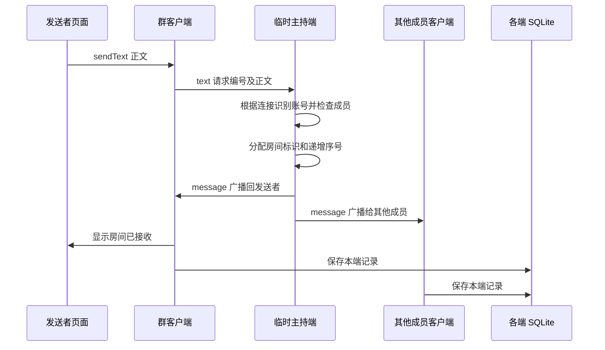

# P5 群聊实现说明与验收

> 版本说明（P6 9A，2026-10-21）：本文保留当时的设计和测试记录。当前版本仅支持本机窗口通信，双机/IP、局域网发现和 --lan 入口已移除；运行请以 [现行使用说明](P5使用与代码说明.md) 为准。持久群服务、本机多群及离线补齐保留。

> 2026-10-17 现行补充：[交互改进 1—11](交互改进_1-11_说明与验收.md)已接入自动保存、普通群创建、完整名单、后台群接收、未读计数、列表搜索、最近摘要及历史阅读定位；下文早期的手动保存、单群连接说明以该补充为准。

> 2026-10-15 更新：本机正常模式已改为独立持久群服务，支持离线补齐与服务重启恢复。当前使用与实现以 [群离线同步方案与验收](P5群离线同步方案与验收.md) 为准。下文为 10 月 14 日初版实现记录，临时主持、只读本地历史等限制仅适用于保留的临时房间模式。
日期：2026-10-14。对应 [群聊扩展方案与四批清单](P5群聊扩展方案与任务清单.md)。四批已完成：自动房间、图形页面、历史与业务联动、验收和发布。P6 最终课程报告未开始。

## 1 如何使用

进入“消息 → 群聊”，点一个本人参加的群，程序自动加入。群管理中也有“进入群聊”按钮。第一位成员自动启动房间，哪怕他只是普通成员；后续成员自动连接，不必分配谁点监听、谁点连接。页面显示“已加入”后可发送。

每个窗口同时参加一个群房间。切去账号、好友、群管理页面，房间仍工作；选择另一个群、切换服务、注销或关闭时退出。原私聊连接独立保留，可与群聊同时工作。

Enter 发送，Shift+Enter 或 Ctrl+Enter 换行。消息显示昵称、号码、首字头像和尖角，自己靠右。长消息预览六行，可展开、收起，完整正文不会被截断。

本机三人演示、完整命令及三服务账号见 [使用说明](P5使用与代码说明.md) 的“多人群聊”节。正常发布入口为 `dist/JLU_InstantMessaging/jlu_im_gui.exe`；应复制整个发布目录到另一台电脑。

## 2 房间是什么，为什么不用手动连接

房间是某个已进入成员的程序内临时启动的 TCP 转发端。这个程序同时具有“主持端”和“普通聊天客户端”两种角色；自己的正文也通过客户端发给主持端，再统一广播回来。因此没有一套专门给群主发送的特殊流程。

主持端只负责网络转发，不是业务里的群主。关闭主持窗口后，其他成员重新找房或创建房间，群主身份没有转让。一个人在线时，也能启动房间并发送，其他人稍后进入可以接收之后的消息。

### 本机自动加入

群标识由“服务编号:群号”组成，例如 QQ 群 1001 是 `0:1001`，微信群 1001 是 `1:1001`。同号不同服务不会混在一起。

默认端口为 `32000 + (service * 997 + group) % 20000`。第一次进入尝试监听该端口，成功就主持房间；端口已被占用则连接其上的已有房间。加入后仍要核对服务和群号，误占用端口不会被当成正确群。QQ、微信、微博的 1001 群默认分别为 33001、33998、34995。

这种映射足够课堂小规模演示，但不是全球唯一分配。发生其他软件占用或不同群映射冲突时，在内置“更多设置”改端口，各参与端配置一致。

### 局域网自动发现

“更多设置”选择局域网模式，指定 IP 留空。客户端通过 UDP `239.255.42.99:45045` 发送找房请求；主持端公告群标识、随机房间标识和 TCP 端口，聊天正文仍走 TCP。公告在可组播网卡发送，不能把虚拟网卡地址当作另一台电脑必然可访问的地址。

进入后先留出短暂发现时间；没有房间就监听默认端口，局域网模式下该端口被占用可由系统分配空闲端口。两人同时开房时，比较随机房间标识，较大的候选停止主持并加入较小的候选。本机测试验证了两个候选最终收敛，不需要用户选择角色。

UDP 发现依赖网络允许组播。若环境屏蔽发现，让一人自动开房，其他人填写他的实际局域网 IPv4 和页面显示的端口。指定 IP 模式只连接这个地址，不在失败时另开房。这也意味着指定 IP 的主持电脑退出后，需要改为新地址或恢复自动发现。

自动模式下，主持端退出造成 TCP 断开，客户端重新发现或监听；新主持实例使用新 UUID，避免新房间的消息序号和旧房间重复。无心跳，静默断网的识别速度仍取决于 Socket；不承诺断网瞬间恢复。

## 3 消息如何从一个人到达所有人

TCP 是字节流，不保证一次接收刚好是一条消息。GroupChatProtocolLJY 在 JSON 外放四字节大端长度，接收缓冲够一帧才解析，不够则等下次；一次有多帧则逐个取出。JSON 负责清楚表达种类和字段，正文不靠换行切割，因此中文和多行可原样传递。正文上限 16 KiB，帧上限 64 KiB。

入场帧 hello 携带协议版本、群标识、账号和预设头像色。主持端核对本地成员清单及重复账号，再发送 welcome 和 roster。发正文时不接受用户另填发送人，直接使用这个 Socket 已登记的账号；昵称来自主持端的本地群资料。message 包含消息编号、账号、昵称、颜色、正文、时间和原请求编号。

发送者收到自己的广播后，删除待确认请求并显示气泡。“房间已接收”表示主持端收到了正文，不等于全体成员在线、不等于已读。断开或 10 秒未确认时，未确认文字放回输入框并提示结果未知，不自动重发，避免对端实际收到后又被重复发送。

群网络采用 Qt Network 的异步 QTcpServer / QTcpSocket / QUdpSocket，在 Qt 事件循环中响应 readyRead 等信号，没有在界面线程阻塞等待网络。私聊继续使用原 Winsock 后台线程；本次没有重写已验收的私聊。

## 4 SQLite 的变化

SQLite 只负责保存，不承担消息联网。消息首先经 TCP 到达每个在线程序，各程序再写自己的数据库，不通过让多人共享一个数据库文件实现聊天。

新增独立表 `group_chat_messages`，第一次查看正常模式的群历史时创建。原账号、好友、群和私聊表保持原来的用途。

| 字段 | 含义 |
| --- | --- |
| id | 本地递增行号，用于向前分页 |
| service、owner_account、group_number | 当前服务、使用者账号、群号，共同限定历史归属 |
| message_key | 房间 UUID 加递增消息序号 |
| sender_account、nickname、avatar_color | 发送人及当时的显示资料 |
| body、message_time | 完整正文和 Unix 毫秒时间 |

联合唯一键为 `service + owner_account + group_number + message_key`。重复保存同一广播使用 INSERT OR IGNORE，不新增第二条。读取按本地行号取最近 100 条，再反转为时间顺序；更早分页使用 `id < before`。

这里只存已由房间回传的消息，未确认发送没有虚构的成功记录。写入失败时消息仍保留在页面及 pending_ 队列，队列项记录原服务、账号、群号，切换后重试也不会写到新身份。保存和退出提供重试、取消、明确放弃。普通“保存数据”仍保存平台资料，不清空群消息表。

`--demo` / `--empty` 使用内存记录；正常模式逐条落库。离线时可读取以前的本地记录，但不会补齐自己不在线时他人发送的内容；输入草稿只保留在本次程序内存中，不承诺重启恢复。

## 5 群管理如何影响群聊

GroupMessagesPageLJY 从现有 SessionManagerLJY 查询本人群列表及成员，不另建一套群管理。页面刷新时，当前群仍存在就更新主持端成员表；本人退群、被移出或身份变化则停止原连接。

主持端本地移除在线成员，会发送拒绝并断开其连接。接收方不会无限尝试重新入场。其他电脑修改群资料不会自动同步到主持端，演示前应使用一致成员资料；这是当前客户端分别持有本地数据的边界。

QQ、微信、微博按服务隔离。子群使用独立群号，因此拥有自己的房间与历史。主群切换 QQ/微信管理策略时，原群身份、已保留子群和聊天历史不被删除，也不把群切换到另一个服务。

当前握手适用于可信课堂局域网，核对成员账号，没有联网密码认证或端到端加密。它不是公网账号服务器，也没有实现云端群资料同步或离线转发。

## 6 代码推荐阅读顺序

先读每个头文件的中文注释，再读下面列出的关键函数；不用从页面构造函数里大量控件布局开始。

| 顺序 | 文件 | 阅读重点 |
| --- | --- | --- |
| 1 | [GroupChatMessageLJY.h](../src/domain/GroupChatMessageLJY.h) | 一条已确认群消息有什么字段，fromFrame 如何转换 |
| 2 | [GroupChatProtocolLJY.h](../src/network/GroupChatProtocolLJY.h)、[实现](../src/network/GroupChatProtocolLJY.cpp) | encode / feed，长度前缀与接收缓冲 |
| 3 | [GroupChatHostLJY.h](../src/network/GroupChatHostLJY.h)、[实现](../src/network/GroupChatHostLJY.cpp) | start → acceptPeers → receive → broadcast；roster / updateMembers |
| 4 | [GroupChatClientLJY.h](../src/network/GroupChatClientLJY.h)、[实现](../src/network/GroupChatClientLJY.cpp) | enter → attempt → connectTo → receive；之后读 tick / announce / discover |
| 5 | [GroupChatHistoryLJY.h](../src/storage/GroupChatHistoryLJY.h)、[实现](../src/storage/GroupChatHistoryLJY.cpp) | 构造建表、save 逐条写入、load 分页 |
| 6 | [GroupMessagesPageLJY.h](../src/gui/GroupMessagesPageLJY.h)、[实现](../src/gui/GroupMessagesPageLJY.cpp) | selectGroup → join → sendText → receive；再读 loadHistory / retryHistory / prepareToClose / render |
| 7 | [MainWindowLJY.cpp](../src/gui/MainWindowLJY.cpp)、[GroupsPageLJY.cpp](../src/gui/GroupsPageLJY.cpp) | 消息页签、群管理跳转、切服务、注销和关闭联动 |

最短调用路径：点击群 → selectGroup → join → room_.enter → attempt；按 Enter → sendText → room_.sendText → 主持端 receive / broadcast → 各客户端 receive → 页面 receive → history().save → render。

## 7 验收记录

验收使用隔离数据库和测试进程，不操作正式 `data/jlu_im.db`。证据在 [群聊验收目录](P5验收记录/群聊_2026-10-14)。

| 项目 | 结果及实际覆盖 |
| --- | --- |
| p5_group_network | 通过：分帧、三个成员收发、普通成员首开、错服务/非成员/重复账号拒绝、成员移除、主持端恢复、消息编号不重用；本机组播候选收敛；历史分页、去重、隔离和锁库 |
| p5_group_gui_0 / 1 / 2 | 通过：QQ、微信、微博各三个独立 GUI 进程，真实 TCP；C 首开，A/B 加入收发；C 退出后 A/B 恢复；保存及新进程读取 |
| p5_group_gui_subgroup | 通过：独立子群的三进程收发与恢复 |
| p5_group_state | 通过：105 条历史的 100+5 分页、长文展开、隐藏页面收取、锁库重试与取消关闭、主持端成员移除、模式切换不断线、群隔离、平台保存保留 107 条历史、注销停止 |
| 原功能回归 | 全量 42 项首轮发现两处测试问题；修正后相关 8 项全部通过，其余首轮已通过项未无故重跑 |
| 截图检查 | 检查最终 1100×820 聊天及 900×600 设置截图：绿色卡片、头像尖角、昵称、固定反馈、IPv4 和保存按钮可见 |
| Release | 已构建并部署便携目录及 zip，清除开发 PATH 后执行独立库启动检查；详情记录在同目录发布核对文件 |

首轮问题如实保留：旧 P4 测试仍断言交换前侧栏顺序；新增长文测试在控件显示前过早检查展开按钮。已调整断言和等待显示时机，相关 8 项复验通过。首轮原始记录为 `全量首轮.log`，复验为 `修正后相关8项.log`。

GUI 三进程通过真实 TCP 传消息，标志文件只协调何时启动和退出；没有用文件传递聊天正文。自动 UI 测试采用 offscreen Qt 平台，测试截图已查看；不把它描述成人工逐项点击验收。

正式数据库哈希与开发前一致；原终端、业务核心、私聊网络和私聊历史源文件未改。发布时不打包用户数据库或本地连接 INI。

## 8 实测边界

已测同一电脑三个独立进程，以及本机局域网模式的组播发现和候选收敛。没有第二台实体电脑可供控制，因此没有宣称两台电脑实际收发通过；跨机器路由、防火墙、组播可达性需现场补验。

本版本没有云服务器、跨网段发现、NAT 穿透、成员资料同步、离线消息补齐和全员已读。网络分区或发现被阻断时，不承诺多个孤立网络中的房间自动成为一个房间。所有这些限制在方案和使用说明中保持一致。

## 加载更早消息修复（2026-10-14）

用户反馈点击后像没反应。实际复现确认：群聊分页已从数据库读出旧消息，但原代码按新增内容高度补偿滚动位置，仍让人停留在原消息处，且没有加载提示。旧验收仅检查气泡数量，没检查旧消息是否进入可见区域。

本次改为点击后定位到新加载的一批旧消息，并在底部提示“已加载 N 条更早的群消息”；到头后按钮显示“已到最早消息”，空历史显示“暂无群聊天记录”。每批显示 100 条，多查询一条判断是否仍有更早记录，避免不足或刚好 100 条时仍提供无效加载。读取失败则保留“重试加载聊天记录”。没有修改数据库表或通信协议。

验收先在旧实现增加可见位置检查，实际失败：`older messages loaded but not brought into view`。修复后 p5_group_state 与 p5_history_gui 两项通过：群聊 205 条按 100→200→205 加载，核对滚动位置、最早正文进入可见区域、提示条数和结束按钮；另核对恰好 100 条、空历史、重进群，以及原私聊分页。群消息新增后保存总数为 207，原成员和保存流程仍通过。日志见 [分页修复记录](P5验收记录/历史分页修复_2026-10-14)。

Debug、Release 及便携包同步更新。较早的群聊验收结果属于当时记录，本节补充实际可见性检查。
