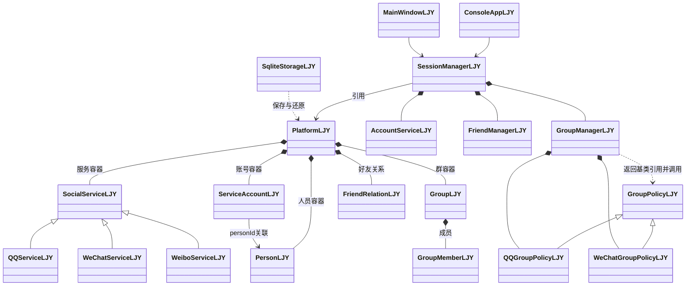
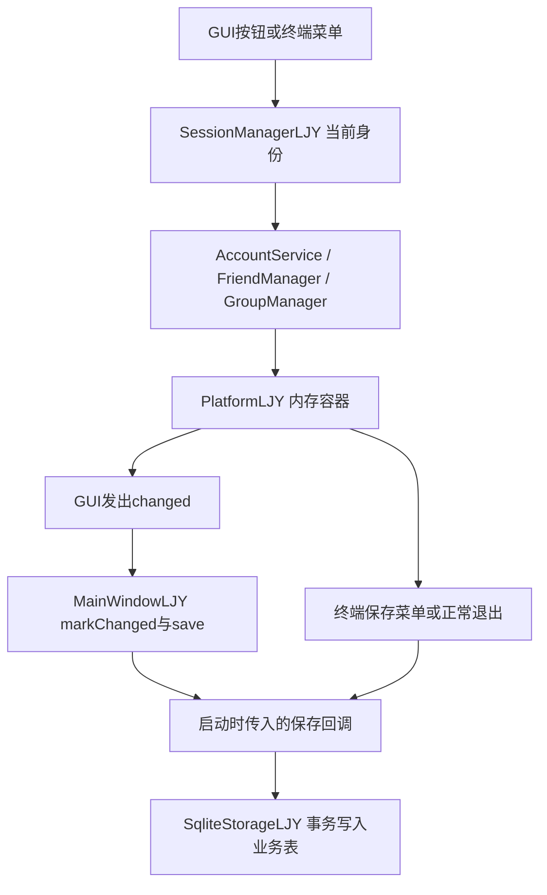
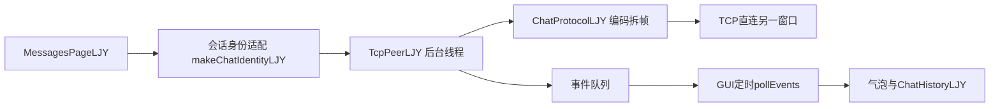
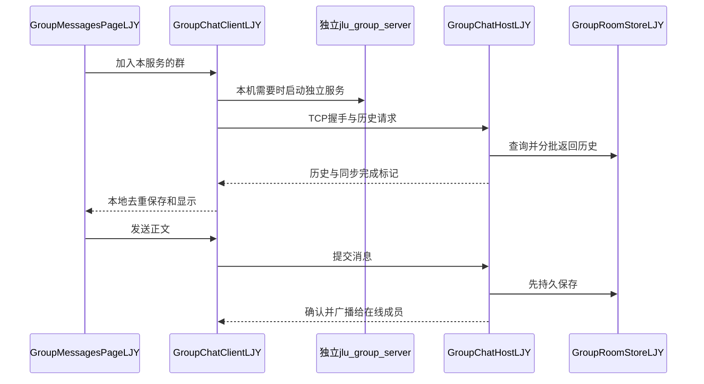

# P6 实际架构与代码阅读

2026-10-27 补充：[本地多窗口同步修复与验收](P6本地多窗口好友同步修复与验收.md)。`id_state.revision` 记录业务版本；GUI 每 500 毫秒重读其他窗口已提交的业务变化，保存时拒绝旧副本覆盖。业务表仍为十张，聊天写入不触发业务刷新；仅同一数据库路径参与同步。

核对日期：2026-10-21。描述当前源码，不是待实现方案。课程对照和已发现差异见 [第三批说明](P6第三批课程核对与说明.md)；以下类名均使用实际 LJY 后缀。

补充学习材料（2026-10-27）：[源码阅读指南 Markdown](源码阅读指南_面向对象_SQLite_Qt.md)与 [Word](源码阅读指南_面向对象_SQLite_Qt.docx)。按实体、继承、容器、管理器和会话建立阅读顺序，再衔接 SQLite 与 Qt；包含类关系图和当前源码说明。

## 1 核心类关系

此图只保留答辩核心类，省略请求实体、日期、凭据与页面细节。箭头中的关联不都代表指针所有权：账号以人员编号关联 Person，Platform 实际持有对象；Session 持有 Platform 引用，并组合三个业务管理器。

最适合讲解多态的路径是 GroupManagerLJY::policy：根据 GroupLJY 的 style 返回 QQGroupPolicyLJY 或 WeChatGroupPolicyLJY 的基类引用，再调用 canApply、canKick 等虚函数。switchMode 只修改群的管理模式，不搬运成员容器，因此可以改变规则而保留成员数据。

当前没有实现旧方案中的 Storage → JsonStorage 多后端体系；实际业务存储是 SqliteStorageLJY，不能把计划中的类画进最终类图。

## 2 一次业务操作如何保存

启动入口先选择默认库、显式 --database 或内存模式，再创建 Platform 与会话；新正常库载入演示数据并保存，已有库恢复数据。GUI 成功提交后自动保存，未提交表单是草稿；终端保留保存菜单。内存模式没有落库回调。

SqliteStorageLJY::save 在事务中替换平台业务快照，只操作自身业务表，不清空聊天表。聊天消息使用独立的存储类逐条保存，避免改一个好友备注就重写整段聊天历史。

## 3 SQLite 的实际分工

| 所在文件/范围 | 表 | 负责的类及用途 |
| --- | --- | --- |
| 客户端数据库，10 张业务表 | persons、service_accounts、credentials、account_bindings、friendships、chat_groups、group_members、group_requests、id_state、friend_requests | SqliteStorageLJY；[业务建表文件](../schema/create_tables.sql) |
| 同一客户端数据库，私聊表 | chat_messages | [ChatHistoryLJY](../src/storage/ChatHistoryLJY.cpp)；按服务/本人/好友组织记录，更新 ACK 状态 |
| 同一客户端数据库，群历史及已读位置 | group_chat_messages、group_chat_read | [GroupChatHistoryLJY](../src/storage/GroupChatHistoryLJY.cpp)；服务端消息去重、本端缓存、分页与已读位置 |
| 独立群服务房间数据库 | room_identity、room_messages | [GroupRoomStoreLJY](../src/storage/GroupRoomStoreLJY.cpp)；持久房间身份、序号及服务端消息日志 |

完整使用聊天功能后，客户端具有上述 13 张应用表；聊天表按功能初始化，未使用相关功能的库不一定已经建齐。群服务另有 2 张应用表；不把 SQLite 内部 sqlite_sequence 计入业务设计表数，也不将迁移中的旧临时表算作现行表。

连接设置保存在数据库旁 .connection.ini、.group.connection.ini，私聊未读保存在 .unread.ini；群名单 JSON 与服务端日志在同机群服务目录。它们不是新的 SQL 表。

默认路径、备份及不同入口的区别集中在 [P5 使用说明](P5使用与代码说明.md)。本次只读建表代码，不打开用户库查看聊天正文，不迁移数据。

## 4 私聊调用与群聊调用

### 私聊

ChatProtocolLJY 使用四字节大端长度前缀；一次 receive 不必对应一整条消息，feed 保留半帧并取出完整帧。TcpPeerLJY 通过 Winsock 执行监听/连接及收发；后台线程与 GUI 用队列交换事件，GUI 每 50 毫秒取事件更新界面。ACK 只表示对端程序收到，不代表对方已读或已经写库。

MessagesPageLJY 的 selected_ 是正在浏览的好友，connectedPeer_ 是实际连接对象；切换浏览不关闭原连接，新好友开始聊天才替换。原连接的后台消息按原对象保存，不能把草稿发给错误对象。

### 群聊

群聊使用 Qt Network 事件循环，GroupChatHostLJY 管理多个连接，GroupRoomStoreLJY 保存服务端日志；不经过私聊 Winsock 工作线程。GroupMessagesPageLJY::refreshBackground 为其他已加入群维护后台客户端，前台只展示一个群。离线后恢复时，从服务端分批补齐，再在客户端去重保存。

GroupRosterLJY 的同机成员差异合并避免旧窗口刷新把已删除成员加回来；现行群服务只监听本机，不再提供远端入口。默认独立持久服务与旧临时主持房间要区分，只有前者承担离线历史恢复。

## 5 推荐代码阅读顺序

| 顺序 | 文件 | 重点回答的问题 |
| --- | --- | --- |
| 1 | [main.cpp](../src/main.cpp)、[main_gui.cpp](../src/gui/main_gui.cpp) | 两个入口怎样选择数据库、加载平台并创建会话？ |
| 2 | [PersonLJY.h](../src/domain/PersonLJY.h)、[ServiceAccountLJY.h](../src/domain/ServiceAccountLJY.h)、[PlatformLJY.h](../src/services/PlatformLJY.h) | 人员、服务账号和容器为什么分开？ |
| 3 | [SocialServiceLJY.h](../src/services/SocialServiceLJY.h) 及三派生类、[AccountServiceLJY.cpp](../src/services/AccountServiceLJY.cpp) | 共享 ID、微信独立 ID 和绑定如何实现？ |
| 4 | [SessionManagerLJY.cpp](../src/services/SessionManagerLJY.cpp) | 当前身份、服务确认、统一注销怎样传给业务？ |
| 5 | [FriendManagerLJY.cpp](../src/services/FriendManagerLJY.cpp) | 双向关系、单方备注、跨服务映射、好友申请如何组织？ |
| 6 | [GroupLJY.h](../src/domain/GroupLJY.h)、[GroupPolicyLJY.h](../src/services/GroupPolicyLJY.h)、[GroupManagerLJY.cpp](../src/services/GroupManagerLJY.cpp) | 权限怎样通过多态切换，成员为什么不丢失？ |
| 7 | [SqliteStorageLJY.cpp](../src/storage/SqliteStorageLJY.cpp)、[create_tables.sql](../schema/create_tables.sql) | 平台如何事务保存和还原，为什么不覆盖聊天表？ |
| 8 | [ConsoleAppLJY.cpp](../src/ui/ConsoleAppLJY.cpp)、[MainWindowLJY.cpp](../src/gui/MainWindowLJY.cpp) | 数字菜单与 Qt 按钮怎样复用业务，保存如何触发？ |
| 9 | [ChatMessageLJY.h](../src/domain/ChatMessageLJY.h)、[ChatIdentityLJY.cpp](../src/services/ChatIdentityLJY.cpp)、[ChatProtocolLJY.cpp](../src/network/ChatProtocolLJY.cpp) | 消息、会话身份快照及分帧是什么？ |
| 10 | [TcpPeerLJY.cpp](../src/network/TcpPeerLJY.cpp)、[TcpPeerChatLJY.cpp](../src/network/TcpPeerChatLJY.cpp)、[MessagesPageLJY.cpp](../src/gui/MessagesPageLJY.cpp)、[ChatHistoryLJY.cpp](../src/storage/ChatHistoryLJY.cpp) | 连接、后台收发、界面事件和历史如何串起来？ |
| 11 | [main_group_server.cpp](../src/network/main_group_server.cpp)、[GroupChatHostLJY.cpp](../src/network/GroupChatHostLJY.cpp)、[GroupRoomStoreLJY.cpp](../src/storage/GroupRoomStoreLJY.cpp) | 独立群服务怎样保存再广播，重启为什么能恢复？ |
| 12 | [GroupChatClientLJY.cpp](../src/network/GroupChatClientLJY.cpp)、[GroupMessagesPageLJY.cpp](../src/gui/GroupMessagesPageLJY.cpp)、[GroupChatHistoryLJY.cpp](../src/storage/GroupChatHistoryLJY.cpp) | 离线同步、后台多群、分页和未读怎么展示？ |

先读头文件的职责与关键接口，再沿一条实际调用进入 cpp；第一遍跳过主题样式和大部分测试。课程核心优先读 1—8，通信扩展再读 9—12。

## 6 9A 已完成：当前通信范围

本机多窗口真实 TCP 保留。私聊默认 27015；群端口仍按 32000 + (service×997 + group) % 20000 计算，1001 群分别为 33001/33998/34995。双方使用同一端口，不代表开放整个端口范围。

已删除双机模式、网卡/IP 输入、远端群服务入口、UDP 45045/组播发现和 --lan 参数。GroupChatClientLJY::enter 现在只接收群标识、账号、成员和端口，GroupChatHostLJY 仅监听 LocalHost；内存练习仍允许本机临时开房，正式模式保留独立持久服务。

过时自动连接说明已并入使用指南后删除，历史验收加适用范围提示。具体修改、验证和备份见 [9A 验收](P6_9A本机通信清理与验收.md)。系统防火墙未找到本项目程序对应规则，没有修改系统服务、其他程序或用户数据库。
