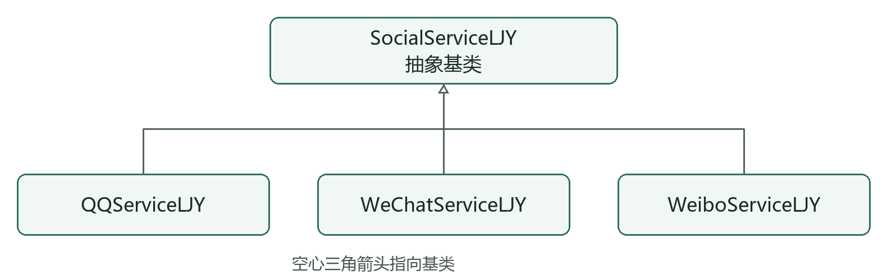
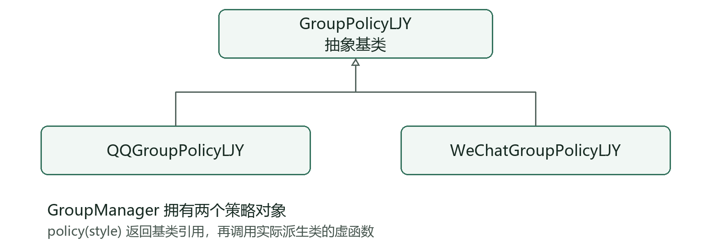
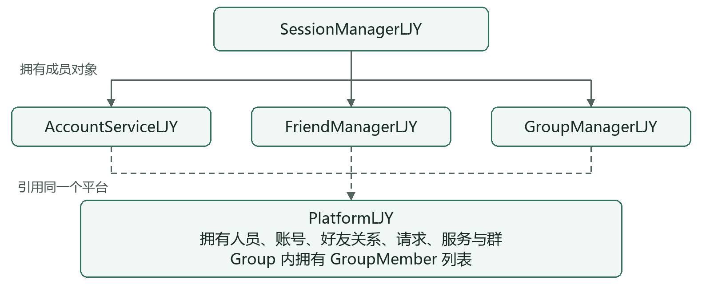

# 源码阅读指南

面向对象为主线 · SQLite 与 Qt 为辅助

适用项目：JLU 即时通信平台。核对日期：2026年10月27日。本文以当前源码为准，是学习指南，不替代五页课程设计报告。

## 1 总体阅读路线

### 1.1 src 各目录负责什么

先用目录定位代码，再按后面的路线阅读具体类。src 下主要分成六块：

| 目录 | 负责内容 | 典型类 |
| --- | --- | --- |
| [domain](../src/domain) | 业务数据模型：表示人员、账号、好友关系、群和消息，保存数据并提供基本操作与校验 | PersonLJY、ServiceAccountLJY、FriendRelationLJY、GroupMemberLJY |
| [services](../src/services) | 业务逻辑：处理登录、好友管理、群管理、权限判断，以及不同社交服务的规则 | SessionManagerLJY、FriendManagerLJY、GroupManagerLJY、GroupPolicyLJY |
| [storage](../src/storage) | 数据存储：将数据写入数据库、读取并还原对象，以及保存和查询聊天记录 | SqliteStorageLJY、ChatHistoryLJY、GroupChatHistoryLJY |
| [network](../src/network) | 网络通信：建立连接、收发消息、编解码通信协议，以及实现群聊客户端和服务端 | TcpPeerLJY、GroupChatClientLJY、GroupChatHostLJY |
| [ui](../src/ui) | 控制台界面：显示文字菜单、读取键盘输入、输出操作结果 | ConsoleAppLJY |
| [gui](../src/gui) | Qt 图形界面：窗口、按钮、好友页面、群页面、聊天页面和样式资源 | MainWindowLJY、FriendsPageLJY、MessagesPageLJY |

以“修改好友备注”为例，可以按下面的职责顺序理解：

```text
ui / gui   用户输入备注并确认
    ↓
services   检查当前身份、好友关系、备注是否合法
    ↓
domain     FriendRelationLJY 保存对应一方的备注
    ↓
storage    保存更新后的数据到数据库
```

这是职责示意，不表示 domain 会主动调用 storage；具体保存时机由应用流程安排。聊天时还会用到 network，负责发送和接收消息。

三个程序入口分别是：[src/main.cpp](../src/main.cpp) 启动控制台程序；[src/gui/main_gui.cpp](../src/gui/main_gui.cpp) 启动 Qt 图形程序；[src/network/main_group_server.cpp](../src/network/main_group_server.cpp) 启动群聊服务端。入口负责创建和组装所需对象，再启动程序运行。

### 1.2 推荐阅读顺序

建议先读面向对象部分，再接数据库，最后看 Qt。第一次阅读同名文件时，先看 .h 中的职责、公开函数和成员，再到 .cpp 找对应实现；不要从几千行的界面文件第一行一路读到底。

| 阶段 | 推荐顺序 | 读完应理解 |
| --- | --- | --- |
| 面向对象一 | 人员、账号、日期、凭据 → 好友与群实体 | 对象保存什么，哪些数据属于同一个人或同一个账号 |
| 面向对象二 | 服务继承 → 群策略继承 | 抽象类、虚函数和运行时多态 |
| 面向对象三 | 平台容器 → 三个业务管理器 → 会话 → 终端入口 | 对象如何合作完成一次业务 |
| SQLite | 表结构 → 存储类 → 启动加载和操作保存 | 对象如何变成记录，又如何还原 |
| Qt | 构建与入口 → 登录与主窗口 → 各业务页面 → 聊天与样式 | 点击按钮如何调用已有业务并刷新界面 |

本文将基础实体、两组继承体系、平台、三个业务管理器、会话和终端界面合计 23 个核心类作为重点。聊天消息、网络类、存储类及 Qt 类另列扩展路线。这里的划分是学习顺序，并不表示 SQLite 或 Qt 不使用面向对象。

所有源码路径均相对项目根目录；Markdown 中的文件链接可直接打开源码。核心类介绍保留 LJY 后缀，部分流程文字省略后缀以便阅读。LJY 是作者姓名缩写，不是每个注册用户的名字；增加用户只创建对象和数据记录，不需要增加一套 .h/.cpp。

建议每次只完成一条主线：第一遍认清数据和关系；第二遍跟踪一次成功操作；第三遍再看必要的失败分支。输入框、配色、网络拆包、SQL 参数绑定可以推迟，不必一开始同时理解。

<!-- PAGE -->
## 2 人员与账号先区分对象

依次阅读 [ServiceTypeLJY.h](../src/domain/ServiceTypeLJY.h)、[DateLJY.h](../src/domain/DateLJY.h)、[PersonLJY.h](../src/domain/PersonLJY.h)、[ServiceAccountLJY.h](../src/domain/ServiceAccountLJY.h)、[PasswordCredentialLJY.h](../src/domain/PasswordCredentialLJY.h)，再阅读相应 .cpp。ServiceType 是枚举，没有同名实现文件。

| 类 | 关键内容 | 重点观察 |
| --- | --- | --- |
| DateLJY | 年月日、格式化、日期比较、整年差 | 构造时验证日期；operator< 是运算符重载；fullYearsUntil 用于注册年龄 |
| PersonLJY | 人员编号、姓名、生日、所在地、头像颜色 | 私有成员配合只读访问函数，表达同一个自然人 |
| ServiceAccountLJY | 账号内部编号、所属人员、服务类型、对外号码、昵称、申请日期 | 一个 Person 可以对应多个服务账号，昵称属于账号 |
| PasswordCredentialLJY | 密码校验和匹配 | validatePassword 与 matches；当前是课设用字符串比较，不是早期复杂密码方案 |

四个类都没有自定义基类或派生类。ServiceAccount 通过 personId 关联 Person，它不是 Person 的子类。“某个人拥有一个账号”属于对象关联，不是“账号是一种人”的继承关系。

要分清三个编号：personId 标识一个人；accountId 标识平台中的一份服务账号；externalId 是用户输入的对外号码。查询登录账号需要“服务类型＋对外号码”，不能只看到 10001 就认定是哪一项服务。

例如，同一个人可以开通 QQ 和微博，按共享号码规则显示相同对外号码，但两条 ServiceAccount 仍有不同的内部 accountId。微信使用独立号码。好友和群成员通常关联内部账号编号，界面主要展示对外号码。

先看构造函数如何接收参数并初始化成员，再看 getter 如何返回信息。实体通常不负责菜单、弹窗、查 SQL；业务规则集中在后面的管理器。修改个人资料也不是给界面公开每个字段任意写入，而是通过 AccountService 校验并更新平台中的对象。

读完应能回答：同一人更改 QQ 昵称，会不会同时改变姓名和微博昵称？为什么账号和人员需要分别保存？

<!-- PAGE -->
## 3 好友和群用关系对象表达

继续按下表顺序阅读 domain 目录中的头文件和同名 .cpp。这六个类加上上一节四个类，构成十个基础实体及辅助值类型；它们同样没有自定义派生类。

| 类与源码入口 | 表达的含义 | 重点方法或字段 |
| --- | --- | --- |
| [FriendRelationLJY](../src/domain/FriendRelationLJY.h) | 一对账号之间的双向好友关系 | otherAccountId、remarkFor；双方备注分别保存 |
| [FriendRequestLJY](../src/domain/FriendRequestLJY.h) | 尚未或已经处理的好友申请 | 发送者、接收者、状态；当前状态用 0、1、2 表达待处理、同意、拒绝 |
| [FriendQueryResultLJY](../src/domain/FriendQueryResultLJY.h) | 跨服务查询得到的结果 | 账号副本列表与跳过原因，不负责添加好友 |
| [GroupMemberLJY](../src/domain/GroupMemberLJY.h) | 某账号在某个群里的身份 | accountId 与管理员标记；管理员是群内角色 |
| [GroupLJY](../src/domain/GroupLJY.h) | 一份群资料和成员集合 | 服务、群号、群主、管理模式、parentGroupId、findMember |
| [GroupRequestLJY](../src/domain/GroupRequestLJY.h) | 入群申请或邀请及处理状态 | 服务、群号、发送者和目标号码、类型与状态 |

好友关系的两端按内部账号编号排序，只用一条关系对象表示 A 与 B 互为好友，避免保存两份互相矛盾的关系。双方备注仍独立：A 对 B 的备注不影响 B 对 A 的备注。

好友申请与好友关系不是同一件事。发送申请只增加请求，接收方同意后才建立关系。阅读时不要只找到兼容用 addFriend 就误认为当前界面可以直接互加。

Group 拥有 vector<GroupMemberLJY>，这是成员组合。群主由 Group 中的群主账号字段确定；普通成员对象的管理员标记不等于群主身份。同一个账号可以在甲群是管理员，在乙群是普通成员，所以不能把管理员字段放进 Person。

主群与子群都是 GroupLJY 对象，通过 parentGroupId 关联。子群不是 C++ 派生类。所属服务和管理模式也分开保存：QQ 服务中的群可以切换为微信管理模式，但服务和账号号码不因此改变。

同时翻看 [GroupRequestTypeLJY.h](../src/domain/GroupRequestTypeLJY.h)、[GroupRequestStateLJY.h](../src/domain/GroupRequestStateLJY.h)。它们是枚举。注意 GroupRequest 的目标使用服务范围内的对外号码字符串，不要把所有名字带 Id 或 number 的字段一律当成同一种数据库外键。

<!-- PAGE -->
## 4 服务继承统一三种服务的接口

阅读顺序：[SocialServiceLJY.h](../src/services/SocialServiceLJY.h) → [QQServiceLJY.h](../src/services/QQServiceLJY.h) → [WeChatServiceLJY.h](../src/services/WeChatServiceLJY.h) → [WeiboServiceLJY.h](../src/services/WeiboServiceLJY.h) → 四个同名 .cpp。配合 AccountIdModeLJY.h、GroupStyleLJY.h 理解返回值。



SocialServiceLJY 是抽象基类，声明 type、name、accountIdMode、defaultGroupStyle 四个纯虚函数，并提供虚析构函数。它规定三种服务必须回答哪些问题；派生类分别提供答案，不能直接创建一个抽象 SocialService 对象。

| 派生类 | 账号号码模式 | 默认群管理模式 |
| --- | --- | --- |
| QQServiceLJY | SharedQQWeibo，共享 QQ 与微博号码规则 | QQ |
| WeChatServiceLJY | Independent，独立号码规则 | WeChat |
| WeiboServiceLJY | SharedQQWeibo | QQ |

Platform 用 unique_ptr<SocialServiceLJY> 统一持有具体服务。上层取得基类指针后调用 name 或 accountIdMode，实际执行哪个实现取决于对象真正的派生类型；这就是这里的运行时多态。

可结合下面的阅读示意理解，变量名为说明而简化：

```cpp
const SocialServiceLJY* service = platform.findService(type);
// 已找到服务时，通过统一接口取得具体服务的规则。
auto mode = service->accountIdMode();
```

override 让编译器检查函数确实重写基类虚函数；final 表示当前服务派生类不再允许继续派生。虚析构保证通过基类指针销毁对象时执行正确的析构过程，unique_ptr 负责自动释放所拥有的对象。

这组继承主要表达服务差异，不负责登录或好友处理。AccountServiceLJY 名字中也有 Service，但它是账号业务管理类，不继承 SocialService。新增第四种服务也不等于只写一个派生类即可，还涉及枚举、平台注册和界面入口。

<!-- PAGE -->
## 5 群策略继承是多态重点

阅读顺序：[GroupPolicyLJY.h](../src/services/GroupPolicyLJY.h) → [QQGroupPolicyLJY.h](../src/services/QQGroupPolicyLJY.h) → [WeChatGroupPolicyLJY.h](../src/services/WeChatGroupPolicyLJY.h) → 同名 .cpp → GroupManagerLJY::policy。



GroupPolicyLJY 是抽象基类，声明 canApply、canInvite、canApprove、canKick、canSetAdministrator、canCreateSubgroup 六类权限判断。QQ 与微信策略重写这些函数。项目没有 WeiboGroupPolicy，也没有 QQGroup、WeChatGroup 这样的群实体派生类。

| 规则 | QQ 管理模式 | 微信管理模式 |
| --- | --- | --- |
| 入群路径 | 非成员申请，群主或管理员审批 | 成员邀请，对方确认 |
| 任免管理员 | 群主可以操作 | 不提供该操作 |
| 移除成员 | 按群角色判断；管理员须先降为普通成员 | 群主可移除其他成员 |
| 新建子群 | 顶级群群主可创建 | 不允许新建 |

GroupManager 内直接包含 qqPolicy_ 与 weChatPolicy_ 两个成员对象。policy(style) 返回其中一个的 const GroupPolicyLJY&，调用方通过基类引用执行虚函数。这里既用了“管理器拥有策略”的组合，又用了“策略基类与派生类”的继承。

最值得跟踪的路径是 switchMode → 修改 Group 的 style → 下一次操作调用 policy(style) → 对应派生类的权限函数。改变的是使用的规则，不需要删除群再创建另一种群。

当前切换模式会保留已有子群、成员和请求，子群继续使用各自模式；微信模式下保留的管理员标记不会获得 QQ 管理员权限。能否踢人还要由 GroupManager 检查目标、群主身份及主子群约束，不能把策略返回 true 理解为整项操作已经完成。

这就是策略模式的实际落点：将可变化的群规则单独封装，用统一接口选择。报告可以重点讲这一组，避免为了“设计模式数量”把每个类都生硬套进一种模式。

<!-- PAGE -->
## 6 平台持有数据而管理器引用平台

阅读 [PlatformLJY.h](../src/services/PlatformLJY.h) 后看构造函数和 findPerson、findAccount、findService、findGroup。先理解容器，不用逐个背完查询函数。



图中实线标注“拥有”表示对象生命周期由持有者管理；虚线标注“引用”表示使用已有对象，不负责销毁。账号和人员、主群和子群之间还有编号关联，未全部画入图中。

| 平台成员 | 保存什么 | 容器为什么合适 |
| --- | --- | --- |
| people_、accounts_ | 人员和账号 | map 通过内部编号定位对象 |
| friendRelations_、friendRequests_ | 好友对和好友申请 | pair 作为键，同一账号对保持唯一 |
| groups_、groupRequests_ | 群和群请求 | map 按内部编号组织 |
| services_ | 三种服务对象 | 基类 unique_ptr 统一持有不同派生类 |
| weChatToQQ_ | 微信与 QQ 的绑定 | 两个内部账号编号之间的映射 |
| passwordLoginHistory_ | 本次运行中曾通过密码验证的账号 | set 去重；不是当前在线状态，也不持久化 |

Platform 的公开查询通常返回 const 指针或只读结果，管理器通过 friend 声明取得必要的私有访问权。friend 不是继承：它只授权指定类访问私有成员，也不表示所有调用方都能直接修改容器。这是本项目选择的集中存储与集中业务协作方式。

findAccount 有不同参数形式，是函数重载；根据内部 accountId 查找，与根据“服务＋externalId”查找，是两个不同入口。返回 nullptr 表示没找到。返回的平台对象指针不能由调用方 delete，也不能在对象被移除或平台被替换后继续当成有效数据。

Session 组合三个管理器，三个管理器引用同一个 Platform。因此界面和终端可以复用同一套业务规则。CMake 的 jlu_core 还编入了一些存储文件，构建目标名称不等于严格的业务分层边界。

<!-- PAGE -->
## 7 三个管理器负责业务动作

建议每个管理器先挑一个完整动作读通，再扩展到其余功能。三个类没有自定义基类或派生类，它们通过 PlatformLJY& 使用平台数据。

| 顺序与源码 | 第一条主线 | 第二遍再读 |
| --- | --- | --- |
| [AccountServiceLJY.h](../src/services/AccountServiceLJY.h) 与 .cpp | registerAccount → openService；authenticate | updateProfile、updateNickname、绑定、changePassword、registrationAge |
| [FriendManagerLJY.h](../src/services/FriendManagerLJY.h) 与 .cpp | sendRequest → handleRequest → createRelation | 删除、双方备注、共同好友、跨服务映射、同城候选 |
| [GroupManagerLJY.h](../src/services/GroupManagerLJY.h) 与 .cpp | createGroup → apply 或 invite → handleRequest | kick、setAdministrator、transferOwner、createSubgroup、switchMode |

AccountService 将“人员＋凭据＋首项服务”合成注册动作。openService 根据服务的 accountIdMode 决定号码规则，并防止给同一个人重复开通同一服务。authenticate 查询账号和凭据，成功返回人员身份；它本身不维护窗口，也不代表会话已经切换。

Person 保存个人信息，ServiceAccount 保存服务内昵称，AccountService 负责检查并完成修改。这体现实体保存状态、业务对象组织行为的职责分配。createPerson 等入口仍可用于演示或早期测试，正式注册应跟 registerAccount。

FriendManager 将申请和关系分开维护：发送申请不会产生好友关系；同意时才调用内部建关系逻辑。跨服务推荐先按同一个人映射到当前服务账号，再判断资格。同城查询返回稳定顺序的候选，由界面按三个一批轮换；不要把分页展示误认为业务类每次随机生成三个人。

GroupManager 负责“检查对象和上下文 → 调用策略 → 更新成员或请求”。阅读 kick 时连着看 checkOperation、checkRemoval 和实际移除：不能移除自己；QQ 模式下不能直接移除管理员；父群成员如果仍是某个子群的群主，应先处理群主身份。策略只负责其中一部分判断。

错误通常以异常传给上层，再由终端或 Qt 转成文字提示；管理器不决定红色提示条怎么画。此处先理解规则所在的位置，不必逐项做高强度边界测试。

<!-- PAGE -->
## 8 会话把业务动作绑定到当前身份

阅读 [SessionManagerLJY.h](../src/services/SessionManagerLJY.h) 的成员区，再看 .cpp 中构造函数、login、logout、enterService，最后选一组账号、好友和群的转发方法。

Session 持有 Platform 引用，内部组合 AccountService、FriendManager、GroupManager；构造时让它们引用同一个平台。currentPersonId_ 表示当前人员，currentAccountId_ 表示当前服务账号，loggedInAccounts_ 记录本会话已经确认的服务账号。

| 方法或对象 | 负责什么 | 不应混淆的地方 |
| --- | --- | --- |
| registerAccount | 返回注册得到的账号副本 | 注册成功后仍需登录 |
| login | 验证密码并建立当前身份 | 不是仅根据号码就建立会话 |
| enterService | 确认切换已开通服务 | 不允许重复切到当前服务 |
| serviceState | 查询未开通、待确认、已登录状态 | 枚举见 ServiceLoginStateLJY.h |
| logout | 清除当前身份和本会话状态 | 不清除本次运行的平台密码登录历史 |
| updateNickname 等 | 从当前会话取得操作者身份 | 界面不需要自行指定任意人员编号 |

以 SessionManagerLJY::updateFriendRemark 为例，页面只给目标号码和备注，会话提供本人账号，再交给 FriendManager 更新关系。它的价值是统一“谁在操作”，而不是把所有业务实现重新复制一遍。

随后阅读 [ConsoleAppLJY.h](../src/ui/ConsoleAppLJY.h) 和 .cpp 的 run 及一条菜单流程，最后回到 [main.cpp](../src/main.cpp)。ConsoleApp 没有 Qt 基类，接收会话、输入输出流及保存回调；它负责输入、菜单、调用和展示。密码隐藏、控制台按键细节可留到第二遍。

main 展示这些对象怎样被组装：创建 Platform → 准备存储并加载数据库或演示数据 → 创建 Session → 创建 ConsoleApp → 运行菜单。Platform 必须比引用它的 Session 活得更久；Session 必须比使用它的界面活得更久。

[DemoDataLJY.h](../src/services/DemoDataLJY.h) 提供装载演示数据的函数，不是 DemoDataLJY 类。演示账号有利于观察对象关系，但不应把演示初始化当成每次启动都清空并重建平台。

<!-- PAGE -->
## 9 用三条调用链把源码串起来

以下箭头表示调用或数据变化的先后，不表示类继承。建议在 VS Code 中用 F12 跳转定义，用“查找所有引用”定位调用者；每条链只跟一次成功流程，再看一个常见失败分支。

### 注册与登录

```text
LoginPage 或 ConsoleApp 收集并确认密码
  → SessionManager::registerAccount
  → AccountService::registerAccount / openService
  → Platform 保存人员、凭据、服务账号
  → 返回账号副本并展示对外号码
随后 login → authenticate → 凭据匹配 → 建立会话
```

观察三件事：注册如何同时产生多个对象；注册与登录为什么分开；返回副本后界面改变副本为什么不会直接改动平台。以上类名在源码中均带 LJY 后缀。

### 发送好友申请并同意

```text
FriendsPage 查询 friendCandidate 并确认
  → SessionManager::sendFriendRequest
  → FriendManager::sendRequest → 保存申请
接收方 handleFriendRequest
  → FriendManager::handleRequest
  → createRelation → 保存双向好友关系并更新申请状态
```

观察申请对象与关系对象何时出现；一条关系如何保存两人的备注。当前公开界面使用申请流程，addFriend 和跨服务的 addRecommendedFriend 是直接建关系的旧兼容入口，不适合作为当前用户操作的完整讲解；推荐按钮当前也发送好友申请。

### 切换群管理模式后移除成员

```text
SessionManager::switchGroupMode
  → GroupManager::switchMode → 改变 Group::style
下一次 kickGroupMember → GroupManager::kick
  → checkOperation → policy(style) → 派生策略权限判断
  → 其他群关系检查 → 移除目标成员
```

观察群对象没有换类型，成员容器也没有因为切换模式被整体重建；变化的是选中的策略。这条链最适合用来说明抽象、继承、多态和组合如何一起解决实际问题。

GUI 操作成功后还会走 changed → MainWindow::markChanged → 保存回调。先把业务链读懂，再接第 12 节的持久化链，避免把所有函数都理解为“执行 SQL”。

<!-- PAGE -->
## 10 对照源码理解面向对象语法

| 概念 | 在本项目里看哪里 | 应当怎样理解 |
| --- | --- | --- |
| 封装 | Person、ServiceAccount 的 private 数据与 getter | 对外暴露必要操作，避免任意改写状态 |
| 抽象 | SocialService、GroupPolicy 的纯虚函数 | 约定统一接口，具体差异由派生类提供 |
| 继承 | 三个服务类、两个群策略类 | “一种服务”或“一种策略”，不是“拥有”关系 |
| 多态 | 基类指针调用服务；基类引用调用群策略 | 执行实际派生对象的虚函数 |
| 组合 | Session 包含管理器；Group 包含成员列表 | 对象由其他对象组成，不必继承 |
| 关联 | ServiceAccount::personId；Group::parentGroupId | 使用编号表达对象之间的业务联系 |
| 重载 | Platform::findAccount；Date::operator< | 参数不同的同名函数；自定义比较运算 |
| 生命周期 | unique_ptr、对象成员、Platform 引用 | 区分拥有、借用和返回副本 |

const 成员函数承诺不修改对象的普通成员；const T& 通常表示只读引用，避免复制；返回 T 则得到独立副本。三者不能只看返回值名字，要看完整类型。GroupPolicy 的基类引用尤其重要：它保留实际对象类型，避免按基类值复制带来的对象切片问题。

构造函数初始化列表负责初始化引用和成员对象。例如管理器的 PlatformLJY& 必须在构造时绑定已有平台，不能先空着再随意赋给另一个平台。static 函数属于类接口，不依赖某个实例；enum class 只定义有限状态，不是持有业务数据的实体类。

本项目的设计重点是两组继承与多态，以及对象职责分工。不要把 Session 的封装入口说成继承，把主子群说成父子类，把数据库表外键画成 C++ 继承箭头。SqliteStorage 也没有继承一个已实现的 Storage 或 JsonStorage 基类。

到这里可做四个口头自查：① 一个新人注册需要新增源码文件吗？② 同一账号的群管理员身份为什么放在 GroupMember？③ policy 返回基类引用为什么仍能调用 QQ 实现？④ Qt 页面为何能复用终端的业务？能结合源码回答后，再继续数据库部分。

<!-- PAGE -->
## 11 SQLite 先看对象与表的对应

推荐顺序：[schema/create_tables.sql](../schema/create_tables.sql) → [SqliteStorageLJY.h](../src/storage/SqliteStorageLJY.h) → .cpp 构造及辅助函数 → save → load → main.cpp/main_gui.cpp 的接入位置。

SQLite 是嵌入式数据库。项目把 third_party/sqlite/sqlite3.c 编译成库，由程序直接打开本地 .db 文件；不需要启动 MySQL 服务。CMake 读取表结构并生成 SqliteSchemaLJY.h，程序运行时用其中 SQL 建表。不会每次查询都另起一个数据库进程。

| 业务表 | 对应对象或状态 | 阅读重点 |
| --- | --- | --- |
| persons、service_accounts | Person、ServiceAccount | 人员与多个账号的归属关系 |
| credentials、account_bindings | 凭据、微信与 QQ 绑定 | 通过人员或账号内部编号关联 |
| friendships、friend_requests | 好友关系、好友申请 | 双方账号、独立备注、请求状态 |
| chat_groups、group_members | Group、GroupMember | 群资料与一对多成员拆开保存 |
| group_requests、id_state | 群请求、编号计数和业务版本 | 请求还原、连续发号和跨窗口同步 |

当前业务表是十张。部分早期文档及头文件概述仍写九张，是加入好友申请表之前的口径。请以当前 SQL 为准，本文不修改这些历史文件的正文。

业务对象不是“一类必定一表”：例如 Platform 的多个容器映射多张表，Group 的成员列表单独拆表。聊天表由专门存储类维护，后续初始化后，客户端库还可有 chat_messages、group_chat_messages、group_chat_read 三张表；服务端群日志使用单独的数据库文件，含 room_identity、room_messages。表数不计 SQLite 自己的内部表。

可在数据库查看工具中执行下面的只读查询，查看实际表名，再结合表结构理解人员和账号的关联，不要求额外安装 sqlite3 命令行：

```sql
SELECT name FROM sqlite_master
WHERE type = 'table' AND name NOT LIKE 'sqlite_%'
ORDER BY name;
```

先对照 CREATE TABLE 找主键和外键，再看保存时如何绑定字段。不要直接修改日常使用库来练习，使用下一节的独立练习库。

<!-- PAGE -->
## 12 SQLite 读取和保存的实际流程

构造函数先打开数据库、启用外键、准备表结构及必要升级。辅助函数可以按 prepare → bind → step → reset/finalize 理解：准备 SQL，绑定值，执行或取行，复用或释放语句；参数序号从 1 开始，读结果列从 0 开始。

save 把 Platform 的业务容器写进一个事务。当前实现是清理并重写相关业务表的快照，不是每个字段修改都单独发一条 UPDATE。它按依赖顺序处理表，写入前核对 id_state.revision，拒绝旧副本覆盖他人提交；成功 COMMIT 并递增版本，失败 ROLLBACK。聊天记录由其他类独立维护，不随业务快照一起清空。

load 先把记录读入临时 Platform restored，构造 Person、账号、关系和群等对象，恢复编号并检查引用关系，全部成功后执行 platform = std::move(restored)。因此一半读取失败不会留下一个只加载了一半的正式平台。refreshIfChanged 在版本改变时重读并保留本次运行的密码登录历史。析构函数只负责释放语句和数据库连接，不等于自动保存。

```text
启动：数据库记录 → load → Platform 内存对象 → 创建会话和界面
操作：按钮 → Session → 管理器 → 修改 Platform
GUI 提交：changed → markChanged → saveAction → SqliteStorage::save
```

日常查询访问内存；GUI 每半秒检查业务版本，其他窗口提交后重读并刷新申请、好友和聊天联系人。确认卡片或未保存修改期间暂缓重读。GUI 成功提交业务操作后自动保存；终端保留保存入口及退出保存。数据库事务回滚只撤销那次数据库写入，不能撤销已经发生的内存修改；普通保存失败保留待保存状态；并发版本冲突时重读新数据，明确提示刚才操作未保存，须重新操作。

聊天持久化可稍后读：[ChatHistoryLJY.h](../src/storage/ChatHistoryLJY.h) 保存私聊；[GroupChatHistoryLJY.h](../src/storage/GroupChatHistoryLJY.h) 保存客户端群消息和已读位置；[GroupRoomStoreLJY.h](../src/storage/GroupRoomStoreLJY.h) 保存服务端群日志。它们与业务快照分工不同，SQLite 负责存储，消息传输仍由 Socket 完成。

练习时，从项目根目录运行已经构建好的程序，指定一个独立库：

```powershell
.\build\gui-debug\bin\jlu_im_gui.exe --database .\build\gui-debug\阅读练习.db
```

首次新库初始化演示数据，修改后关闭并重开同一个路径，观察是否恢复。--demo 和 --empty 是内存模式，不适合验证重启持久化。正常 Debug 默认项目 data 目录，便携 Release 默认 exe 旁的 data 目录；显式 --database 优先，避免把两个不同库误认为“记录丢失”。

<!-- PAGE -->
## 13 Qt 先跟随一次按钮点击

主窗口还通过启动入口注入的 synchronizeAction 检查共享库更新，具体 SQL 留在存储类中。

先略看 [src/gui/CMakeLists.txt](../src/gui/CMakeLists.txt)，再按 [main_gui.cpp](../src/gui/main_gui.cpp) → [LoginPageLJY.h](../src/gui/LoginPageLJY.h) 及 .cpp → [MainWindowLJY.h](../src/gui/MainWindowLJY.h) 及 .cpp → [FriendsPageLJY.cpp](../src/gui/FriendsPageLJY.cpp) 阅读。

Qt 是本项目创建窗口、控件、布局和事件循环的 C++ 框架。main_gui 创建 QApplication，加载主题，准备 Platform、存储和 Session，创建 MainWindow，最后进入 app.exec() 等待用户操作。运行窗口并不是一个反复要求输入数字的控制台 while 菜单。

| 代码位置 | 先看什么 | 作用 |
| --- | --- | --- |
| main_gui.cpp | QApplication、saveAction、show、exec | 组装应用并传入保存能力 |
| LoginPageLJY.cpp | 按钮信号连接与登录处理 | 收集输入，调用 Session，报告结果 |
| MainWindowLJY.cpp | 页面构造、connect、markChanged、save | 页面切换、统一反馈、自动保存 |
| FriendsPageLJY.cpp | saveRemark | 小而完整的界面到业务调用示例 |
| AccountPage、GroupsPage | 提交资料、群操作 | 用同一方式连接不同业务 |

以修改备注为例，saveRemark 从列表选中项的 UserRole 取号码，从文本框取备注，调用 session_.updateFriendRemark；成功后 emit changed，异常时 emit feedback 并标记为错误。MainWindow 收到 changed，调用 markChanged，刷新并执行保存回调，最后把提示改成已自动保存或仅保留内存。

信号和槽可以理解为“发生事件后通知指定处理函数”。connect 把按钮 clicked 连接到成员函数或 lambda；emit 发出信号，本身不代表执行 SQL，也不自动创建线程。业务中的异常由页面捕获并转换为界面反馈。

QString 是 Qt 字符串，业务层使用 std::string，交界处进行编码转换。QVBoxLayout、QHBoxLayout 等负责摆放控件，QStackedWidget 负责切换页面。QObject 父子对象机制管理大多数界面子控件的生命周期；Session 引用则仍由入口创建的业务对象负责存活。

<!-- PAGE -->
## 14 Qt 类关系和外观阅读顺序

| 类或类组 | 直接基类 | 主要职责 |
| --- | --- | --- |
| MainWindowLJY | QMainWindow | 主窗口、导航、统一状态和保存 |
| LoginPage、AccountPage、FriendsPage、GroupsPage、MessagesPage、GroupMessagesPage、InlineDialog，均带 LJY | QWidget | 页面、聊天视图及界面内确认卡片 |
| ChatBubbleLJY | QFrame | 绘制气泡背景与指向头像的尖角 |
| ConversationItemLJY | QListWidgetItem | 会话列表项；不是 QObject |
| GroupRowDelegateLJY | QStyledItemDelegate | 群列表绘制 |
| FeedbackShakeEffectLJY | QGraphicsEffect | 错误提示的轻晃效果 |
| GroupChatClientLJY、GroupChatHostLJY | QObject | 群通信客户端和服务端；不属于页面控件 |

这是 Qt 框架继承，与业务层两组自定义继承要分开理解。大多数页面类之间没有相互继承，而是由主窗口组织。部分辅助类仍写在其他头文件内部，不应凭类名猜测一定存在同名文件。

行为理解后，再看 [theme.qss](../src/gui/theme.qss)、[AvatarLJY.h](../src/gui/AvatarLJY.h)、[CardSurfaceLJY.h](../src/gui/CardSurfaceLJY.h)、[ActionStyleLJY.h](../src/gui/ActionStyleLJY.h)、[UiFeedbackLJY.h](../src/gui/UiFeedbackLJY.h)、[SidebarIconLJY.h](../src/gui/SidebarIconLJY.h)。这些头文件有些主要提供辅助函数，不应都当成同名类。QSS 控制配色、边框和尺寸，玻璃阴影及动画还涉及代码。

聊天页面放到最后：MessagesPage 管理私聊展示、输入和连接状态；GroupMessagesPage 管理群消息视图及历史同步。长消息展开按钮与状态也在这两个页面中处理。私聊底层工作线程产生事件，界面定时取事件并更新控件；群聊使用 Qt Network 的事件通知。信号槽和多线程不是同一个概念，不能随意在工作线程直接修改控件。

Q_OBJECT 与 AUTOMOC 配合生成元对象代码；gui_assets.qrc 与 AUTORCC 将图标和主题等资源编入程序。windeployqt 为可执行程序准备 Qt DLL 和平台插件。运行便携版时需保留这些依赖，不能只拷贝一个 exe。

学到此处，应能沿“按钮 → 页面方法 → Session → 业务管理器 → changed → 保存与刷新”独立跟踪另一个功能，而不是把整个页面文件背下来。

<!-- PAGE -->
## 15 构建和通信扩展的选读路线

以下命令在 PowerShell 执行。先切到项目根目录，避免之前在用户主目录下运行相对路径找不到 exe 的问题。

```powershell
Set-Location 'D:\C_code\Cpp_test\JLU_InstantMessaging'
$env:Path = 'C:\mingw64\bin;' + $env:Path
cmake --preset local-debug
cmake --build --preset local-debug --target jlu_im
.\build\debug\bin\jlu_im.exe --demo
```

Qt 图形端使用单独预设：

```powershell
cmake --preset gui-debug
cmake --build --preset gui-debug --target jlu_im_gui
.\build\gui-debug\bin\jlu_im_gui.exe --demo
```

以上是当前本机配置：Qt 6.8.3 与对应 MinGW 工具链由预设指定。CMakeLists.txt 定义目标、源文件和链接关系；CMakePresets.json 选择构建目录、工具链和选项；cmake --build 才调用 Ninja 编译。不要把普通 MinGW 编译的 Qt 对象文件随意混入另一套 Qt 工具链。

如还想理解聊天的面向对象协作，可按以下次序选读，不影响先完成基础业务学习。下表中的路径均位于 src 目录内。

| 分支 | 路径与顺序 | 只抓住的原理 |
| --- | --- | --- |
| 私聊 | domain/ChatMessageLJY.h → services/ChatIdentityLJY.h → network/ChatProtocolLJY.h → TcpPeerLJY.h/.cpp 与 TcpPeerChatLJY.cpp → gui/MessagesPageLJY.cpp | 消息与身份是数据；协议处理格式；TcpPeer 管理连接和收发；页面展示事件 |
| 群聊 | domain/GroupChatMessageLJY.h → network/GroupChatProtocolLJY.h → GroupChatClientLJY → GroupChatHostLJY → storage/GroupRoomStoreLJY → gui/GroupMessagesPageLJY | 多个客户端连接群服务，服务保存日志并分发，重连按序号补齐 |

TcpPeerChatLJY.cpp 是 TcpPeerLJY 的部分实现，不表示另有一个 TcpPeerChat 类。services/ChatIdentityLJY.h 是身份构造适配函数入口，实际 ChatIdentity 类型定义在 domain/ChatMessageLJY.h。Qt 群网络类继承 QObject；这些网络类不能一概算成界面类。

当前正式 GUI 已按 9A 收束为本机通信，旧文档中的外部 IP、UDP 发现和双机步骤不作为当前使用方法。私聊与群聊的连接和离线能力不同，不要因为群聊能补历史就推断私聊也有独立离线消息服务器。

<!-- PAGE -->
## 16 文档核对结果与复习顺序

本次检索项目 README、docs 内 Markdown 与 Word 文档，以及 scripts 的发布说明；共核对 58 份 Markdown 和 5 份 DOCX 的正文、结构及相关阅读说明。构建和发布目录中的复制件不重复计入；课程 DOC 已有转换件。阅读说明与当前类定义、方法及表结构交叉核对，清单保存在“源码阅读指南制作/文档核对索引.json”。

| 现行参考 | 用途 |
| --- | --- |
| [P6 实际架构与代码阅读](P6实际架构与代码阅读.md)、[P6 第三批课程核对](P6第三批课程核对与说明.md) | 实际类关系及课程差异 |
| [P6 报告正文](P6课程设计报告_正文.md)与面向对象修订版 Word | 报告表达；本文展开其代码学习路径 |
| [P3 实际类图与数据流](P3实际类图与数据流.md)、[P3 数据库表设计](P3数据库表设计.md) | 数据库接入的阶段说明，表数以当前 SQL 为准 |
| [P4 使用与代码说明](P4使用与代码说明.md) | Qt 页面组织和原有业务复用 |
| [P5 使用与代码说明](P5使用与代码说明.md)、[群离线同步](P5群离线同步方案与验收.md) | 当前聊天及消息持久化 |
| [9A 本机通信清理](P6_9A本机通信清理与验收.md)、[交互改进](交互改进_1-11_说明与验收.md) | 当前连接范围、自动保存等后续修订 |

早期批次说明应当用于理解实现过程，不能全部叠加为现状。特别注意：MySQL 已不是项目依赖；Storage → JsonStorage 是旧计划；业务表已从九张增至十张；用户添加好友要申请；群切换模式保留子群；GUI 业务提交后自动保存；旧 QQ 单服务聊天限制及外部连接流程已不适用。

如果时间有限，优先复习这条顺序：Person 与 ServiceAccount → SocialService 三个派生类 → Group 与 GroupMember → GroupPolicy 两个派生类 → GroupManager::policy/switchMode → Platform → Session → 一条好友申请链。之后再补 SqliteStorage::save/load，以及 FriendsPage::saveRemark 到 MainWindow::markChanged。

能够讲清“对象保存什么、谁拥有它、由谁修改、哪里发生多态、操作后如何保存和刷新”，就抓住了本项目的主线。本地多窗口行为已按 [同步修复说明](P6本地多窗口好友同步修复与验收.md) 更新。
