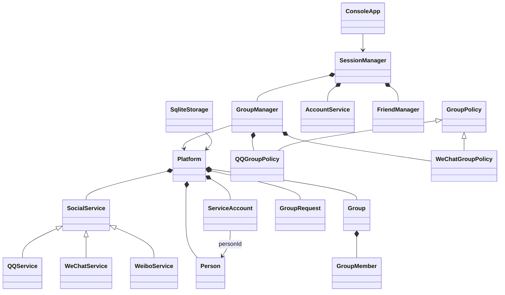

# JLU 即时通信平台项目方案

版本：v1（持续维护）。更新日期：2026 年 10 月 25 日。P0—P5 已完成本机范围实现、验收与便携发布；三服务私聊、独立持久群服务、离线补齐及后续交互已实现。实体两机未实测，按课程原文属于可选环境补验。P6 第一、第三批完成；9A 双机取舍与清理已完成，第四批报告文档已完成，独立类文件整理及第五批仍待完成。

本轮已完成 [交互改进 1—11](交互改进_1-11_说明与验收.md)：图形端业务提交后自动保存、账号表单跨页保留、创建普通群、完整成员名单、同群跳转保持连接、备注一致、推荐结果保留、后台群接收和未读/好友申请提醒。原终端保存菜单不变。2026-10-17 补齐固定保存状态、明确群操作名称、列表搜索/最近摘要和历史阅读定位（7—9、11）；两轮共用上述验收文档。

项目采用 C++17，模拟 QQ、微信、微博三个服务，已覆盖服务开通、账号关联、跨服务登录、好友与群管理。通过群管理策略体现继承、多态和组合，群成员数据与管理规则分离。当前已提供共享业务核心和 SQLite 的控制台、Qt 图形两种入口；P5 已接入图形端 QQ、微信、微博当前服务好友的 TCP 文字私聊，正常模式逐条保存 SQLite 聊天历史，支持最近 100 条、更早分页和重启恢复；内存模式不落库。

本文件是当前项目方案，不是最终课程报告。阶段状态统一见第 9 节；各阶段详细批次与证据分别见 [P1 清单](P1临时任务清单.md)、[P2 清单](P2临时任务清单.md)、[P3 清单](P3_SQLite临时任务清单.md)、[P4 清单](P4临时任务清单.md)、[P5 清单](P5临时任务清单.md)、[P6 清单](P6临时任务清单.md)及其验收文档。已完成的阶段不再列为后续开发任务。

## 1 依据与参考范围

### 1.1 课程要求

依据项目内置的 [2026-面向对象程序课程设计.doc](2026-面向对象程序课程设计.doc) 正文及所附报告说明。课程题目已指定为“模拟即时通信系统实现”，无需另选管理系统题目。

课程目标是清晰的类划分、封装、继承和多态。文件持久化符合要求；TCP 点对点通信标为选做；可视化、多人聊天、聊天记录查询及数据库编程列在课后不考核作业中。数据库不应成为核心版启动的前置门槛。

### 1.2 学长资料

已核实 [课设 README](https://github.com/lycatears/jlu/blob/main/面向对象程序设计/课设/README.md) 和 [qq_users.sql](https://github.com/lycatears/jlu/blob/main/面向对象程序设计/课设/qq_users.sql)。读取时对应 Git blob 为 `c758a9fa93882def6b6553056ecd934d2776f5b8` 和 `7d73c91561313bb12a71c428ef2479d98c0cc841`。

README 给出的落地流程是安装 MySQL、导入数据、用 Visual Studio 打开解决方案、配置数据库、先启动服务端再启动多个客户端，并在本机地址 127.0.0.1 演示聊天。作者明确提醒代码质量、可读性和编译可能存在问题，且 Client 与 Chat_test 的客户端／服务端命名相反。

本次读取到的仓库课设目录只有上述两个文件；C++ 工程由 README 指向网盘。网盘源码本次未取得，不能据此声称其继承体系、权限控制或全部课程功能已经正确实现。借鉴范围限定为已核实的说明、运行示例和表结构，不直接套用未审阅工程。

SQL 示例包含用户、好友、群、群成员、消息五张表，目标版本记录为 MySQL 8.0.34。可借鉴实体划分；本方案进一步补充多服务身份、唯一约束、外键与完整时间字段。示例中的短密码字段、拆分年月日时分秒及缺少关系约束的设计不沿用。原 SQL 含 DROP TABLE，当前不执行、不导入。

## 2 课程要求与交付对应

| 课程要求 | 本方案的具体设计 | 验收方式 |
| --- | --- | --- |
| 用户 ID、昵称、出生时间、注册年龄、所在地、好友和群列表 | 个人资料与服务账号分离；保存申请日期，显示申请时间及计算所得 注册年龄 | 查询完整资料，验证生日和申请日期 |
| QQ 与微博共享 ID，微信独立且可绑定 QQ | QQ 与微博使用同一共享号码；微信另设唯一号码及显式绑定关系 | 先开微博再开 QQ 仍共享；微信绑定冲突被拒绝 |
| 好友添加、修改、删除、查询 | 按服务维护双向关系，备注按个人分别保存 | 四项操作、重复添加、自己加自己 |
| 跨服务共同好友与推荐添加 | 通过已验证的账号映射比较同一人的不同账号 | 交集查询、推荐、过滤未开通及已添加账号 |
| 每种服务已有 1001 至 1006 等群号 | QQ、微信、微博各初始化六个示例群，使用服务与群号联合定位 | 三个服务可同时拥有 1001 群 |
| 加入、退出、被踢、查看成员 | 统一群接口，权限由当前策略决定 | 普通成员、管理员、群主分别演示 |
| QQ 申请入群、管理员、子群 | QQ 策略实现申请审批、管理员任免和临时讨论组 | 普通成员不能直接审批申请 |
| 微信仅推荐入群、仅群主特权、无子群 | 微信策略要求现有成员推荐及被邀请人确认，群主执行管理动作 | 禁止自行申请、管理员踢人和创建子群 |
| 开通 N 个服务 | 服务目录加账号开通记录；核心版展示三个，设计可增加类型 | 未开通服务不参与自动登录 |
| 一个服务登录后其他服务简单确认登录 | 平台会话加各服务登录状态；已开通服务显示可确认进入 | 确认后不再输入密码，取消后保持未登录 |
| 动态切换群特色且不伤害成员数据 | 群对象保留身份与成员，替换管理策略 | 比较切换前后成员及资料，验证权限即时变化 |
| 数字菜单、返回、I/O、注释、简单类图 | 控制台分层菜单、文件保存与恢复、文档类图 | 非法输入和重启恢复测试 |
| 自定义类独立文件及姓名缩写 | 每类独立 .h/.cpp，类名统一带本人缩写 | 实施前固定缩写，交付时核对 |
| QQ 的 TCP 收发 | 增强阶段单列任务 | 两个进程双向发送中文消息 |

课程正文对“已开通”和“已登录”用词略有交叉。本方案区分两者：登录不会替用户开通新服务；其他已开通服务进入待确认状态，简单确认后登录。这同时覆盖开通状态展示与登录管理要求。

## 3 推荐范围和技术选择

核心版：VS Code、C++17、CMake、数字控制台菜单、标准库容器和 SQLite 本地数据库。2026-09-29 用户确定使用 SQLite，替代原 JSON 快照与 MySQL 增强接入计划。P3 已使用 SQLite C/C++ 接口，SqliteStorageLJY 已封装连接、建表、保存与读取，第四批已接入启动和保存菜单；只实现这一种存储，不引入多后端工厂或 ORM。第一批已固定并接入官方 SQLite 3.53.4，创建独立验证库；主程序已在启动、主动保存和正常退出时调用存储接口。参考 [SQLite C/C++ 接口](https://www.sqlite.org/cintro.html)。

继续使用现有 MinGW-w64 与 CMake。此前已安装的 MySQL84 不属于项目依赖，不需要为运行本项目启动它，也不需要配置 MySQL 连接库、3306 端口或数据库账号。本次不修改系统服务、不卸载软件、不删除已有数据库。原安装检查只作为历史记录保留在 [MySQL 安装指南](数据库与MySQL安装指南.md)，不代表本次重新检查了服务状态。

建议使用 VS Code 完成编辑、构建和调试，配合微软 C/C++ 与 CMake Tools 扩展。VS Code 是编辑器，C/C++ 扩展不自带编译器和调试器；实际编译由 MinGW-w64 的 g++ 完成，调试使用 GDB，构建组织由 CMake 负责。本机已检查到 GDB 17.1、GCC 15.2.0、CMake 4.2.1 和 Ninja 1.13.2；C/C++ 1.34.3 与 CMake Tools 1.23.52 扩展已安装。项目将按多个源文件组织，通过 CMake 构建整个目标，不仅编译当前打开的 .cpp 文件。参考 [VS Code 官方 C++ 说明](https://code.visualstudio.com/docs/languages/cpp)。

当前工程使用 CMake、Ninja、MinGW-w64 和 C++17。local-debug 预设固定本机工具路径，程序为 build/debug/bin/jlu_im.exe。VS Code 通过 Ctrl+Shift+B 构建、F5 调试；main 创建平台、会话及正式控制台菜单。操作见 [CMake 与 VS Code 配置指南](CMake与VSCode配置指南.md)。

SQLite 接入与保存恢复已在 P3 完成，见 [P3 SQLite 临时任务清单](P3_SQLite临时任务清单.md)。采用本地数据库文件；Debug 使用项目 data/jlu_im.db，便携 Release 使用 exe 同目录 data/jlu_im.db；无需独立数据库服务。P4 独立图形界面也已完成，见 [P4 方案](P4图形界面方案.md)。现行阶段编号固定为 P5 通信、P6 最终课程交付。

TCP 增强版：Winsock2，实现本机两个 QQ 账号之间的文本私聊。先确保双向收发，再增加服务端转发、历史消息等扩展。课程文字中的“点对点”可能指两人私聊，也可能要求客户端直连；为覆盖更严格解释，先设计直接 TCP 双端演示，不将学长的服务端转发模式当成唯一满足方式。

P4 已采用 Qt 6.8.3 Widgets，实现登录、好友和群列表及操作、保存和退出，复用业务与 P3 存储；工具链已安装，原终端保留。聊天收发已在 P5 第三批接入窗口，当前支持 QQ、微信、微博的同服务好友文字私聊。暂不纳入：真实 QQ／微信接口、真实跨产品账号同步、公网部署、语音视频、文件传输。所有账号与服务都是课程模拟数据。

## 4 业务规则

### 4.1 身份与账号

Person 保存内部 person_id、出生日期和所在地；ServiceAccount 保存服务类型、对外账号、昵称、申请日期和开通状态。内部主键不直接当成 QQ 号码。QQ 与微博从共享号码字段读取对外 ID，不要求先开通 QQ 才能使用微博；微信号码来自独立命名空间。

同一平台用户可开通多个服务。微信与 QQ 绑定需验证两侧账号归属，一对一绑定，禁止将他人的账号自动认作本人。跨服务推荐仅使用共享号码或明确授权绑定产生的映射，不通过昵称猜测身份。绑定不合并两边好友列表。

注册年龄由该服务申请日期按完整周年计算；申请日期未来、生日未来等输入拒绝。基础资料修改属于本人权限，好友“修改”主要指个人备注，不能修改好友本人的资料。

P1 认证：注册时同时创建人员、一份密码凭据和首个服务，成功后仍需登录。首次登录使用“服务类型＋对外号码＋密码”；其他已开通服务等待简单确认，取消不改变当前服务及原有状态。新开服务不自动登录，统一注销清空本会话全部服务状态。菜单从会话取得操作人员，不采信手动输入的人员编号。

凭据由 PasswordCredentialLJY 封装，课设演示改用私有 string 在内存中保存测试密码，通过 == 验证；保存的是明文，不是加密；正常模式保存时写入 SQLite 凭据表。已移除 BCrypt，Windows 依赖仅来自控制台交互。微信／QQ 绑定允许两种条件：本人两个服务在当前会话均已登录，或两个账号均曾用密码成功登录。密码登录历史按平台账号保存，注销不清除，程序退出后随内存数据丢弃；失败登录与仅开通服务不计入历史，历史也不会自动恢复当前登录状态。运行中仍操作内存，密码与资料已接入 SQLite 保存恢复，密码登录历史不落库。

### 4.2 好友与推荐

2026-10-12 按用户要求改为好友审批：搜索或推荐选中目标并确认后发送申请，接收方同意后才建立双向好友关系。接收方可拒绝，拒绝后允许重新申请；GUI 在“好友申请”页签处理，终端在好友菜单第 9 项处理。添加、删除操作同时更新双方关系，备注单独保存。禁止重复好友、自我好友和跨服务直接关系。沿用 P2 的关系表示：Platform 用一条按账号编号排序的 FriendRelationLJY 表示双向关系，分别保存双方备注；菜单经 SessionManager 调用 FriendManager。备注留空清除，非空最多 120 字节且不能全空白或含控制字符。

推荐过程：读取源服务好友 → 取得已验证的跨服务身份映射 → 查找目标服务已开通账号 → 排除本人及已是好友的人 → 用户选择添加。共同好友按映射后的身份取交集；没有映射的账号标为无法关联，不算进交集。P2 第二批已实现：同服务共同好友、本人跨服务交集与推荐；源服务需已开通，目标为当前登录服务，本人及好友涉及微信的映射均需有效绑定。QQ/微博核对共享号码，微信/微博经已绑定 QQ 关联；按人员编号去重并显示未入选原因。查询时按上述映射筛选，用户选择后与搜索共用发送申请入口，接收方同意时统一写入好友关系，不重新生成整份推荐列表。GUI 另提供同城查询：当前服务内所在地文字完全相同，排除本人、好友及待处理申请；每批最多三人，尾批不足三个照常显示，取尽后循环。

### 4.3 群与权限

群包含稳定内部 ID、所属服务、可见群号、群名称、群主、成员集合、管理员标记及父群关系。QQ群主可设管理员；管理员不能踢群主或其他管理员、不能任免管理员，普通成员没有管理权限。群主也不能直接移除管理员，必须先取消目标的管理员身份；任何人都不能通过踢人移除自己。群主退出前必须转让群主；转让后原群主成为普通成员，新旧群主的管理员标记清除；不默认自动解散群。

微信群由现有成员发起邀请、被邀请人确认后入群；邀请人须在提交时及接受时都仍为群成员；退群或被踢后，其待处理邀请失效，再次入群不会恢复旧邀请。仅群主可踢人。微博的详细群规则在课程文档中未规定，v1 约定采用 QQ 风格，明确属于本方案选择。

子群仅允许 QQ 管理策略下的顶级群创建，子群成员必须是父群成员，不允许无限嵌套。父群成员离开时同步移除其子群成员资格；若涉及子群群主，先处理转让或拒绝退出并给出原因。

### 4.4 群管理模式动态切换

采用策略模式：Group 保存当前模式，GroupManager 持有 QQ 与微信两种策略并按模式返回基类引用；群成员只保存在 Group 中。第五批已实现切换入口，仅对群主开放，直接使用现有两种策略。

示例：QQ 1001 群有群主 A、管理员 B、普通成员 C。改成微信管理模式后，A/B/C 的身份和成员资料保持原样，B 的管理员标记保留但权限暂不生效；重新切回 QQ 后恢复其原有管理员权限。

按用户 2026-10-12 最新要求，主群切换为微信模式时保留已有直属子群、成员及全部申请邀请；子群继续使用自身模式，仍可查询、操作和处理请求。主群成员、所属服务、管理员标记和请求不变；微信模式下主群管理员权限暂停且不能新建子群，切回 QQ 后恢复。父子成员一致性规则仍生效。实现仅校验权限和目标模式后修改本群 style，不删除子群；SQLite 读取允许微信模式父群持有既有子群，不改变表结构。UI 与终端提示同步说明保留规则。详见 [P4 验收](P4已完成工作与验收.md)第 8 节。

此处切换的是管理规则，不把 QQ 账号转换成微信账号，也不迁移群所属服务。因此不会与另一个服务的 1001 群冲突。演示必须明确说明这一点。

## 5 面向对象结构

根据本人姓名 Li Jiaye，按 Li、Jia、Ye 的首字母取缩写 LJY，作为自定义类名的统一后缀，符合课程要求的本人姓名缩写命名方式。下列名称省略后缀以便阅读；正式类名均追加 LJY，例如 PersonLJY、GroupLJY、QQGroupPolicyLJY，文件对应 PersonLJY.h 与 PersonLJY.cpp。

| 类或类族 | 主要职责 |
| --- | --- |
| Person、ServiceAccount、FriendRelation、GroupMember | 封装人员、服务账号、个人备注和群内身份 |
| Platform | 组织人员、服务和群容器，提供查询入口；不承担菜单和 SQL |
| SocialService → QQService、WeChatService、WeiboService | 统一服务接口，派生类提供 ID 类型、名称和默认群策略 |
| AccountService | 账号开通、共享 ID、微信绑定和资料校验 |
| SessionManager | 首次身份验证、当前平台会话、各服务确认状态及统一注销 |
| PasswordCredential | 校验密码格式，内存中保存并比较课堂测试密码 |
| FriendManager | 好友申请审批、删除与备注、共同好友、跨服务和同城推荐 |
| FriendRequest | 保存发送方、接收方和处理状态，每对账号保留最近一次申请 |
| Group、GroupManager | 保存群数据、维护群容器、协调成员操作和模式切换 |
| GroupRequest | 保存申请或邀请及处理状态，由平台容器持有、群业务处理 |
| GroupPolicy → QQGroupPolicy、WeChatGroupPolicy | 判断加群、踢人、管理员和子群权限，运行时多态 |
| SqliteStorage | P3 新增，封装 SQLite 加载和保存，不向业务层暴露 SQL |
| ConsoleApp | 输入校验、数字菜单、结果展示 |
| TcpPeer、ChatProtocol | P5 已实现，封装 Socket 资源、后台收发、协议与握手 |
| ChatIdentity、ChatMessage | 当前服务及账号快照、消息内容与接收状态 |
| ChatHistory | 三服务独立历史、旧 QQ 迁移、逐条保存及分页 |
| MessagesPage、ChatBubble | 共用图形私聊页、头像与尖角气泡 |
| GroupChatProtocol、GroupChatHost、GroupChatClient | 群分帧、多成员转发、自动开房加入和主持端恢复 |
| GroupChatMessage、GroupChatHistory、GroupMessagesPage | 群消息、客户端 SQLite 缓存和图形群聊页 |
| GroupRoomStore、独立群服务入口 | 服务端持久消息、分批补齐、重启恢复；本机自动启动 |

类图为方案示意，所有展示的类同样适用姓名后缀规则。

设计原则：数据成员私有；通过方法保持不变量；抽象基类提供虚析构；群业务直接持有两种策略，通过基类引用选择；实体关系优先保存稳定 ID，避免悬空指针。好友、群、存储三类职责分开，菜单不直接改容器。每个自定义类独立头文件／实现文件，抽象接口可只有头文件。

代码注释规范（后续开发持续遵守）：注释统一使用简体中文，简洁明了。优先在头文件的类、函数声明或重要成员定义处说明职责、用途及必要的参数、返回值和约束。实现文件已有清楚说明时避免重复；仅在关键实现逻辑或没有头文件的函数定义处补充必要注释。不逐行翻译代码；新增或修改代码时同步维护注释，确保与实际行为一致。函数说明使用普通 `//` 并紧贴对应声明；多个函数分别说明，不使用 `@brief`、`@param` 等标签。为便于悬浮阅读，可将实现处的接口说明移至头文件，关键实现逻辑仍在原处注释。

## 6 数据保存与数据库设计

### 6.1 SQLite 保存与恢复

SQLite 是当前唯一的持久化方案，替代 JSON 快照。SqliteStorageLJY 负责连接、建表、读取和保存；业务层仍负责账号、好友及群规则，菜单不直接执行 SQL。首先采用易解释的“启动加载、明确保存、正常退出保存”流程；一次保存使用数据库事务，失败则回滚并提示，不显示保存成功。析构仅负责释放连接，不依赖析构完成重要保存。

启动时读取已有数据，完成引用与编号检查后再交给业务使用；不得把已有库当成空库重新初始化。演示初始化仅用于明确的新库或独立测试环境，--empty 与 --demo 均为内存隔离模式，测试不得覆盖用户数据。无参数时，Debug 使用 CMake 固定的项目 data/jlu_im.db，便携 Release 使用实际 exe 同目录 data/jlu_im.db；--database 可指定其他位置；新库首次初始化演示数据，已有库只读取，不按人员数量判断新库。

先实现正常保存、重启恢复与保存失败不损坏原数据，再按实际需要增加保存时机，不引入自动迁移、多后端切换或复杂备份系统。第一批已核对原 doc：要求文件 I/O，但未限定手写文件格式。沿用 SQLite 文件；正式报告说明启动读取、显式正常退出保存与原文析构写回示例的时机差异，P3 已完成保存和读取接口，并接入启动读取、主动保存和退出保存。

### 6.2 SQLite 逻辑表

第一批已生成 [建表脚本](../schema/create_tables.sql)，并在独立验证库成功执行；完整字段与读写顺序见 [数据库表设计](P3数据库表设计.md)。平台事务读写、启动读取和菜单已整合；见 [第四批说明与验收](P3第四批说明与验收.md)。

| 表 | 内容与关键约束 |
| --- | --- |
| persons | person_id 主键、姓名、生日、所在地、头像预设色 avatar_color；共享号码保存在服务账号中 |
| service_accounts | account_id 主键、person_id 外键、服务、外部 ID、昵称、申请日期；同人同服务唯一，服务加外部 ID 唯一 |
| credentials | 人员编号主键兼外键、课堂演示密码字符串；每人一份 |
| account_bindings | 微信账号和 QQ 账号外键，两侧分别唯一，保存绑定关系 |
| friendships | 两个按序排列的账号 ID 作为唯一好友对，保存双方各自备注，限制同服务、不同账号 |
| friend_requests | 有序账号对主键、发送方、接收方、待处理 / 同意 / 拒绝状态，引用双方账号 |
| chat_groups | 内部 group_id、所属服务、展示群号、群主、当前策略、父群；服务加展示群号唯一 |
| group_members | 群与账号联合主键、管理员标记、成员展示顺序；群主属于群由业务维护 |
| group_requests | 加群申请或邀请、发起人、目标账号、所属群和处理状态 |
| id_state | 单行保存六个最后已分配编号，删除最高编号后也不回退 |

唯一性和引用关系尽量由主键、唯一约束及外键保证；跨表服务一致性、群主必须是成员、绑定号码一致性由业务层在同一事务内校验。不能声称单个外键就能保证所有业务规则。

编号使用 INTEGER，字符串使用 TEXT；生日和申请日期沿用 YYYY-MM-DD 文本表示，不照搬 MySQL 的字符集与 DATE/DATETIME 定义。打开连接后显式启用外键检查（PRAGMA foreign_keys = ON）。SQL 使用预处理语句绑定参数，数据库连接与语句使用后及时释放。参考 [SQLite 数据类型](https://www.sqlite.org/datatype3.html)、[外键说明](https://www.sqlite.org/foreignkeys.html)。

表结构尽量对应现有类，双方备注仍放在一条好友关系中；凭据与发号状态已在第一批表结构中明确。凭据仅服务于虚构课堂账号，沿用现有简化范围，不趁持久化阶段扩展密码系统。运行中的登录会话不因读取数据库而自动恢复。P3 已完成 SQL、存储类、事务读写及程序整合，并在隔离库通过完整重启、关系恢复、当时子群释放规则与失败回滚总体验收；子群规则于 2026-10-12 改为保留并补验；见 [阶段报告](P3第五批与阶段总体验收.md)。P5 第四批已按需新增独立 chat_messages 表，由 ChatHistoryLJY 逐条读写，不参与原业务表整体保存，见 [第四批说明](P5第四批说明与验收.md)。

## 7 菜单与演示

当前主菜单：1 登录，2 注册并开通首项服务，3 使用说明，4 保存数据，0 保存并退出（内存模式无保存入口）。登录后：1 查看个人资料，2 查看服务及绑定，3 开通其他服务，4 切换服务，5 修改个人资料，6 修改当前服务的用户昵称，7 绑定微信与 QQ，8 好友管理，9 群管理，10 保存数据（正常模式），0 统一注销。输入步骤支持 0 返回，非法数字重新提示。好友子菜单已包含列表、资料查询、添加、修改本人备注、删除，以及 6 同服务共同好友、7 跨服务共同好友、8 跨服务推荐、9 好友申请；搜索和推荐均发送申请，对方同意才成为好友。群菜单先显示我的群列表并选择有效群号，再进行查询、申请/邀请及处理、退出、踢人、管理员任免和群主转让。输入时立即检查群号、权限及目标；移除成员或任免管理员前显示成员列表，修改前均需确认。1 切换群聊、0 返回主菜单；退群成功后重新选群。申请与邀请按当前群筛选，不能处理其他群的请求。已新增 11 创建子群、12 查看子群、13 切换群管理模式。P3 第四批已接入保存；退出保存失败可重试、返回菜单或明确放弃，注销仅清理会话。

第三批已预置六名模拟用户 A—F、12 个账号及三个服务各六个群。A/D 开通三服务，B 开通 QQ 和微信，C 仅 QQ，E 开通 QQ 和微博，F 仅微信。新库首次或 --demo 模式初始化并显示测试账号；已有库恢复原数据，--empty 保留空平台内存启动，测试不改变原发号规则。所有群主和成员已开通相应服务。

建议答辩顺序：查看 A 的资料与共享号码 → 登录 QQ 并确认进入微信 → 查看共同好友并将 B 从 QQ 推荐到微信，发送申请后换 B 登录同意 → 展示 QQ 入群申请、管理员和子群 → 切换同一群为微信管理模式 → 验证主群成员未变、管理员权限暂停且已有子群保留 → 切回恢复主群管理员权限 → 保存重启核对。TCP 按批准且已完成的范围另行展示；数据库统一使用 SQLite。

## 8 验收清单

| 场景 | 应有结果 |
| --- | --- |
| QQ 与微博开通顺序相反 | 同一个人仍共享同一号码 |
| 他人微信账号尝试绑定本人的 QQ | 拒绝，不改变现有映射 |
| 另一服务未开通或取消登录确认 | 不出现误开通或误登录 |
| 好友申请与重启 | 发送时尚非好友，接收方同意后才建立关系，状态保存重启可恢复 |
| 删除好友并重启 | 双方关系消失，其他好友不受影响 |
| 推荐对象未开目标服务、未绑定或已是好友 | 不被误添加，给出可解释结果 |
| 普通成员踢人，管理员踢群主 | 拒绝 |
| 群主直接退出 | 要求先转让，群不成为无主群 |
| 微信主动申请、设管理员、建子群 | 拒绝相应操作 |
| QQ 改微信再改 QQ | 成员 ID 与资料保持一致；权限暂停并恢复 |
| 带子群切换，父群成员退出 | 主群切微信时保留子群及请求，子群自身模式不变；父子成员一致性持续生效 |
| 文件损坏、保存失败 | 不覆盖有效数据；明确提示失败与恢复办法 |
| SQLite 保存中断 | 整体回滚，不出现半条好友或不完整成员关系 |
| P5：TCP 断开、半包、连续多包、中文 | 三服务双进程收发、ACK、重连和重启通过；服务隔离、关闭重试/取消/放弃、原功能回归及 Release 部署通过；实体两机不纳入当前范围 |

测试聚焦规则和数据一致性，不追求堆砌数量。核心版先做业务测试与人工菜单演示；增强版新增实际数据库和双进程验证，不能只用模拟接口宣称通过。

## 9 实施阶段与当前进度

当前顺序：**P0 项目准备 → P1 账号与会话 → P2 好友与群 → P3 SQLite → P4 图形界面 → P5 通信 → P6 最终课程交付**。P0—P5 已完成当前本机范围的实现、验收及发布；P5 的实体两机局域网互通尚未实测。P6 第一、第三批已完成；9A 已收束为本机通信，第二批不纳入当前交付，下一步整理报告与交付；见 [P6 清单](P6临时任务清单.md)。

| 阶段 | 当前状态 | 阶段内容与交付 | 完成依据或后续验收目标 |
| --- | --- | --- | --- |
| P0 项目准备 | 已完成 | 本地方案、目录命名、数据库说明、CMake 与 VS Code 初步配置 | 编译运行及 GDB 断点验证通过 |
| P1 账号与会话 | 已完成，顺序 1—7 | 人员与服务账号、注册登录、服务开通与切换、QQ/微信绑定、控制台菜单 | 阶段验收通过；见 [P1 验收](P1第7步验收报告.md) |
| P2 好友与群管理 | 已完成，六批、顺序 1—10 | 好友与推荐、群成员权限、申请邀请、一级子群与模式切换 | 总体验收通过；见 [P2 验收](P2第10步验收报告.md)。主群切换保留子群的最新规则已补验 |
| P3 SQLite 持久化 | 已完成，五批、顺序 1—10 | SQLite 接入、表结构、事务保存与读取、启动和菜单整合 | 重启恢复、编号延续及失败回滚通过；见 [P3 验收](P3第五批与阶段总体验收.md) |
| P4 Qt 图形界面与本阶段部署 | 已完成，六批、顺序 1—18；追加外观调整已完成 | 账号、好友、群和保存窗口；保留终端；双入口往返、综合回归、Release 便携包及运行说明 | 第六批 GUI 构建 25 项、原终端 13 项 CTest 通过；最新卡片材质调整另通过 8 项相关 GUI 用例；见 [P4 验收](P4已完成工作与验收.md)第 13、14 节 |
| P5 TCP 消息通信 | 原六批、群聊扩展四批及离线同步修复已完成本机验收与发布 | 三服务私聊、群聊、独立持久群服务、离线补齐、分页与便携包 | 本轮群聊 9 项、共享界面 3 项通过，发布服务重启及 GUI 启动核对通过；实体两机未实测且已不纳入当前范围，详见 [离线同步验收](P5群离线同步方案与验收.md) |
| P6 最终课程交付 | 第一、第三批及 9A 完成；第二批不执行；第四批文档完成，独立类文件差异待处理；第五批待进行 | 核对课程要求、整理最终报告和类图、汇总实际测试、完善完整项目运行与答辩材料 | 用户能够自行编译、演示并解释关键设计；报告只记录实际完成内容 |

P5 Release 已替换当前发布目录，P4 原 zip 保留作历史版本。P6 负责最终课程报告和完整项目交付，不能因 P5 已打包就标为完成。后续报告及实体两机补验按用户安排推进。

### 9.1 P4 六批完成情况

| 批次 | 顺序 | 内容 | 状态 |
| --- | --- | --- | --- |
| 第一批 | 1—3 | Qt 工具链、登录注册、账号与服务入口 | 已完成 |
| 第二批 | 4—6 | 好友列表、资料备注、共同好友及推荐、恢复验证 | 已完成 |
| 第三批 | 7—9 | 统一外观、行内编辑、固定反馈及小窗口适配 | 已完成 |
| 第四批 | 10—12 | 群选择、资料、申请邀请与成员权限操作 | 已完成 |
| 第五批 | 13—15 | 子群、模式切换及保存关闭联动 | 已完成 |
| 第六批 | 16—18 | 双入口往返、综合回归、Release 部署与运行说明 | 已完成 |

好友审批、同城推荐、头像六色选择、四项侧栏、微软雅黑、内置确认卡片、错误条震动和卡片柔影材质均已作为 P4 追加修改落实。详细任务只在 [P4 临时任务清单](P4临时任务清单.md)维护，方案不另起一套编号。

### 9.2 当前工程与运行位置

| 目录或入口 | 当前用途 |
| --- | --- |
| src/domain、src/services | 数据实体和业务规则，供两种入口共用 |
| src/ui、src/main.cpp | 原控制台菜单和终端入口 |
| src/storage | SQLite 建表、事务读写及默认库路径 |
| src/gui | Qt 页面、样式、资源及独立图形入口 |
| src/network | 私聊 Winsock 后台收发；群聊 Qt 异步 Socket、本机独立持久服务与多连接转发 |
| build/debug/bin/p5_chat_demo.exe | 第二批连续消息演示，内存 QQ 账号核对、三条双向消息与 ACK |
| build/debug/bin/p5_socket_demo.exe | 第一批独立网络演示，各端发送一段短文字后退出，不访问数据库 |
| tests、docs | 分阶段验证与项目说明 |
| build/debug/bin/jlu_im.exe | 原 MinGW 15.2 的终端 Debug，使用项目数据库 |
| build/gui-debug/bin/jlu_im_gui.exe | Qt 6.8.3 / MinGW 13.1 的图形 Debug，使用项目数据库 |
| build/gui-release/bin/jlu_im_gui.exe | 图形 Release 构建产物，使用自身目录的 data |
| dist/JLU_InstantMessaging | 已部署的便携目录，两个 Release 入口统一使用 MinGW 13.1；默认共用目录内 data/jlu_im.db |
| dist/JLU_InstantMessaging_P5_Windows_x64.zip | 当前私聊及群聊便携包，不含用户数据库；P4 zip 为历史版本 |

src/network 已完成前两批链路、分帧和后台收发；主线程通过 ChatIdentity 会话适配提供验证后的号码，网络线程不访问业务或 GUI。MessagesPageLJY 通过 50 毫秒 QTimer 在主线程取事件并刷新气泡。两种入口按“保存并关闭一个，再打开另一个”使用同一库；SQLite 持久化不等于进程间实时通信。开发版与发布版默认数据库位置不同，现行路径、备份与运行方式见 [P5 使用说明](P5使用与代码说明.md)。

## 10 当前结论与后续审核重点

P0—P4 已完成，不再保留“等待 SQLite 接入”“第六批待部署”等旧安排。P4 第六批已经通过实际 GUI → 终端 → GUI 往返，以及中文移动目录、清除开发 PATH 后的启动验证。历史 p1_binding_history 拒绝启动缺项在两套工具链的第六批回归中均已通过；此前失败记录保留在验收文档，不作为当前未完成项。最新柔影卡片调整完成了受影响的 8 项 GUI 回归，并同步 Debug、Release 和发布包，没有为纯外观修改重复全量业务测试。

P4 当前采用 Qt Widgets；所检查固定版本的 ElaWidgetTools 配置不兼容 Qt 6.8.3，已结束选型。账号、好友、群管理和登录卡片使用乳白渐变、细边框、顶部高光及柔影模拟磨砂观感；文字保持清晰。侧栏为“消息、群管理、好友列表、我的账号”，其中消息页已在 P5 接入 QQ、微信、微博三服务的同服务好友私聊、好友入口、可折叠连接设置和消息气泡；第四批已接入持久化聊天历史和加载更早消息。2026-10-13 已追加侧栏身份卡的偏白玻璃渐变与柔影，以及聊天气泡旁的发送人首字头像，复用各端本地昵称与预设颜色；第四批新增指向头像的气泡尖角。

后续重点：

1. **P5 已完成与环境补验**：[详细清单](P5临时任务清单.md)六批已完成。当前便携包为 dist/JLU_InstantMessaging_P5_Windows_x64.zip；运行及三服务演示账号见 [P5 使用说明](P5使用与代码说明.md)。本机双端、SQLite 历史与 Release 已验收；历史私聊验收曾遇 WLAN 绑定拒绝（10049）；旧版本曾验证本机组播发现；9A已移除该机制与双机入口，当前以本机独立群服务为准。实体两机未实测，不纳入当前交付。
2. **P6 最终报告（文档已完成）**：已按学校模板生成 [五页Word报告](P6课程设计报告_李佳烨_面向对象修订版.docx)（含封面），包含设计任务分析、设计方案、详细设计和总结与体会。封面按本人资料填写，座位号留空；类图、实际截图、正文事实与分页已检查，见 [第四批说明与验收](P6第四批报告说明与验收.md)。独立类文件差异仍待整理，第五批演示、答辩与最终打包尚未执行；不代为提交学习通。
3. **持续规范**：类名后缀固定 LJY；简体中文关键注释优先放头文件，保留普通 //；测试聚焦受影响流程和实际风险。终端 Ctrl+C 保护、保存行为及用户数据库继续保留。

当前未提供截止日期，不编造工期承诺。P4 的详细现状统一查阅 [图形界面方案](P4图形界面方案.md)、[任务清单](P4临时任务清单.md)、[使用与代码说明](P4使用与代码说明.md)和 [已完成工作与验收](P4已完成工作与验收.md)。阶段范围或用户安排改变时，再同步本方案。

2026-10-14 界面追加调整已完成：长消息 6 行预览/展开、侧栏顺序调整、好友操作按钮紧凑化、消息好友行头像与资料跳转。见 [本次说明与验收](P5界面交互调整_2026-10-14.md)。

P5 私聊连接交互：本机演示 / 两台电脑，统一开始聊天入口，自动分配等待方与主动方，首次连通前有限重试；连接设置使用独立 INI，聊天历史继续使用 SQLite。Enter 发送，Shift+Enter / Ctrl+Enter 换行。详见 [自动连接与快捷键说明](P5使用与代码说明.md)。

P5 群聊扩展已完成四批：消息页增加群聊页签，选群即自动加入，默认使用独立持久群服务，客户端关闭不再等于房间关闭；离线后重连补齐，登录期间后台接收本人各群。9A 已删除局域网发现，仅内存练习保留本机临时开房。Qt Network 事件循环负责群通信，原私聊 Winsock 后台线程保持不变。新增 group_chat_messages 表，按服务、本人账号和群号隔离已确认记录，不参与原平台整体保存。群服务广播完整成员名单；同机成员变更按差异合并共用名单，群服务仅监听本机回环地址，不同步完整业务数据库。详细设计与批次见 [群聊方案](P5群聊扩展方案与任务清单.md)，调用原理、实际验收范围及阅读顺序见 [群聊说明](P5群聊实现说明与验收.md)。

2026-10-14 全部图形页面统一美化：浅绿/乳白层次、微软雅黑、同组按钮等宽等高、清晰的侧栏与页签分级、聊天设置及登录窄窗适配。本轮只调整 UI，采用 P5 发布入口，不新增阶段。修改前保留源码及便携版快照，见 [UI 美化与验收](UI统一美化与验收_2026-10-14.md)。

2026-10-15：P5 群聊补齐独立持久服务、本机自动启动及离线历史同步；当前规则、验收和限制见 [群离线同步方案与验收](P5群离线同步方案与验收.md)。临时房间仅用于原自动发现演示；此处为当日记录，P6 当前进度以第 9 节为准。

2026-10-20：私聊浏览对象与连接对象分离，换好友浏览保留原连接，点击新好友开始聊天才替换。好友/群聊改为红色未读角标；聊天区浅色横条定位第一条未读，支持自动补读更早历史。数据库位置和既有记录不变。详见 [交互改进说明](交互改进_1-11_说明与验收.md)末节。

2026-10-21：完成 P6 第一批文档收尾，统一现行连接规则、自动保存、群服务与数据库位置；未修改代码或数据。后续五批顺序及状态统一见 [P6 临时任务清单](P6临时任务清单.md)，本次结果见 [第一批整理说明](P6第一批收尾整理说明.md)。

2026-10-21 第三批核对：课程原文将 QQ TCP 收发列为选做，没有实体双机要求；图形界面及多人聊天属于课后扩展，保留终端业务展示。当前类图和阅读路线见 [P6 实际架构](P6实际架构与代码阅读.md)，要求逐项对照及独立文件差异见 [第三批说明](P6第三批课程核对与说明.md)。主要业务类已独立；辅助类和结构体尚有 14 处未独立同名文件，报告前应整理，不写成全部严格满足。新增 9A 负责双机功能取舍及不必要文档、入口、端口相关实现清理；本轮未执行删除。

2026-10-21 9A 已完成：删除双机/IP、远端群服务入口、UDP 45045/组播及 --lan 参数；本机真实 Socket、独立群服务与离线补齐保留。18 项相关验收通过，后续以 [9A 说明](P6_9A本机通信清理与验收.md) 和现行使用指南为准，历史双机步骤不再适用。

2026-10-25：P6第四批报告文档完成，使用doc-coauthoring及word-academic-docx-cn；Word共5页，封面已填写，座位号留空。顺序11、12完成，顺序10保留独立类文件整理待办。

2026-10-25报告修订：改用核心业务对象关系图和群策略类图，围绕实体关联、封装、组合、抽象接口与运行时多态展开；UI、SQLite和通信仅作为扩展边界说明。原Word因被占用保留，新版使用“面向对象修订版”文件名。
